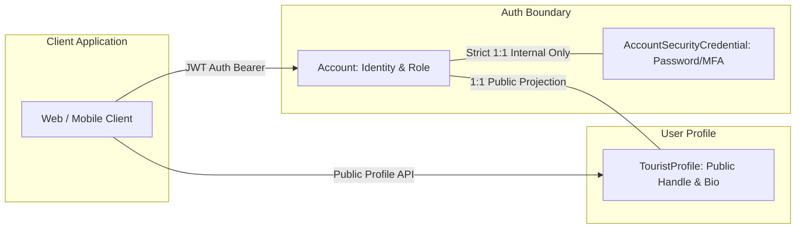
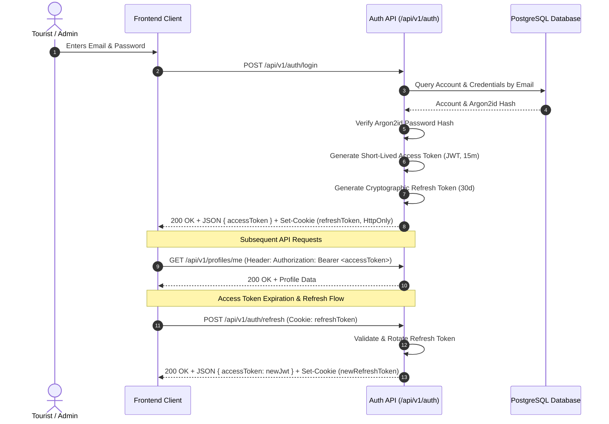
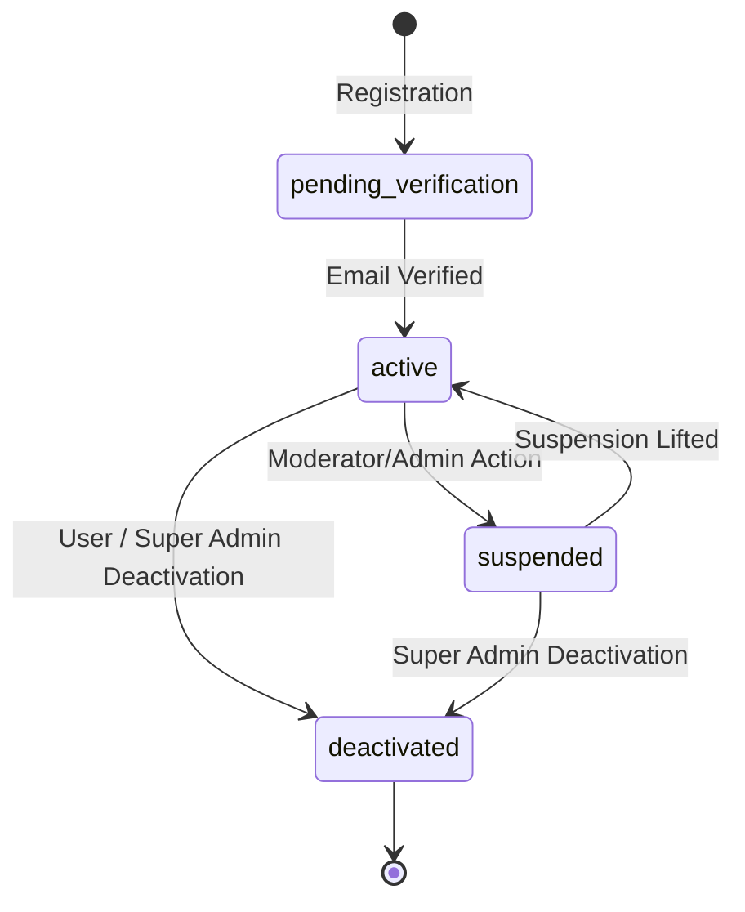
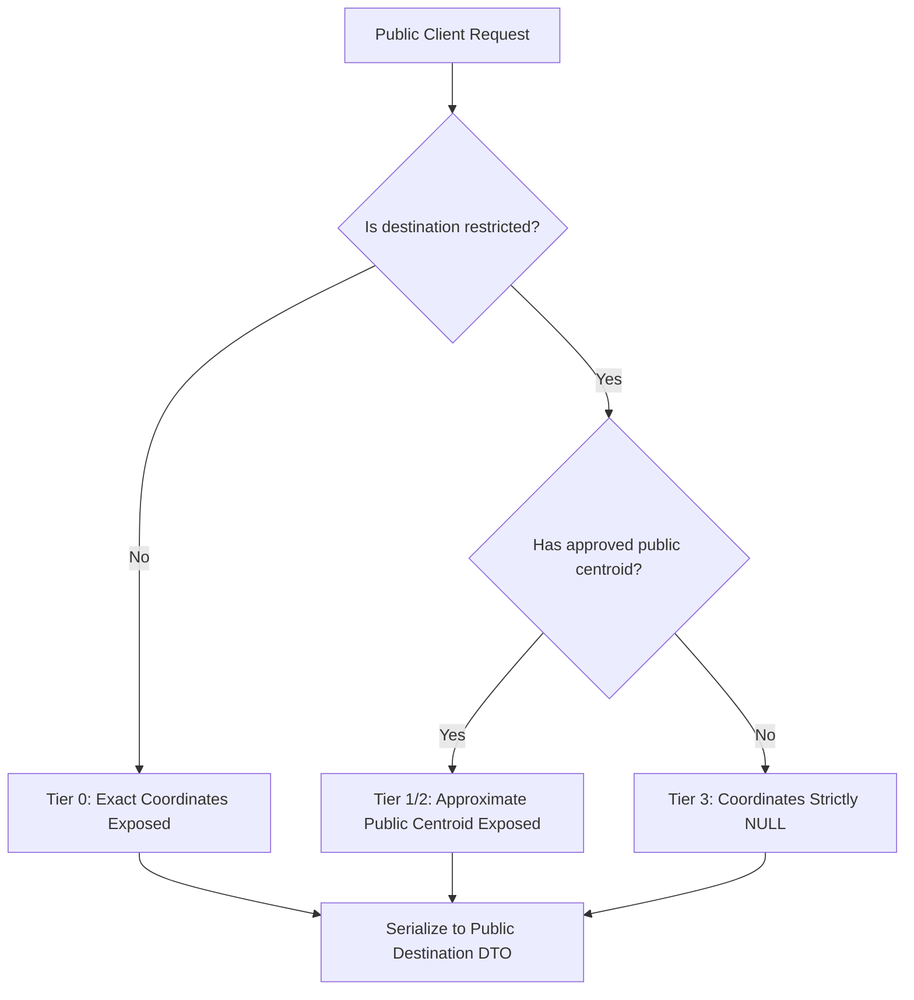

# API Architecture & Standards Specification

## 1. Executive Summary & Architectural Scope

This specification establishes the architectural foundation, design principles, and technical standards for the **My Travelroad** REST API (Stage A). **My Travelroad** is a tourism discovery and verified information platform for Kerala, scaling from Malappuram to regional and statewide destinations.

The API layer is built on the approved domain models ([`domain-model.md`](./domain-model.md)) and PostgreSQL 16 + PostGIS 3.4 database architecture ([`database-architecture.md`](./database-architecture.md)). It exposes resource-oriented HTTP interfaces designed for high-concurrency read traffic, strict coordinate privacy, granular fact-level verification auditing, and decoupled user identities.

> [!IMPORTANT]
> **Stage A Architectural Boundary**: The API scope defined herein is strictly constrained to Stage A entities:
> 1. Identity & Credentials (`accounts`, `account_security_credentials`)
> 2. Tourist Profiles (`tourist_profiles`)
> 3. Taxonomy & Categories (`destination_categories`, `destination_secondary_categories`)
> 4. Destinations & Geography (`destinations`, `destination_locations`, `destination_media`, `destination_opening_hours`)
> 5. Governance & Fact Verification (`destination_verifications`, `verification_evidence`, `verification_records`)
> 6. Traveler Bookmarks (`saved_destinations`)
> 7. Immutability & Audit Trails (`audit_logs`, `audit_log_telemetry`)
>
> Community social feeds, reviews, ratings, and commercial bookings belong to future project stages (Stage B & C) and are explicitly excluded from Stage A endpoints.

---

## 2. Core Architectural Principles

### 2.1 Protocol and Base Path
- **Protocol**: HTTPS only (TLS 1.3 preferred, TLS 1.2 minimum). Plain HTTP requests are redirected with `301 Moved Permanently` or rejected with HSTS.
- **Base URI Path**: `/api/v1`
- **Data Interchange Format**: JSON (`Content-Type: application/json; charset=utf-8`) for all request and response payloads.
- **Statelessness**: Every request must carry all the authentication context and parameters necessary to execute. The server maintains no in-memory session affinity.

### 2.2 Resource-Oriented URI Conventions
- **Plural Nouns**: Resources are identified using lowercase, kebab-case plural nouns (e.g., `/destinations`, `/destination-categories`, `/saved-destinations`).
- **Resource Hierarchy**: Sub-resources express natural ownership (e.g., `/destinations/{slug}/media`, `/categories/{slug}/destinations`).
- **Identifier Independence**: Public-facing destination and category endpoints favor human-readable, SEO-friendly `slug` identifiers over internal UUIDs. Administrative and relational mutations use canonical UUID strings.
- **Action Verbs Reserved for RPC-style Transitions**: State machine transitions that do not naturally map to CRUD nouns are expressed as sub-resource action verbs (e.g., `POST /destinations/{id}/publish`, `POST /destinations/{id}/archive`, `POST /verification/{id}/assign`).

### 2.3 HTTP Method Semantics
| Method | Usage | Idempotent | Safe | Typical Success Status |
| :--- | :--- | :--- | :--- | :--- |
| `GET` | Retrieve resource representation or filtered collection | Yes | Yes | `200 OK` |
| `POST` | Create a new resource or trigger an operational state transition | No | No | `201 Created` or `200 OK` |
| `PUT` | Complete resource replacement or upsert | Yes | No | `200 OK` |
| `PATCH` | Partial resource update (only supplied fields mutated) | No | No | `200 OK` |
| `DELETE` | Remove a resource or disassociate a relationship | Yes | No | `204 No Content` or `200 OK` |

### 2.4 Standardized JSON Response Envelope
Every API response adheres to a predictable two-channel envelope to eliminate ambiguity for frontend clients and SDK consumers.

#### Successful Response Format
```json
{
  "success": true,
  "data": { ... },
  "meta": {
    "pagination": {
      "page": 1,
      "limit": 20,
      "totalItems": 142,
      "totalPages": 8,
      "hasNextPage": true,
      "hasPrevPage": false
    },
    "timestamp": "2026-11-15T15:00:00.000Z"
  }
}
```
*Note: The `meta` block is optional and primarily populated for paginated collections or diagnostic telemetry.*

#### Error Response Format
```json
{
  "success": false,
  "error": {
    "code": "VALIDATION_FAILED",
    "message": "The request body failed schema validation.",
    "details": [
      {
        "field": "coordinates.longitude",
        "issue": "Longitude must be a finite number between -180.0 and 180.0."
      }
    ],
    "requestId": "req_01JB89Z8H1K4V9Z0P9R8E7W6T2",
    "timestamp": "2026-11-15T15:00:00.000Z"
  }
}
```

---

## 3. Centralized Error Handling & Taxonomy

### 3.1 Standard Error Structure
The `error` object inside a failed envelope guarantees four standard properties:
1. `code`: A machine-readable, stable uppercase string identifying the error category.
2. `message`: A user-safe, concise explanation of the failure.
3. `details`: An optional array of field-level or diagnostic failure objects.
4. `requestId`: A unique tracing identifier (ULID or UUIDv4) generated at the edge gateway to trace errors across logs without exposing internal implementation details.

### 3.2 Error Code Catalog & HTTP Status Mapping
| Error Code | HTTP Status | Description / Trigger Scenario |
| :--- | :--- | :--- |
| `BAD_REQUEST` | `400` | Malformed JSON syntax, invalid query parameters, or missing mandatory headers. |
| `AUTHENTICATION_REQUIRED` | `401` | Missing, expired, or malformed Bearer access token. |
| `INVALID_CREDENTIALS` | `401` | Incorrect email/password combination or failed token signature. |
| `TOKEN_EXPIRED` | `401` | The access token has expired and must be refreshed. |
| `TOKEN_INVALID` | `401` | The token signature is forged, invalid, or revoked. |
| `FORBIDDEN_ACCESS` | `403` | Caller lacks the necessary role or permission for the requested action. |
| `EMAIL_VERIFICATION_REQUIRED` | `403` | Account status is `pending_verification`; mutations are blocked until email is confirmed. |
| `ACCOUNT_SUSPENDED` | `403` | Account has been suspended by governance moderators/administrators. |
| `ACCOUNT_DEACTIVATED` | `403` | Account has been deactivated and cannot authenticate or refresh tokens. |
| `RESOURCE_NOT_FOUND` | `404` | The requested entity ID, slug, or route does not exist. |
| `DUPLICATE_RESOURCE` | `409` | Uniqueness violation (e.g., email, handle, category slug, or destination save). |
| `ACCOUNT_LOCKED` | `423` | Account temporarily locked due to excessive failed login attempts. |
| `VALIDATION_FAILED` | `422` | Zod schema validation failed on one or more payload fields. |
| `COORDINATE_PRIVACY_RESTRICTED` | `403` | Caller attempted to query raw coordinates of an ecologically restricted destination. |
| `RATE_LIMIT_EXCEEDED` | `429` | Request volume exceeded the allocated rate limit tier. |
| `INTERNAL_SERVER_ERROR` | `500` | Unhandled server exception. Details are redacted from client response. |

### 3.3 Security Redaction & Information Sanitization
- **No Database Traces**: Raw SQL queries, PostgreSQL constraint names (`uq_accounts_email`, `ck_locations_coord_range`), and stack traces are **never** returned to the client.
- **Log Correlation**: Full error details, stack traces, and database error codes are captured strictly in server-side structured application logs labeled with the `requestId`.
- **Timing Attack Mitigation**: Credential verification always executes constant-time comparisons or dummy password hashing to prevent user enumeration via timing discrepancies.

---

## 4. Pagination, Filtering, and Sorting Conventions

### 4.1 Pagination Parameters
All collection endpoints support standardized 1-indexed query parameters:
- `page`: Positive integer indicating the requested page number (default: `1`, minimum: `1`).
- `limit`: Positive integer indicating items per page (default: `20`, maximum: `100`).

The response includes the canonical `DomainPaginationMeta` metadata object:
```typescript
interface DomainPaginationMeta {
  page: number;
  limit: number;
  totalItems: number;
  totalPages: number;
  hasNextPage: boolean;
  hasPrevPage: boolean;
}
```

### 4.2 Sorting Syntax
Sorting is expressed via the `sort` query parameter using `field:direction` notation. Multiple sorting keys are comma-separated:
- `?sort=createdAt:desc` (Newest first)
- `?sort=featuredRank:asc,title:asc` (Featured rank ascending, then alphabetical title)
- Defaults: If unspecified, collections default to `createdAt:desc` (or `displayOrder:asc` for categories and media).

### 4.3 Filtering Conventions
- **Exact Match**: `?district=Malappuram`
- **Multi-Value (OR)**: Comma-separated list: `?status=published,in_review`
- **Boolean Flags**: Explicit boolean strings: `?isCover=true`
- **Text Search**: `?search=teak+reserve` (Performs title and description trigram/full-text search)

### 4.4 Geospatial Query Conventions
To leverage the underlying PostGIS spatial engine, geographic discovery endpoints support two standardized query modes:

#### 1. Proximity / Radial Search (`near` + `radiusKm`)
- Parameters:
  - `near`: `longitude,latitude` (WGS 84 coordinate pair, strictly longitude first)
  - `radiusKm`: Search radius in kilometers (default: `15`, maximum: `100`)
- Example: `GET /api/v1/destinations/search?near=76.22,11.28&radiusKm=25`
- Database Mapping: Uses PostGIS `ST_DWithin(coordinates, ST_MakePoint(lon, lat)::geography, radiusMeters)`.

#### 2. Bounding Box Search (`bbox`)
- Parameters:
  - `bbox`: `minLon,minLat,maxLon,maxLat` (Southwest corner to Northeast corner)
- Example: `GET /api/v1/destinations/search?bbox=75.8,10.8,76.5,11.5`
- Database Mapping: Uses PostGIS `coordinates && ST_MakeEnvelope(minLon, minLat, maxLon, maxLat, 4326)::geography` with antimeridian splitting where required.

---

## 5. Request Validation Architecture

### 5.1 Zod Schema Boundary Validation
All incoming HTTP requests (path parameters, query parameters, and JSON request bodies) are parsed and validated at the boundary using strict Zod schemas before reaching any business logic or database layer.

- **Strict Property Evaluation**: Request body schemas enforce `.strict()` to reject unmapped or unknown fields, preventing parameter pollution and mass-assignment vulnerabilities.
- **Type Coercion**: Query string numbers and booleans are coerced safely (e.g., `z.coerce.number().int().min(1)`).
- **String Sanitization**: User-supplied strings are trimmed of leading/trailing whitespace, and HTML tags are stripped from narrative inputs.

### 5.2 Geospatial Coordinate Validation Standards
In compliance with RFC 7946 and OGC Simple Features:
- Coordinates are validated as a 2-element tuple: `[longitude, latitude]`.
- Finite check: `Number.isFinite(lon) && Number.isFinite(lat)` (rejects `NaN`, `Infinity`, `-Infinity`).
- Range limits: Longitude $\in [-180.0, 180.0]$, Latitude $\in [-90.0, 90.0]$.

---

## 6. Authentication Architecture

### 6.1 Split-Identity Architecture
In accordance with [`domain-model.md`](./domain-model.md) Section 1, the platform strictly decouples authentication identity from public user profiles:
- **`Account`**: Internal authentication anchor (`id`, `email`, `role`, `status`). Never directly serialized in public profile views.
- **`AccountSecurityCredential`**: Internal authentication secrets (`passwordHash`, `mfaSecret`, `failedLoginAttempts`, `lockedUntil`). Completely isolated and inaccessible through any public API.
- **`TouristProfile`**: User-facing profile projection (`displayName`, `handle`, `avatarUrl`, `travelPreferences`, `isPublic`). 1:1 relation with `Account`.



### 6.2 Dual-Token Session Lifecycle
The API implements an industry-standard dual-token authentication model:



1. **Short-Lived Access Token (JWT)**:
   - **Lifespan**: 15 minutes.
   - **Format**: Signed JWT (RS256 or HMAC-SHA256 with 256-bit entropy secret).
   - **Payload Claims**:
     ```json
     {
       "sub": "account-uuid-v4",
       "role": "traveler",
       "email": "tourist@example.com",
       "emailVerified": true,
       "type": "individual",
       "iat": 1731682800,
       "exp": 1731683700,
       "iss": "https://mytravelroad.com",
       "aud": "https://mytravelroad.com"
     }
     ```
   - **Delivery**: Returned in JSON response body. Transmitted in client requests via header: `Authorization: Bearer <accessToken>`.
2. **Long-Lived Refresh Token**:
   - **Lifespan**: 30 days (sliding window).
   - **Format**: High-entropy cryptographically random string (256-bit CSPRNG).
   - **Storage**: Transmitted in an `HttpOnly`, `Secure`, `SameSite=Strict` browser cookie with path restricted to `/api/v1/auth`.
   - **Token Rotation & Invalidation**: Every call to `POST /api/v1/auth/refresh` invalidates the old refresh token and issues a new pair. If a revoked refresh token is presented, the entire token family is immediately invalidated to neutralize replay attacks.
3. **Password Security Standards**:
   - Algorithms: Argon2id ($m=64\text{ MiB}, t=3, p=4$).
   - Failed login attempts trigger exponential lockout: 5 consecutive failures lock the account for 15 minutes (`lockedUntil`).
4. **Root System Account Safeguard**:
   - In accordance with the database security invariants, the Root System Account (`00000000-0000-4000-8000-000000000001`) and any account with `type = 'system'` are **strictly forbidden** from authenticating through `/api/v1/auth/login` or acquiring interactive sessions.

### 6.3 Refresh Token Persistence Architecture

To guarantee token rotation, session persistence, and replay detection across multiple server instances or process restarts without altering the approved 15-table Stage A database schema, session state is managed via a dedicated persistence store.

#### Primary Architecture: Redis Key-Value Session Store
The production deployment utilizes Redis (or Valkey) as the primary session and token state store:

1. **Key Schema & Data Structures**:
   - **Session Key**: `session:{sessionId}` (Redis Hash, TTL: 30 days / 2,592,000s)
     - `accountId`: UUID of the authenticated account.
     - `tokenHash`: SHA-256 hash of the currently valid refresh token (`SHA256(rawRefreshToken)`). Plaintext tokens are **never** stored.
     - `familyId`: UUID identifying the token rotation lineage / device session.
     - `rotationSeq`: Integer sequence counter incremented on each rotation.
     - `createdAt`: ISO 8601 creation timestamp.
     - `expiresAt`: ISO 8601 expiry timestamp.
     - `ipAddress`: Client IP address at issuance.
     - `userAgent`: Client user-agent string at issuance.
   - **Account Sessions Index**: `account_sessions:{accountId}` (Redis Set)
     - Contains all active `sessionId`s for the account. Facilitates instant revocation of all sessions on password change or account suspension.
   - **Token Family Tracker**: `family:{familyId}` (Redis Hash, TTL: 30 days)
     - `activeSessionId`: Current valid session ID.
     - `activeTokenHash`: Current valid token SHA-256 hash.
     - `isCompromised`: Boolean flag (true if replay detected).

2. **Atomic Token Rotation & Replay Detection**:
   - When `POST /api/v1/auth/refresh` is called, an atomic Redis Lua script executes:
     1. Verifies that `SHA256(presentedRefreshToken)` matches `family:{familyId}.activeTokenHash`.
     2. **Replay Detection**: If the presented token hash was previously rotated or does not match the active hash, the entire `familyId` is flagged as compromised. All sessions associated with `familyId` and listed in `account_sessions:{accountId}` are immediately deleted from Redis. The request is rejected with `401 Unauthorized` (`code: 'TOKEN_INVALID'`).
     3. **Successful Rotation**: If valid, the Lua script generates a new random token, updates `tokenHash` to the new token's SHA-256 hash, increments `rotationSeq`, resets the 30-day sliding TTL on `session:{sessionId}` and `family:{familyId}`, and deletes the old token hash.
   - A new `refreshToken` cookie is dispatched to the client along with a fresh 15-minute JWT.

3. **Session Revocation & Lifecycle Cascade**:
   - **Logout (`POST /api/v1/auth/logout`)**: Deletes `session:{sessionId}` from Redis and removes `sessionId` from `account_sessions:{accountId}`. The browser cookie is cleared (`Max-Age=0`).
   - **Password Reset / Change**: Iterates and deletes all `sessionId`s in `account_sessions:{accountId}`, terminating all existing sessions across all client devices.
   - **Account Suspension / Deactivation**: All sessions in `account_sessions:{accountId}` are immediately purged. Subsequent refresh calls fail.

4. **Failure Behavior**:
   - **Fail-Closed**: If the Redis cluster is unreachable or encounters an operational failure, token refresh operations **fail closed** returning `503 Service Unavailable` (`code: 'SERVICE_UNAVAILABLE'`). Under no circumstance does the API fail open to unverified tokens.

#### Relational Alternative Architecture (Future Database Migration Design)
For single-instance or strictly relational architectures where Redis is unavailable, the session store can be represented as an additional PostgreSQL table. This relational schema is documented as a future architectural migration proposal and requires separate database approval before implementation:

```sql
-- Prospective Stage A+ table for relational session persistence (NOT in current Stage A migration)
CREATE TABLE account_sessions (
    id UUID PRIMARY KEY DEFAULT gen_random_uuid(),
    account_id UUID NOT NULL REFERENCES accounts(id) ON DELETE CASCADE,
    family_id UUID NOT NULL,
    rotation_seq INTEGER NOT NULL DEFAULT 1,
    token_hash VARCHAR(64) NOT NULL, -- SHA-256 hex digest
    is_revoked BOOLEAN NOT NULL DEFAULT false,
    expires_at TIMESTAMPTZ NOT NULL,
    ip_address INET NULL,
    user_agent TEXT NULL,
    created_at TIMESTAMPTZ NOT NULL DEFAULT NOW(),
    updated_at TIMESTAMPTZ NOT NULL DEFAULT NOW()
);

CREATE INDEX idx_account_sessions_lookup ON account_sessions(family_id, token_hash) WHERE is_revoked = false;
CREATE INDEX idx_account_sessions_account ON account_sessions(account_id);
```

### 6.4 Ephemeral Verification & Password Reset Token Storage

The platform handles email verification and self-service password reset using cryptographically secure, high-entropy ephemeral tokens:

1. **Token Generation & Cryptographic Hashing**:
   - Tokens are 256-bit random values generated using a cryptographically secure pseudo-random number generator (`crypto.randomBytes(32).toString('hex')`).
   - **Plaintext tokens are NEVER stored in persistent storage or written to application logs.**
   - Only the SHA-256 hex digest of the token is persisted: `tokenHash = SHA256(rawToken)`.
   - The raw token is sent exclusively to the user's verified communication channel (email).

2. **Lifespan & Expiry Policies**:
   - **Email Verification Tokens**: Valid for **24 hours** from generation.
   - **Password Reset Tokens**: Valid for **15 minutes** from generation.
   - Upon expiry, tokens are purged automatically.

3. **Storage Architecture**:
   - **Primary Store (Redis)**:
     - `email_verification:{tokenHash}` -> `{ accountId, email, expiresAt }` (TTL: 86,400s)
     - `password_reset:{tokenHash}` -> `{ accountId, expiresAt }` (TTL: 900s)
   - **Single-Use Consumption**: Tokens are consumed atomically via a Redis `GETDEL` (or transactional Lua script) on first presentation. Any subsequent attempt to present the same token fails immediately with `400 Bad Request` (`code: 'TOKEN_INVALID'`).
   - **Password Reset Cascade**: When a password reset token is consumed:
     1. The new password hash is computed using Argon2id and updated in `account_security_credentials`.
     2. Failed login counters (`failedLoginAttempts`, `lockedUntil`) are cleared.
     3. All active refresh sessions for the account in `account_sessions:{accountId}` are deleted, revoking all active sessions across all devices.
     4. An immutable audit log entry is recorded (`action: 'account.password_reset'`).

4. **Relational Alternative Design (Future Migration Proposal)**:
   - For database-backed ephemeral tokens, a prospective `account_ephemeral_tokens` table with columns `(id, account_id, token_type, token_hash, expires_at, consumed_at)` may be proposed in a future migration cycle.

### 6.5 Account Status Lifecycle & Verification Permissions

The `Account.status` domain attribute (`pending_verification`, `active`, `suspended`, `deactivated`) strictly dictates caller capabilities:



1. **`pending_verification`**:
   - **Login Allowed**: The user can log in with their email and password to avoid frustrating registration drop-offs.
   - **Scoped Access Token**: The issued JWT contains claim `"emailVerified": false`.
   - **Allowed Endpoints**:
     - `GET /api/v1/auth/me` (Identity inspection)
     - `GET /api/v1/profiles/me` (View own profile)
     - `POST /api/v1/auth/verify-email` (Confirm token)
     - `POST /api/v1/auth/resend-verification` (Request new verification email)
     - `POST /api/v1/auth/logout` (End session)
   - **Blocked Operations**: All state-modifying business actions (updating profile, saving destinations, creating destination drafts, or invoking admin routes) are blocked. Mutating requests return `403 Forbidden` with error code `EMAIL_VERIFICATION_REQUIRED`.

2. **`active`**:
   - Standard verified account. Fully authorized for all endpoints permitted by their assigned role.

3. **`suspended`**:
   - Temporarily barred due to community safety or terms violations.
   - **Login Blocked**: `POST /api/v1/auth/login` returns `403 Forbidden` (`code: 'ACCOUNT_SUSPENDED'`).
   - **Refresh Blocked**: `POST /api/v1/auth/refresh` returns `403 Forbidden` (`code: 'ACCOUNT_SUSPENDED'`), and active refresh sessions are purged.

4. **`deactivated`**:
   - Permanently or indefinitely disabled by the user or super administrator.
   - **Authentication Blocked**: All login and refresh requests return `403 Forbidden` (`code: 'ACCOUNT_DEACTIVATED'`).

---

## 7. Authorization & Access Control Strategy

### 7.1 Six Discrete Caller Tiers
Every endpoint explicitly defines authorization rules across six discrete caller tiers based on the domain enum `UserRole` (`'traveler' | 'contributor' | 'curator' | 'moderator' | 'super_admin'`) plus unauthenticated public callers:

1. **Public Visitor**: Unauthenticated anonymous caller.
2. **Authenticated Tourist** (`role: 'traveler'`): Registered individual traveler.
3. **Contributor** (`role: 'contributor'`): Community explorer authorized to submit destination drafts and draft media.
4. **Curator** (`role: 'curator'`): Editorial fact verifier authorized to triage verification queues, review media, and certify facts.
5. **Moderator** (`role: 'moderator'`): Governance role managing community safety, reporting, and account flags.
6. **Super Administrator** (`role: 'super_admin'`): Full platform administrator managing users, taxonomy, role elevations, and critical system configurations.

> [!IMPORTANT]
> **Discrete Role Architecture (No Implicit Inheritance)**:
> Roles are discrete, mutually exclusive domain classifications. A higher-tier role does **not** automatically inherit all capabilities of other administrative roles:
> - A `moderator` does **not** possess fact-verification certification rights.
> - A `curator` does **not** have authority to moderate account flags or suspend users.
> - A `contributor` cannot view admin verification queues or publish content.
> - `super_admin` possesses administrative override capabilities only where explicitly granted in the authorization matrix.
> Every endpoint evaluates permissions explicitly against the caller's verified role.

### 7.2 RBAC + ABAC (Resource Ownership) Enforcement
- **Role-Based Access Control (RBAC)**: Enforces coarse-grained capabilities (e.g., only `curator` or `super_admin` can call `/api/v1/admin/verification/*`).
- **Attribute-Based Access Control (ABAC)**: Enforces granular ownership on user-owned entities (e.g., a tourist can only update their own profile `/api/v1/profiles/me` or delete their own saved bookmarks `/api/v1/saved-destinations/{id}`).
- **Backend Assertion**: Authorization checks are strictly performed server-side on decoded JWT claims and database entity ownership. Client-side role claims are never trusted.

---

## 8. Rate-Limiting & Abuse Prevention Policy

Rate limits are enforced at the API gateway layer using an atomic sliding window counter (e.g., Redis or database-backed rate limiter) segmented by caller IP address and authenticated Account ID.

| Category / Endpoint Pattern | Rate Limit Window | Key / Segment | Purpose / Protection |
| :--- | :--- | :--- | :--- |
| **Authentication Flow** (`/api/v1/auth/login`, `/register`, `/forgot-password`) | 5 requests / min | Client IP | Prevents brute-force credential stuffing and password reset flooding. |
| **Public Read APIs** (`/api/v1/destinations`, `/categories`) | 60 requests / min | Client IP | Protects spatial search and database resources from scraping. |
| **Authenticated Tourist APIs** (`/api/v1/profiles/*`, `/saved-destinations/*`) | 120 requests / min | `Account.id` | Facilitates smooth client experience while preventing API abuse. |
| **Privileged Administrative APIs** (`/api/v1/admin/*`) | 300 requests / min | `Account.id` | Accommodates batch verification workflows and curator audits. |

### Standard Rate Limit Headers
Every response includes standard rate limit headers:
```http
RateLimit-Limit: 60
RateLimit-Remaining: 57
RateLimit-Reset: 1731682860
```
When a caller exceeds their limit, the API immediately responds with `429 Too Many Requests`, returning the standard error envelope and a `Retry-After: <seconds>` header.

---

## 9. API Security & Privacy Standards

### 9.1 Three-Tier Public Coordinate Privacy
Kerala contains ecologically fragile forest reserves (e.g., Nilambur evergreen sholas, silent valley buffer zones) and sensitive habitats. To protect these locations, the API strictly enforces the 3-Tier Coordinate Privacy Architecture:



- **Tier 0 (Unrestricted)**: Returns exact WGS 84 GPS coordinates (`[longitude, latitude]`).
- **Tier 1 & 2 (Restricted with Centroid)**: Replaces exact coordinates with the approved approximate public centroid (e.g., forest entry gate or district range office) and masks locality names.
- **Tier 3 (Restricted Suppressed)**: Coordinates are returned strictly as `null`. Under no circumstances does the API fall back to exact coordinates.
- **Database Boundary**: Public destination location queries consume the secure definer view `v_public_destination_locations`.
- **Privileged Administrative Access**: To support editorial fact verification and ecological perimeter monitoring, authorized callers with role `curator` or `super_admin` can access unmasked, exact coordinates and sensitivity metadata through the administrative endpoint `GET /api/v1/admin/destinations/:id`. Every access to this privileged endpoint generates an immutable audit telemetry log entry (`action: 'destination.privileged_location_read'`). All public-facing endpoints continue strictly enforcing the `v_public_destination_locations` view.

### 9.2 Audit Logging Invariants
Every state-modifying administrative action (`POST`, `PUT`, `PATCH`, `DELETE` under `/api/v1/admin/*`) generates an immutable server-side `AuditLog` entry matching the domain `AdminAction` taxonomy (`destination.create`, `destination.publish`, `destination.opening_hours_update`, `verification.field_verify`, etc.).
- **Atomic Transaction Logging**: State modifications and their corresponding `AuditLog` records are committed within the same atomic database transaction. Specifically, `PUT /api/v1/admin/destinations/:id/opening-hours` atomically commits the operating hours upsert and an `AuditLog` record (`action: 'destination.opening_hours_update'`).
- Telemetry (`ipAddress`, `userAgent`) is captured in `audit_log_telemetry` and decoupled from the immutable ledger.
- Telemetry retention is governed by a 90-day privacy policy (`retentionExpiresAt`) supporting GDPR Right-to-Erasure anonymization.

### 9.3 Content Security, CORS, and CSRF Policies
- **CORS**: Restricted strictly to authorized platform origins (e.g., `https://mytravelroad.com` and staging domains). Pre-flight `OPTIONS` requests are cached for 1 hour (`Access-Control-Max-Age: 3600`).
- **CSRF Defense**: Authenticated endpoints relying on cookie authentication (`/api/v1/auth/refresh` and `/api/v1/auth/logout`) enforce a multi-layered CSRF defense:
  1. Browser cookies enforce `SameSite=Strict`, `HttpOnly=true`, `Secure=true`, and `Path=/api/v1/auth`.
  2. Mandatory custom header verification: Requests must include `X-Requested-With: XMLHttpRequest`. Because standard HTML forms and cross-origin `fetch` calls cannot set custom headers without passing a CORS pre-flight check, cross-origin attackers cannot trigger unauthorized token refreshes or logouts.
- **Security Headers**:
  - `X-Content-Type-Options: nosniff`
  - `X-Frame-Options: DENY`
  - `Strict-Transport-Security: max-age=31536000; includeSubDomains; preload`
  - `Content-Security-Policy: default-src 'none'; frame-ancestors 'none'`

### 9.4 Media & Evidence Upload Security
To prevent server memory exhaustion, resource denial-of-service, and Server-Side Request Forgery (SSRF) vulnerabilities, the platform enforces strict upload and artifact management policies:
1. **Direct-to-Object-Storage Upload Workflow**:
   - Binary asset uploads (photos, videos, verification documents) never stream directly through the Next.js API server.
   - Clients request a pre-signed, time-limited upload URL from the object storage service (AWS S3 or Cloudflare R2).
   - The client uploads the binary directly to the storage bucket.
   - Once uploaded, the client registers the asset metadata with the API (`POST /api/v1/admin/destinations/:id/media` or `POST /api/v1/admin/verification/:destinationId/evidence`).
2. **Anti-SSRF & Domain Whitelisting**:
   - The backend API **never fetches arbitrary remote URLs** supplied in request payloads.
   - Asset URLs provided in registration payloads are strictly validated against the approved CDN/storage bucket domain (e.g., `^https://assets\.mytravelroad\.com/.*$`). Any foreign or non-whitelisted domain is rejected with `422 Unprocessable Entity` (`code: 'VALIDATION_FAILED'`).
3. **Strict Content-Type Whitelist & Size Ceilings**:
   - **Destination Media**: Restricted to `image/jpeg`, `image/png`, `image/webp`. File size ceiling: **10 MB**.
   - **Verification Evidence**: Restricted to `image/jpeg`, `image/png`, `image/webp`, and `application/pdf`. File size ceiling: **25 MB**.
4. **Cryptographic Storage Key Isolation**:
   - Storage keys are generated server-side using cryptographically secure UUIDs (`destinations/{id}/media/{uuid}.webp`, `evidence/{id}/{uuid}.pdf`). User-provided filenames are completely discarded to prevent directory traversal (`../`) and path injection.
5. **Evidence Confidentiality Boundary**:
   - Verification evidence (`verification_evidence`) contains sensitive official certificates, surveyor field notes, and legal documentation.
   - Evidence endpoints (`/api/v1/admin/verification/*`) and URLs are strictly confidential and restricted to `curator` and `super_admin` callers. Evidence documents are **never exposed** in public tourist destination endpoints.

---

## 10. API Lifecycle & Versioning Strategy

1. **Path-Based Versioning**: All endpoints are prefixed with `/api/v1`. Breaking changes mandate a major version increment (`/api/v2`).
2. **Backward-Compatible Evolution**:
   - Adding new optional request fields is non-breaking.
   - Adding new response fields is non-breaking (frontend clients must ignore unknown fields).
   - Deprecating endpoints requires a minimum 6-month deprecation window signaled via HTTP standard headers:
     ```http
     Deprecation: @1747440000
     Sunset: Wed, 16 May 2027 00:00:00 GMT
     Link: </api/v2/destinations>; rel="successor-version"
     ```
