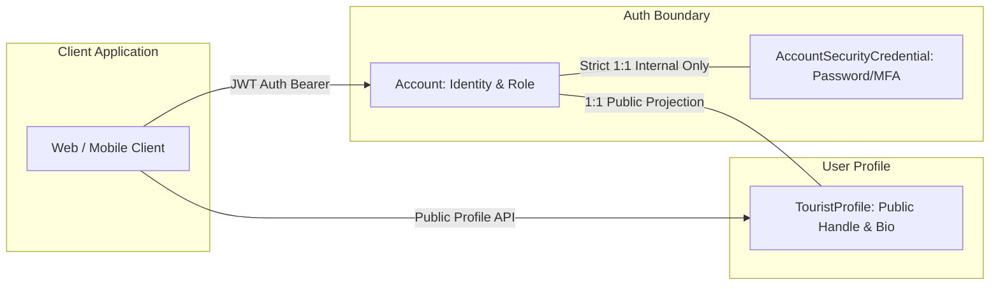
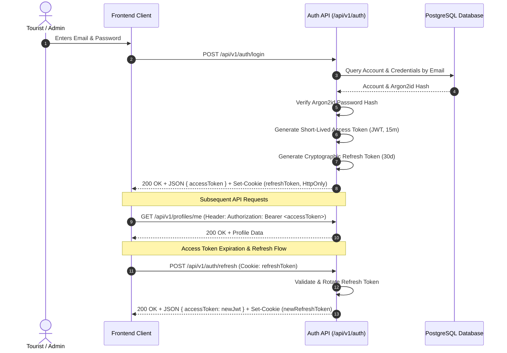
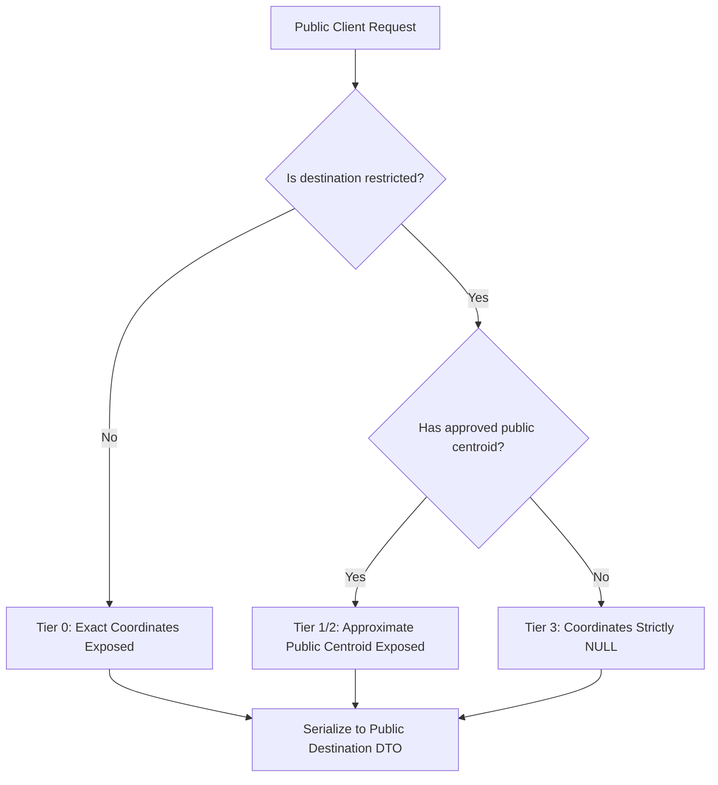

# API Architecture & Standards Specification

## 1. Executive Summary & Architectural Scope

This specification establishes the architectural foundation, design principles, and technical standards for the **My Travelroad** REST API (Stage A). **My Travelroad** is a tourism discovery and verified information platform for Kerala, scaling from Malappuram to regional and statewide destinations.

The API layer is built on the approved domain models ([`domain-model.md`](./domain-model.md)) and PostgreSQL 16 + PostGIS 3.4 database architecture ([`database-architecture.md`](./database-architecture.md)). It exposes resource-oriented HTTP interfaces designed for high-concurrency read traffic, strict coordinate privacy, granular fact-level verification auditing, and decoupled user identities.

> [!IMPORTANT]
> **Stage A Architectural Boundary**: The API scope defined herein is strictly constrained to Stage A entities:
> 1. Identity & Credentials (`accounts`, `account_security_credentials`)
> 2. Tourist Profiles (`tourist_profiles`)
> 3. Taxonomy & Categories (`destination_categories`, `destination_secondary_categories`)
> 4. Destinations & Geography (`destinations`, `destination_locations`, `destination_media`, `destination_opening_hours`)
> 5. Governance & Fact Verification (`destination_verifications`, `verification_evidence`, `verification_records`)
> 6. Traveler Bookmarks (`saved_destinations`)
> 7. Immutability & Audit Trails (`audit_logs`, `audit_log_telemetry`)
>
> Community social feeds, reviews, ratings, and commercial bookings belong to future project stages (Stage B & C) and are explicitly excluded from Stage A endpoints.

---

## 2. Core Architectural Principles

### 2.1 Protocol and Base Path
- **Protocol**: HTTPS only (TLS 1.3 preferred, TLS 1.2 minimum). Plain HTTP requests are redirected with `301 Moved Permanently` or rejected with HSTS.
- **Base URI Path**: `/api/v1`
- **Data Interchange Format**: JSON (`Content-Type: application/json; charset=utf-8`) for all request and response payloads.
- **Statelessness**: Every request must carry all the authentication context and parameters necessary to execute. The server maintains no in-memory session affinity.

### 2.2 Resource-Oriented URI Conventions
- **Plural Nouns**: Resources are identified using lowercase, kebab-case plural nouns (e.g., `/destinations`, `/destination-categories`, `/saved-destinations`).
- **Resource Hierarchy**: Sub-resources express natural ownership (e.g., `/destinations/{slug}/media`, `/categories/{slug}/destinations`).
- **Identifier Independence**: Public-facing destination and category endpoints favor human-readable, SEO-friendly `slug` identifiers over internal UUIDs. Administrative and relational mutations use canonical UUID strings.
- **Action Verbs Reserved for RPC-style Transitions**: State machine transitions that do not naturally map to CRUD nouns are expressed as sub-resource action verbs (e.g., `POST /destinations/{id}/publish`, `POST /destinations/{id}/archive`, `POST /verification/{id}/assign`).

### 2.3 HTTP Method Semantics
| Method | Usage | Idempotent | Safe | Typical Success Status |
| :--- | :--- | :--- | :--- | :--- |
| `GET` | Retrieve resource representation or filtered collection | Yes | Yes | `200 OK` |
| `POST` | Create a new resource or trigger an operational state transition | No | No | `201 Created` or `200 OK` |
| `PUT` | Complete resource replacement or upsert | Yes | No | `200 OK` |
| `PATCH` | Partial resource update (only supplied fields mutated) | No | No | `200 OK` |
| `DELETE` | Remove a resource or disassociate a relationship | Yes | No | `204 No Content` or `200 OK` |

### 2.4 Standardized JSON Response Envelope
Every API response adheres to a predictable two-channel envelope to eliminate ambiguity for frontend clients and SDK consumers.

#### Successful Response Format
```json
{
  "success": true,
  "data": { ... },
  "meta": {
    "pagination": {
      "page": 1,
      "limit": 20,
      "totalItems": 142,
      "totalPages": 8,
      "hasNextPage": true,
      "hasPrevPage": false
    },
    "timestamp": "2026-11-15T15:00:00.000Z"
  }
}
```
*Note: The `meta` block is optional and primarily populated for paginated collections or diagnostic telemetry.*

#### Error Response Format
```json
{
  "success": false,
  "error": {
    "code": "VALIDATION_FAILED",
    "message": "The request body failed schema validation.",
    "details": [
      {
        "field": "coordinates.longitude",
        "issue": "Longitude must be a finite number between -180.0 and 180.0."
      }
    ],
    "requestId": "req_01JB89Z8H1K4V9Z0P9R8E7W6T2",
    "timestamp": "2026-11-15T15:00:00.000Z"
  }
}
```

---

## 3. Centralized Error Handling & Taxonomy

### 3.1 Standard Error Structure
The `error` object inside a failed envelope guarantees four standard properties:
1. `code`: A machine-readable, stable uppercase string identifying the error category.
2. `message`: A user-safe, concise explanation of the failure.
3. `details`: An optional array of field-level or diagnostic failure objects.
4. `requestId`: A unique tracing identifier (ULID or UUIDv4) generated at the edge gateway to trace errors across logs without exposing internal implementation details.

### 3.2 Error Code Catalog & HTTP Status Mapping
| Error Code | HTTP Status | Description / Trigger Scenario |
| :--- | :--- | :--- |
| `BAD_REQUEST` | `400` | Malformed JSON syntax, invalid query parameters, or missing mandatory headers. |
| `AUTHENTICATION_REQUIRED` | `401` | Missing, expired, or malformed Bearer access token. |
| `INVALID_CREDENTIALS` | `401` | Incorrect email/password combination or failed token signature. |
| `TOKEN_EXPIRED` | `401` | The access token has expired and must be refreshed. |
| `TOKEN_INVALID` | `401` | The token signature is forged, invalid, or revoked. |
| `FORBIDDEN_ACCESS` | `403` | Caller lacks the necessary role or permission for the requested action. |
| `RESOURCE_NOT_FOUND` | `404` | The requested entity ID, slug, or route does not exist. |
| `DUPLICATE_RESOURCE` | `409` | Uniqueness violation (e.g., email, handle, category slug, or destination save). |
| `ACCOUNT_LOCKED` | `423` | Account temporarily locked due to excessive failed login attempts. |
| `VALIDATION_FAILED` | `422` | Zod schema validation failed on one or more payload fields. |
| `COORDINATE_PRIVACY_RESTRICTED` | `403` | Caller attempted to query raw coordinates of an ecologically restricted destination. |
| `RATE_LIMIT_EXCEEDED` | `429` | Request volume exceeded the allocated rate limit tier. |
| `INTERNAL_SERVER_ERROR` | `500` | Unhandled server exception. Details are redacted from client response. |

### 3.3 Security Redaction & Information Sanitization
- **No Database Traces**: Raw SQL queries, PostgreSQL constraint names (`uq_accounts_email`, `ck_locations_coord_range`), and stack traces are **never** returned to the client.
- **Log Correlation**: Full error details, stack traces, and database error codes are captured strictly in server-side structured application logs labeled with the `requestId`.
- **Timing Attack Mitigation**: Credential verification always executes constant-time comparisons or dummy password hashing to prevent user enumeration via timing discrepancies.

---

## 4. Pagination, Filtering, and Sorting Conventions

### 4.1 Pagination Parameters
All collection endpoints support standardized 1-indexed query parameters:
- `page`: Positive integer indicating the requested page number (default: `1`, minimum: `1`).
- `limit`: Positive integer indicating items per page (default: `20`, maximum: `100`).

The response includes the canonical `DomainPaginationMeta` metadata object:
```typescript
interface DomainPaginationMeta {
  page: number;
  limit: number;
  totalItems: number;
  totalPages: number;
  hasNextPage: boolean;
  hasPrevPage: boolean;
}
```

### 4.2 Sorting Syntax
Sorting is expressed via the `sort` query parameter using `field:direction` notation. Multiple sorting keys are comma-separated:
- `?sort=createdAt:desc` (Newest first)
- `?sort=featuredRank:asc,title:asc` (Featured rank ascending, then alphabetical title)
- Defaults: If unspecified, collections default to `createdAt:desc` (or `displayOrder:asc` for categories and media).

### 4.3 Filtering Conventions
- **Exact Match**: `?district=Malappuram`
- **Multi-Value (OR)**: Comma-separated list: `?status=published,in_review`
- **Boolean Flags**: Explicit boolean strings: `?isCover=true`
- **Text Search**: `?search=teak+reserve` (Performs title and description trigram/full-text search)

### 4.4 Geospatial Query Conventions
To leverage the underlying PostGIS spatial engine, geographic discovery endpoints support two standardized query modes:

#### 1. Proximity / Radial Search (`near` + `radiusKm`)
- Parameters:
  - `near`: `longitude,latitude` (WGS 84 coordinate pair, strictly longitude first)
  - `radiusKm`: Search radius in kilometers (default: `15`, maximum: `100`)
- Example: `GET /api/v1/destinations/search?near=76.22,11.28&radiusKm=25`
- Database Mapping: Uses PostGIS `ST_DWithin(coordinates, ST_MakePoint(lon, lat)::geography, radiusMeters)`.

#### 2. Bounding Box Search (`bbox`)
- Parameters:
  - `bbox`: `minLon,minLat,maxLon,maxLat` (Southwest corner to Northeast corner)
- Example: `GET /api/v1/destinations/search?bbox=75.8,10.8,76.5,11.5`
- Database Mapping: Uses PostGIS `coordinates && ST_MakeEnvelope(minLon, minLat, maxLon, maxLat, 4326)::geography` with antimeridian splitting where required.

---

## 5. Request Validation Architecture

### 5.1 Zod Schema Boundary Validation
All incoming HTTP requests (path parameters, query parameters, and JSON request bodies) are parsed and validated at the boundary using strict Zod schemas before reaching any business logic or database layer.

- **Strict Property Evaluation**: Request body schemas enforce `.strict()` to reject unmapped or unknown fields, preventing parameter pollution and mass-assignment vulnerabilities.
- **Type Coercion**: Query string numbers and booleans are coerced safely (e.g., `z.coerce.number().int().min(1)`).
- **String Sanitization**: User-supplied strings are trimmed of leading/trailing whitespace, and HTML tags are stripped from narrative inputs.

### 5.2 Geospatial Coordinate Validation Standards
In compliance with RFC 7946 and OGC Simple Features:
- Coordinates are validated as a 2-element tuple: `[longitude, latitude]`.
- Finite check: `Number.isFinite(lon) && Number.isFinite(lat)` (rejects `NaN`, `Infinity`, `-Infinity`).
- Range limits: Longitude $\in [-180.0, 180.0]$, Latitude $\in [-90.0, 90.0]$.

---

## 6. Authentication Architecture

### 6.1 Split-Identity Architecture
In accordance with [`domain-model.md`](./domain-model.md) Section 1, the platform strictly decouples authentication identity from public user profiles:
- **`Account`**: Internal authentication anchor (`id`, `email`, `role`, `status`). Never directly serialized in public profile views.
- **`AccountSecurityCredential`**: Internal authentication secrets (`passwordHash`, `mfaSecret`, `failedLoginAttempts`, `lockedUntil`). Completely isolated and inaccessible through any public API.
- **`TouristProfile`**: User-facing profile projection (`displayName`, `handle`, `avatarUrl`, `travelPreferences`, `isPublic`). 1:1 relation with `Account`.



### 6.2 Dual-Token Session Lifecycle
The API implements an industry-standard dual-token authentication model:



1. **Short-Lived Access Token (JWT)**:
   - **Lifespan**: 15 minutes.
   - **Format**: Signed JWT (RS256 or HMAC-SHA256 with 256-bit entropy secret).
   - **Payload Claims**:
     ```json
     {
       "sub": "account-uuid-v4",
       "role": "traveler",
       "email": "tourist@example.com",
       "emailVerified": true,
       "type": "individual",
       "iat": 1731682800,
       "exp": 1731683700,
       "iss": "https://mytravelroad.com",
       "aud": "https://mytravelroad.com"
     }
     ```
   - **Delivery**: Returned in JSON response body. Transmitted in client requests via header: `Authorization: Bearer <accessToken>`.
2. **Long-Lived Refresh Token**:
   - **Lifespan**: 30 days (sliding window).
   - **Format**: High-entropy cryptographically random string (256-bit).
   - **Storage**: Stored in an `HttpOnly`, `Secure`, `SameSite=Strict` browser cookie with path restricted to `/api/v1/auth`.
   - **Token Rotation & Invalidation**: Every call to `POST /api/v1/auth/refresh` invalidates the old refresh token and issues a new pair. If a revoked refresh token is presented, the entire token family is immediately invalidated to neutralize replay attacks.
3. **Password Security Standards**:
   - Algorithms: Argon2id ($m=64\text{ MiB}, t=3, p=4$).
   - Failed login attempts trigger exponential lockout: 5 consecutive failures lock the account for 15 minutes (`lockedUntil`).
4. **Root System Account Safeguard**:
   - In accordance with the database security invariants, the Root System Account (`00000000-0000-4000-8000-000000000001`) and any account with `type = 'system'` are **strictly forbidden** from authenticating through `/api/v1/auth/login` or acquiring interactive sessions.

---

## 7. Authorization & Access Control Strategy

### 7.1 Six Caller Tiers
Every endpoint explicitly defines authorization rules across six caller tiers:
1. **Public Visitor**: Unauthenticated anonymous caller.
2. **Authenticated Tourist** (`role: 'traveler'`): Registered individual traveler.
3. **Contributor** (`role: 'contributor'`): Community explorer authorized to submit destination drafts and draft media.
4. **Curator** (`role: 'curator'`): Editorial fact verifier authorized to triage verification queues, review media, and certify facts.
5. **Moderator** (`role: 'moderator'`): Governance role managing community safety, reporting, and account flags.
6. **Super Administrator** (`role: 'super_admin'`): Full platform administrator managing users, taxonomy, role elevations, and critical system configurations.

### 7.2 RBAC + ABAC (Resource Ownership) Enforcement
- **Role-Based Access Control (RBAC)**: Enforces coarse-grained capabilities (e.g., only `curator` or `super_admin` can call `/api/v1/admin/verification/*`).
- **Attribute-Based Access Control (ABAC)**: Enforces granular ownership on user-owned entities (e.g., a tourist can only update their own profile `/api/v1/profiles/me` or delete their own saved bookmarks `/api/v1/saved-destinations/{id}`).
- **Backend Assertion**: Authorization checks are strictly performed server-side on decoded JWT claims and database entity ownership. Client-side role claims are never trusted.

---

## 8. Rate-Limiting & Abuse Prevention Policy

Rate limits are enforced at the API gateway layer using an atomic sliding window counter (e.g., Redis or database-backed rate limiter) segmented by caller IP address and authenticated Account ID.

| Category / Endpoint Pattern | Rate Limit Window | Key / Segment | Purpose / Protection |
| :--- | :--- | :--- | :--- |
| **Authentication Flow** (`/api/v1/auth/login`, `/register`, `/forgot-password`) | 5 requests / min | Client IP | Prevents brute-force credential stuffing and password reset flooding. |
| **Public Read APIs** (`/api/v1/destinations`, `/categories`) | 60 requests / min | Client IP | Protects spatial search and database resources from scraping. |
| **Authenticated Tourist APIs** (`/api/v1/profiles/*`, `/saved-destinations/*`) | 120 requests / min | `Account.id` | Facilitates smooth client experience while preventing API abuse. |
| **Privileged Administrative APIs** (`/api/v1/admin/*`) | 300 requests / min | `Account.id` | Accommodates batch verification workflows and curator audits. |

### Standard Rate Limit Headers
Every response includes standard rate limit headers:
```http
RateLimit-Limit: 60
RateLimit-Remaining: 57
RateLimit-Reset: 1731682860
```
When a caller exceeds their limit, the API immediately responds with `429 Too Many Requests`, returning the standard error envelope and a `Retry-After: <seconds>` header.

---

## 9. API Security & Privacy Standards

### 9.1 Three-Tier Public Coordinate Privacy
Kerala contains ecologically fragile forest reserves (e.g., Nilambur evergreen sholas, silent valley buffer zones) and sensitive habitats. To protect these locations, the API strictly enforces the 3-Tier Coordinate Privacy Architecture:



- **Tier 0 (Unrestricted)**: Returns exact WGS 84 GPS coordinates (`[longitude, latitude]`).
- **Tier 1 & 2 (Restricted with Centroid)**: Replaces exact coordinates with the approved approximate public centroid (e.g., forest entry gate or district range office) and masks locality names.
- **Tier 3 (Restricted Suppressed)**: Coordinates are returned strictly as `null`. Under no circumstances does the API fall back to exact coordinates.
- **Database Boundary**: Public destination location queries consume the secure definer view `v_public_destination_locations`.

### 9.2 Audit Logging Invariants
Every state-modifying administrative action (`POST`, `PATCH`, `DELETE` under `/api/v1/admin/*`) generates an immutable server-side `AuditLog` entry matching the domain `AdminAction` taxonomy (`destination.create`, `destination.publish`, `verification.field_verify`, etc.).
- Telemetry (`ipAddress`, `userAgent`) is captured in `audit_log_telemetry` and decoupled from the immutable ledger.
- Telemetry retention is governed by a 90-day privacy policy (`retentionExpiresAt`) supporting GDPR Right-to-Erasure anonymization.

### 9.3 Content Security, CORS, and CSRF Policies
- **CORS**: Restricted strictly to authorized platform origins (e.g., `https://mytravelroad.com` and staging domains). Pre-flight `OPTIONS` requests are cached for 1 hour (`Access-Control-Max-Age: 3600`).
- **CSRF**: Authenticated state mutations relying on cookie authentication enforce `SameSite=Strict` and custom header verification (`X-Requested-With: XMLHttpRequest` or anti-CSRF token verification).
- **Security Headers**:
  - `X-Content-Type-Options: nosniff`
  - `X-Frame-Options: DENY`
  - `Strict-Transport-Security: max-age=31536000; includeSubDomains; preload`
  - `Content-Security-Policy: default-src 'none'; frame-ancestors 'none'`

---

## 10. API Lifecycle & Versioning Strategy

1. **Path-Based Versioning**: All endpoints are prefixed with `/api/v1`. Breaking changes mandate a major version increment (`/api/v2`).
2. **Backward-Compatible Evolution**:
   - Adding new optional request fields is non-breaking.
   - Adding new response fields is non-breaking (frontend clients must ignore unknown fields).
   - Deprecating endpoints requires a minimum 6-month deprecation window signaled via HTTP standard headers:
     ```http
     Deprecation: @1747440000
     Sunset: Wed, 16 May 2027 00:00:00 GMT
     Link: </api/v2/destinations>; rel="successor-version"
     ```
