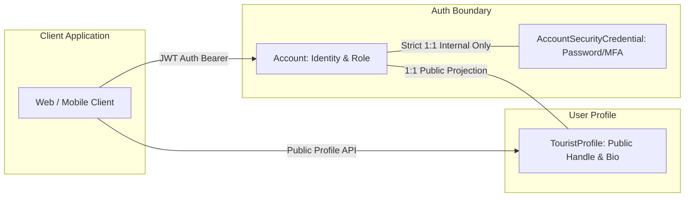
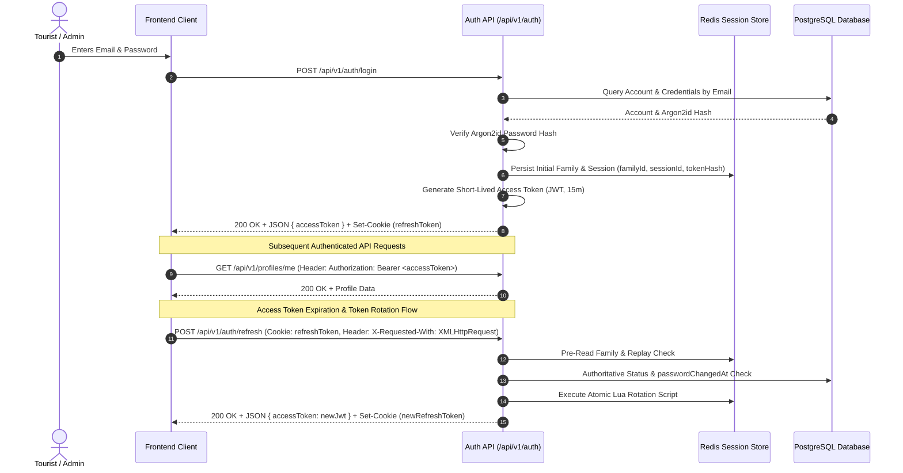
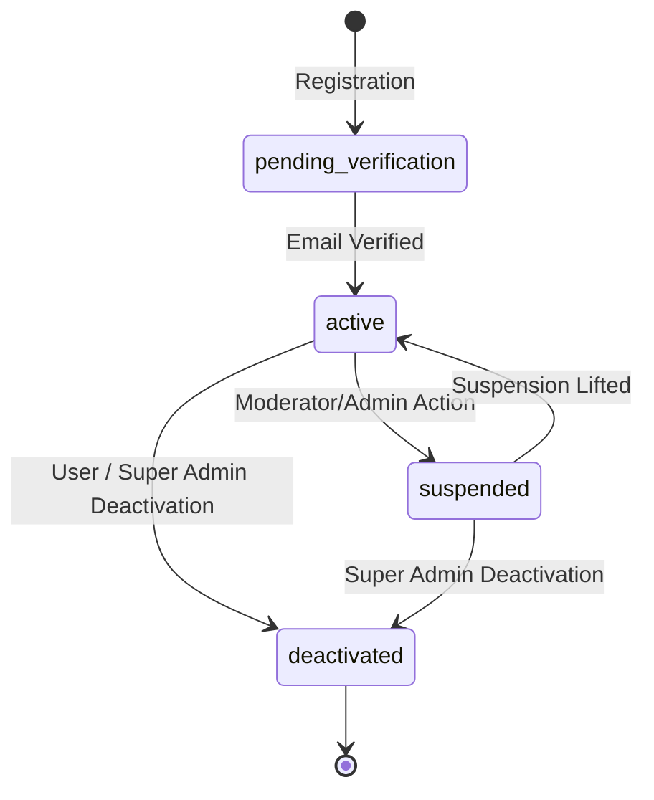
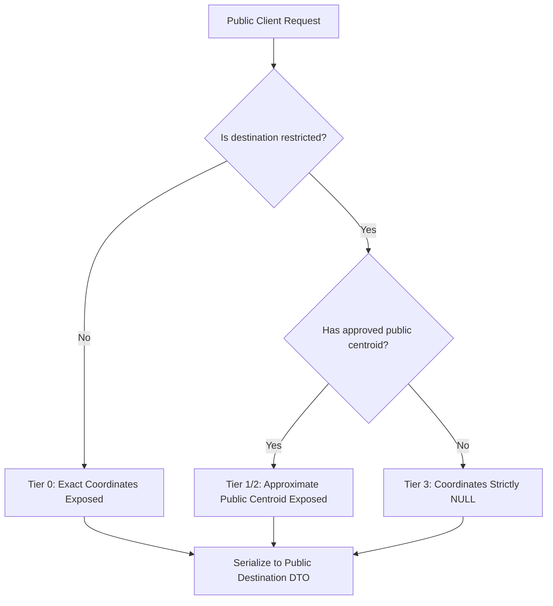

# API Architecture & Standards Specification

## 1. Executive Summary & Architectural Scope

This specification establishes the architectural foundation, design principles, and technical standards for the **My Travelroad** REST API (Stage A). **My Travelroad** is a tourism discovery and verified information platform for Kerala, scaling from Malappuram to regional and statewide destinations.

The API layer is built on the approved domain models ([`domain-model.md`](./domain-model.md)) and PostgreSQL 16 + PostGIS 3.4 database architecture ([`database-architecture.md`](./database-architecture.md)). It exposes resource-oriented HTTP interfaces designed for high-concurrency read traffic, strict coordinate privacy, granular fact-level verification auditing, and decoupled user identities.

> [!IMPORTANT]
> **Stage A Architectural Boundary**: The API scope defined herein is strictly constrained to Stage A entities:
> 1. Identity & Credentials (`accounts`, `account_security_credentials`)
> 2. Tourist Profiles (`tourist_profiles`)
> 3. Taxonomy & Categories (`destination_categories`, `destination_secondary_categories`)
> 4. Destinations & Geography (`destinations`, `destination_locations`, `destination_media`, `destination_opening_hours`)
> 5. Governance & Fact Verification (`destination_verifications`, `verification_evidence`, `verification_records`)
> 6. Traveler Bookmarks (`saved_destinations`)
> 7. Immutability & Audit Trails (`audit_logs`, `audit_log_telemetry`)
>
> Community social feeds, reviews, ratings, and commercial bookings belong to future project stages (Stage B & C) and are explicitly excluded from Stage A endpoints.

---

## 2. Core Architectural Principles

### 2.1 Protocol and Base Path
- **Protocol**: HTTPS only (TLS 1.3 preferred, TLS 1.2 minimum). Plain HTTP requests are redirected with `301 Moved Permanently` or rejected with HSTS.
- **Base URI Path**: `/api/v1`
- **Data Interchange Format**: JSON (`Content-Type: application/json; charset=utf-8`) for all request and response payloads.
- **Statelessness**: Every request must carry all the authentication context and parameters necessary to execute. The server maintains no in-memory session affinity.

### 2.2 Resource-Oriented URI Conventions
- **Plural Nouns**: Resources are identified using lowercase, kebab-case plural nouns (e.g., `/destinations`, `/destination-categories`, `/saved-destinations`).
- **Resource Hierarchy**: Sub-resources express natural ownership (e.g., `/destinations/{slug}/media`, `/categories/{slug}/destinations`).
- **Identifier Independence**: Public-facing destination and category endpoints favor human-readable, SEO-friendly `slug` identifiers over internal UUIDs. Administrative and relational mutations use canonical UUID strings.
- **Action Verbs Reserved for RPC-style Transitions**: State machine transitions that do not naturally map to CRUD nouns are expressed as sub-resource action verbs (e.g., `POST /destinations/{id}/publish`, `POST /destinations/{id}/archive`, `POST /verification/{id}/assign`).

### 2.3 HTTP Method Semantics
| Method | Usage | Idempotent | Safe | Typical Success Status |
| :--- | :--- | :--- | :--- | :--- |
| `GET` | Retrieve resource representation or filtered collection | Yes | Yes | `200 OK` |
| `POST` | Create a new resource or trigger an operational state transition | No | No | `201 Created` or `200 OK` |
| `PUT` | Complete resource replacement or upsert | Yes | No | `200 OK` |
| `PATCH` | Partial resource update (only supplied fields mutated) | No | No | `200 OK` |
| `DELETE` | Remove a resource or disassociate a relationship | Yes | No | `204 No Content` or `200 OK` |

### 2.4 Standardized JSON Response Envelope
Every API response adheres to a predictable two-channel envelope to eliminate ambiguity for frontend clients and SDK consumers.

#### Successful Response Format
```json
{
  "success": true,
  "data": { ... },
  "meta": {
    "pagination": {
      "page": 1,
      "limit": 20,
      "totalItems": 142,
      "totalPages": 8,
      "hasNextPage": true,
      "hasPrevPage": false
    },
    "timestamp": "2026-11-15T15:00:00.000Z"
  }
}
```
*Note: The `meta` block is optional and primarily populated for paginated collections or diagnostic telemetry.*

#### Error Response Format
```json
{
  "success": false,
  "error": {
    "code": "VALIDATION_FAILED",
    "message": "The request body failed schema validation.",
    "details": [
      {
        "field": "coordinates.longitude",
        "issue": "Longitude must be a finite number between -180.0 and 180.0."
      }
    ],
    "requestId": "req_01JB89Z8H1K4V9Z0P9R8E7W6T2",
    "timestamp": "2026-11-15T15:00:00.000Z"
  }
}
```

---

## 3. Centralized Error Handling & Taxonomy

### 3.1 Standard Error Structure
The `error` object inside a failed envelope guarantees four standard properties:
1. `code`: A machine-readable, stable uppercase string identifying the error category.
2. `message`: A user-safe, concise explanation of the failure.
3. `details`: An optional array of field-level or diagnostic failure objects.
4. `requestId`: A unique tracing identifier (ULID or UUIDv4) generated at the edge gateway to trace errors across logs without exposing internal implementation details.

### 3.2 Error Code Catalog & HTTP Status Mapping
| Error Code | HTTP Status | Description / Trigger Scenario |
| :--- | :--- | :--- |
| `BAD_REQUEST` | `400` | Malformed JSON syntax, invalid query parameters, or missing mandatory headers. |
| `AUTHENTICATION_REQUIRED` | `401` | Missing, expired, or malformed Bearer access token. |
| `INVALID_CREDENTIALS` | `401` | Incorrect email/password combination or failed token signature. |
| `TOKEN_EXPIRED` | `401` | The access token has expired and must be refreshed. |
| `TOKEN_INVALID` | `401` | The token signature is forged, invalid, or revoked. |
| `FORBIDDEN_ACCESS` | `403` | Caller lacks the necessary role or permission for the requested action. |
| `EMAIL_VERIFICATION_REQUIRED` | `403` | Account status is `pending_verification`; mutations are blocked until email is confirmed. |
| `ACCOUNT_SUSPENDED` | `403` | Account has been suspended by governance moderators/administrators. |
| `ACCOUNT_DEACTIVATED` | `403` | Account has been deactivated and cannot authenticate or refresh tokens. |
| `RESOURCE_NOT_FOUND` | `404` | The requested entity ID, slug, or route does not exist. |
| `DUPLICATE_RESOURCE` | `409` | Uniqueness violation (e.g., email, handle, category slug, or destination save). |
| `ACCOUNT_LOCKED` | `423` | Account temporarily locked due to excessive failed login attempts. |
| `VALIDATION_FAILED` | `422` | Zod schema validation failed on one or more payload fields. |
| `COORDINATE_PRIVACY_RESTRICTED` | `403` | Caller attempted to query raw coordinates of an ecologically restricted destination. |
| `RATE_LIMIT_EXCEEDED` | `429` | Request volume exceeded the allocated rate limit tier. |
| `AUDIT_LOG_FAILURE` | `500` | Privileged action aborted because the mandatory immutable audit log could not be committed. Exact coordinates and privileged data are suppressed. |
| `INTERNAL_SERVER_ERROR` | `500` | Unhandled server exception. Details are redacted from client response. |

### 3.3 Security Redaction & Information Sanitization
- **No Database Traces**: Raw SQL queries, PostgreSQL constraint names (`uq_accounts_email`, `ck_locations_coord_range`), and stack traces are **never** returned to the client.
- **Log Correlation**: Full error details, stack traces, and database error codes are captured strictly in server-side structured application logs labeled with the `requestId`.
- **Timing Attack Mitigation**: Credential verification always executes constant-time comparisons or dummy password hashing to prevent user enumeration via timing discrepancies.

---

## 4. Pagination, Filtering, and Sorting Conventions

### 4.1 Pagination Parameters
All collection endpoints support standardized 1-indexed query parameters:
- `page`: Positive integer indicating the requested page number (default: `1`, minimum: `1`).
- `limit`: Positive integer indicating items per page (default: `20`, maximum: `100`).

The response includes the canonical `DomainPaginationMeta` metadata object:
```typescript
interface DomainPaginationMeta {
  page: number;
  limit: number;
  totalItems: number;
  totalPages: number;
  hasNextPage: boolean;
  hasPrevPage: boolean;
}
```

### 4.2 Sorting Syntax
Sorting is expressed via the `sort` query parameter using `field:direction` notation. Multiple sorting keys are comma-separated:
- `?sort=createdAt:desc` (Newest first)
- `?sort=featuredRank:asc,title:asc` (Featured rank ascending, then alphabetical title)
- Defaults: If unspecified, collections default to `createdAt:desc` (or `displayOrder:asc` for categories and media).

### 4.3 Filtering Conventions
- **Exact Match**: `?district=Malappuram`
- **Multi-Value (OR)**: Comma-separated list: `?status=published,in_review`
- **Boolean Flags**: Explicit boolean strings: `?isCover=true`
- **Text Search**: `?search=teak+reserve` (Performs title and description trigram/full-text search)

### 4.4 Geospatial Query Conventions
To leverage the underlying PostGIS spatial engine, geographic discovery endpoints support two standardized query modes:

#### 1. Proximity / Radial Search (`near` + `radiusKm`)
- Parameters:
  - `near`: `longitude,latitude` (WGS 84 coordinate pair, strictly longitude first)
  - `radiusKm`: Search radius in kilometers (default: `15`, maximum: `100`)
- Example: `GET /api/v1/destinations/search?near=76.22,11.28&radiusKm=25`
- Database Mapping: Uses PostGIS `ST_DWithin(coordinates, ST_MakePoint(lon, lat)::geography, radiusMeters)`.

#### 2. Bounding Box Search (`bbox`)
- Parameters:
  - `bbox`: `minLon,minLat,maxLon,maxLat` (Southwest corner to Northeast corner)
- Example: `GET /api/v1/destinations/search?bbox=75.8,10.8,76.5,11.5`
- Database Mapping: Uses PostGIS `coordinates && ST_MakeEnvelope(minLon, minLat, maxLon, maxLat, 4326)::geography` with antimeridian splitting where required.

---

## 5. Request Validation Architecture

### 5.1 Zod Schema Boundary Validation
All incoming HTTP requests (path parameters, query parameters, and JSON request bodies) are parsed and validated at the boundary using strict Zod schemas before reaching any business logic or database layer.

- **Strict Property Evaluation**: Request body schemas enforce `.strict()` to reject unmapped or unknown fields, preventing parameter pollution and mass-assignment vulnerabilities.
- **Type Coercion**: Query string numbers and booleans are coerced safely (e.g., `z.coerce.number().int().min(1)`).
- **String Sanitization**: User-supplied strings are trimmed of leading/trailing whitespace, and HTML tags are stripped from narrative inputs.

### 5.2 Geospatial Coordinate Validation Standards
In compliance with RFC 7946 and OGC Simple Features:
- Coordinates are validated as a 2-element tuple: `[longitude, latitude]`.
- Finite check: `Number.isFinite(lon) && Number.isFinite(lat)` (rejects `NaN`, `Infinity`, `-Infinity`).
- Range limits: Longitude $\in [-180.0, 180.0]$, Latitude $\in [-90.0, 90.0]$.

---

## 6. Authentication Architecture

### 6.1 Split-Identity Architecture
In accordance with [`domain-model.md`](./domain-model.md) Section 1, the platform strictly decouples authentication identity from public user profiles:
- **`Account`**: Internal authentication anchor (`id`, `email`, `role`, `status`). Never directly serialized in public profile views.
- **`AccountSecurityCredential`**: Internal authentication secrets (`passwordHash`, `mfaSecret`, `failedLoginAttempts`, `lockedUntil`). Completely isolated and inaccessible through any public API.
- **`TouristProfile`**: User-facing profile projection (`displayName`, `handle`, `avatarUrl`, `travelPreferences`, `isPublic`). 1:1 relation with `Account`.



### 6.2 Access Token and Refresh-Token Session Lifecycle

The platform's authentication architecture implements a secure single-device session lifecycle with rotating refresh tokens and short-lived access tokens:

- **Stage A / Task 10.6 Implementation:** The login endpoint (`POST /api/v1/auth/login`) issues a short-lived HS256 JWT access token in the JSON response body and provisions an isolated token family in Redis, setting a rotating `refreshToken` cookie (`HttpOnly`, `Secure` in production, `SameSite=Strict`, `Path=/api/v1/auth`, `Max-Age=2592000`). `POST /api/v1/auth/refresh` rotates the token family using deterministic atomic Redis Lua scripts, enforcing anti-CSRF headers, account lifecycle, and password-change checks. `POST /api/v1/auth/logout` revokes the caller's specific session.
- **Deferred Stage A+ Architecture:** Multi-device account-wide logout (`POST /api/v1/auth/logout-all`), database generation increments (`accounts.token_generation`), and asynchronous revocation outbox jobs (`account_revocation_jobs`) are explicitly deferred to the Stage A+ database migration.

The following sequence diagram illustrates the active Stage A login, subsequent request, and token refresh lifecycle:



1. **Short-Lived Access Token (JWT)**:
   - **Lifespan**: 15 minutes.
   - **Format**: Signed JWT strictly using HMAC-SHA256 (HS256). Token signing and verification are pinned to HS256 (rejecting 'none', RS256, HS384, and HS512). The signing secret must satisfy the approved minimum entropy requirement of 256 bits (at least 32 characters). RS256 is not implemented and must not be presented as an available alternative unless separately approved and implemented.
   - **Payload Claims**:
     ```json
     {
       "sub": "account-uuid-v4",
       "role": "traveler",
       "email": "tourist@example.com",
       "emailVerified": true,
       "type": "individual",
       "gen": 1,
       "iat": 1731682800,
       "exp": 1731683700,
       "iss": "https://mytravelroad.com",
       "aud": "https://mytravelroad.com"
     }
     ```
   - **Token Generation Compatibility Claim (`gen`)**: An integer claim (`gen: 1`) included in the access token for schema compatibility. The approved Stage A database schema (`accounts`, `account_security_credentials`) does not contain a `token_generation` column. In Stage A, credential invalidation following a password change is enforced using `AccountSecurityCredential.passwordChangedAt` (`claims.iat <= passwordChangedUnix`), and account access lifecycle is asserted via authoritative `Account.status` checks in the authentication middleware. Operative generation-based durable revocation (`account.token_generation`) and multi-device outbox revocation are explicitly deferred to the future Stage A+ schema migration.
   - **Delivery**: Returned in JSON response body. Transmitted in client requests via header: `Authorization: Bearer <accessToken>`.
2. **Long-Lived Refresh Token (Stage A / Task 10.6)**:
   - **Lifespan**: 30 days (sliding window).
   - **Format**: High-entropy cryptographically random string (256-bit CSPRNG).
   - **Storage**: Transmitted in an `HttpOnly`, `Secure`, `SameSite=Strict` browser cookie with path restricted to `/api/v1/auth`.
   - **Token Rotation & Invalidation**: Every call to `POST /api/v1/auth/refresh` invalidates the old refresh token and issues a new pair. If a revoked refresh token is presented, the entire token family is immediately invalidated to neutralize replay attacks.
3. **Password Security Standards**:
   - Algorithms: Argon2id ($m=64\text{ MiB}, t=3, p=4$).
   - Failed login attempts trigger exponential lockout: 5 consecutive failures lock the account for 15 minutes (`lockedUntil`).
4. **Root System Account Safeguard**:
   - In accordance with the database security invariants, the Root System Account (`00000000-0000-4000-8000-000000000001`) and any account with `type = 'system'` are **strictly forbidden** from authenticating through `/api/v1/auth/login` or acquiring interactive sessions.

### 6.3 Refresh Token Persistence Architecture

To guarantee token rotation, session persistence, and replay detection across multiple server instances or process restarts without altering the approved 15-table Stage A database schema, session state is managed via a dedicated persistence store.

#### Primary Architecture: Redis Key-Value Session Store
The production deployment utilizes Redis (or Valkey) as the primary session and token state store:

1. **Unified Opaque Token Format & Information Hiding**:
   - The client holds an opaque, unguessable bearer token in the `refreshToken` HttpOnly cookie: `rt_<familyId>_<64hex>`. This single canonical format is enforced across **both Redis Sentinel and Redis Cluster** topologies.
   - **Entropy & Sharding Guarantee**: Provides 256 bits of CSPRNG entropy generated via `crypto.randomBytes(32).toString('hex')`. The opaque UUID prefix `familyId` serves purely as an unguessable Redis hash-slot routing shard key and contains **no account ID, user role, email, or sensitive identifiers**.
   - **Parsing & Format Validation**:
     ```typescript
     const parts = rawCookie.split('_');
     if (parts.length !== 3 || parts[0] !== 'rt') throw new UnauthorizedException('TOKEN_MALFORMED');
     const [_, familyId, rawEntropy] = parts;
     if (!/^[0-9a-f]{8}-[0-9a-f]{4}-4[0-9a-f]{3}-[89ab][0-9a-f]{3}-[0-9a-f]{12}$/i.test(familyId)) {
       throw new UnauthorizedException('TOKEN_MALFORMED');
     }
     if (!/^[0-9a-f]{64}$/i.test(rawEntropy)) {
       throw new UnauthorizedException('TOKEN_MALFORMED');
     }
     ```
   - **Cryptographic Hashing**: Raw tokens are transmitted exclusively over secure HTTPS cookies and are **never stored in plaintext** in Redis or application logs. The application computes `presentedTokenHash = crypto.createHash('sha256').update(rawCookie).digest('hex')`.
   - **Zero-Trust Routing & Untrusted Identifier Verification**: The client-supplied `familyId` prefix is treated as completely untrusted input. The backend and Lua scripts assert that `family:{familyId}` exists, `activeTokenHash == presentedTokenHash`, and `isCompromised == 0`. An attacker forging or tampering with `familyId` is rejected immediately with `401 Unauthorized` (`code: 'TOKEN_INVALID_OR_EXPIRED'`).

2. **Key Schema & Data Structures**:
   - **Inverted Token Lookup Index**: `token_lookup:{familyId}:{tokenHash}` (Redis String/Hash, TTL: 30 days / 2,592,000s)
     - Maps `SHA256(rawRefreshToken)` $\rightarrow$ JSON `{ familyId, sessionId, accountId }`.
     - Enables instant $O(1)$ identification of the session, family lineage, and account owner within the `{familyId}` hash slot.
   - **Session Key**: `session:{familyId}:{sessionId}` (Redis Hash, TTL: 30 days / 2,592,000s)
     - `accountId`: UUID of the authenticated account.
     - `tokenHash`: SHA-256 hash of the currently active refresh token.
     - `familyId`: UUID identifying the device session / token lineage.
     - `rotationSeq`: Integer sequence counter incremented on each rotation.
     - `createdAt`: ISO 8601 creation timestamp.
     - `expiresAt`: ISO 8601 expiry timestamp.
     - `ipAddress`: Client IP address at issuance.
     - `userAgent`: Client user-agent string at issuance.
   - **Token Family Tracker**: `family:{familyId}` (Redis Hash, TTL: 30 days)
     - `activeSessionId`: Current valid session ID.
     - `activeTokenHash`: Current valid token SHA-256 hash.
     - `rotationSeq`: Current sequence integer.
     - `tokenGeneration`: Compatibility generation integer (default 1). Operative database generation tracking is deferred to Stage A+.
     - `isCompromised`: Boolean flag (true if replay detected).
   - **Resolvable Account Sessions Index**: `account_sessions:{accountId}` (Redis Set)
     - Stores resolvable members formatted as `"{familyId}:{sessionId}"` (e.g., `"550e8400-e29b-41d4-a716-446655440001:550e8400-e29b-41d4-a716-446655440002"`).
     - Provides the application tier with the exact `familyId` required to route to the correct Redis Cluster shard for per-family invalidation during password reset, account suspension, or future Stage A+ logout-all.
     - Maintained strictly outside the `{familyId}` hash slot via decoupled application-level operations.
   - **Revoked Token Tombstone**: `revoked_token:{familyId}:{tokenHash}` (Redis String, TTL: 86,400s / 24 hours)
     - Maps previously rotated token hashes $\rightarrow$ `familyId`. Allows immediate replay detection if an old token is reused within 24 hours.

3. **Application-Driven Token Generation & Explicit Redis Cluster Lua Key Declarations**:
   - **Strict Entropy Boundary**: The Node.js application layer is strictly responsible for cryptographic token generation. **Redis Lua scripts MUST NOT generate cryptographic tokens.**
   - **Explicit Redis Cluster Key Declaration Guarantee**: In Redis Cluster, multi-key commands and Lua scripts throw `CROSSSLOT Keys in request don't hash to the same slot` unless all keys accessed belong to the exact same hash slot. Furthermore, Redis Cluster mandates that **every single key accessed by a Lua script MUST be explicitly passed in the `KEYS` array**. Lua scripts **MUST NEVER dynamically construct undeclared Redis key names**.
   - When `POST /api/v1/auth/refresh` is received:
     1. The application parses `familyId` and verifies UUID/entropy formatting.
     2. Computes `presentedTokenHash = crypto.createHash('sha256').update(rawCookie).digest('hex')`.
     3. Pre-identifies the session and family state via single-key read on `family:{familyId}`:
        - *If Missing*: Fails immediately with `401 Unauthorized` (`code: 'TOKEN_INVALID_OR_EXPIRED'`).
        - *If Compromised (`isCompromised == '1'`)*: Fails immediately with `401 Unauthorized` (`code: 'TOKEN_REPLAY_DETECTED'`).
        - **Authoritative Database Lifecycle & Password-Change Validation**: The application queries PostgreSQL (`SELECT status FROM accounts WHERE id = :accountId` and `SELECT password_changed_at FROM account_security_credentials WHERE account_id = :accountId`):
          - *If Account Not Active*: If status is `suspended`, `deactivated`, or `archived`, rotation is denied fail-closed with `403 Forbidden` (`code: 'ACCOUNT_SUSPENDED'` or `'ACCOUNT_DEACTIVATED'`), and the family is immediately revoked in Redis.
          - *If Password Changed*: If `passwordChangedAt` in PostgreSQL is newer than session creation (`session.createdAt <= passwordChangedAt`), rotation is denied with `401 Unauthorized` (`code: 'SESSION_REVOKED'`), and the family is revoked in Redis. Durable generation-based revocation (`account.token_generation`) and outbox jobs are explicitly deferred to the future Stage A+ database migration.
        - *If Token Hash Mismatch (`family.activeTokenHash != presentedTokenHash`)*:
          Under the strict single-winner rotation policy, a rotated refresh token is permanently spent. Any re-presentation of an already-rotated token is classified as an active replay attack. The application triggers the **Atomic Replay Revocation Script** passing all 4 same-slot keys and expected state arguments explicitly:
          - `KEYS[1]`: `family:{familyId}`
          - `KEYS[2]`: `revoked_token:{familyId}:{presentedTokenHash}`
          - `KEYS[3]`: `token_lookup:{familyId}:{family.activeTokenHash}`
          - `KEYS[4]`: `session:{familyId}:{family.activeSessionId}`
          - `ARGV[1]`: `expectedActiveTokenHash` (`family.activeTokenHash`)
          - `ARGV[2]`: `expectedActiveSessionId` (`family.activeSessionId`)
          - `ARGV[3]`: `tombstoneTtl` (86,400s)
          - *Script Execution & State Revalidation*:
            1. Checks if `KEYS[2]` exists in revoked tombstones. If missing, returns `'NOT_A_REPLAY'`.
            2. Checks if `KEYS[1]` (`family:{familyId}`) exists. If missing, returns `'ALREADY_REVOKED'`.
            3. **Concurrent Rotation Defense**: Revalidates `family.activeTokenHash == ARGV[1]` and `family.activeSessionId == ARGV[2]`. If a concurrent rotation occurred between the application's pre-read and script execution, the script aborts without mutation and returns `'CONCURRENT_ROTATION_DETECTED'`. The application layer re-reads `family:{familyId}` to get the latest active token hash and session ID, and re-executes the replay revocation script until convergence, guaranteeing that newly active sessions are never left behind.
            4. If validated: marks `family:{familyId}.isCompromised = 1`, sets a 24-hour TTL on `family:{familyId}`, deletes `KEYS[3]` and `KEYS[4]`, and returns `'REPLAY_CONFIRMED'`.
            5. **Account Session Index Pruning**: Upon confirmed replay, the application layer resolves the target `accountId` and removes `"{familyId}:{expectedActiveSessionId}"` from `account_sessions:{accountId}`. If index removal fails, the failure is logged via structured `console.error` telemetry for operational alerting.
            Returns `401 Unauthorized` (`code: 'TOKEN_REPLAY_DETECTED'`).
          - *If Lost-Response Occurs*: If a client experiences network disruption after rotation commits in Redis but before the response cookie is received, the client cannot recover replacement credentials using the spent token. The client must re-authenticate cleanly via `POST /api/v1/auth/login`. Under no circumstances are replacement credentials returned to a spent token.
        - *If Token Hash Matches (`family.activeTokenHash == presentedTokenHash`)*:
          The application pre-generates replacement credentials in Node.js memory:
          - `replacementEntropy = crypto.randomBytes(32).toString('hex')` (256-bit CSPRNG)
          - `replacementRawToken = `rt_${familyId}_${replacementEntropy}``
          - `replacementTokenHash = crypto.createHash('sha256').update(replacementRawToken).digest('hex')`
          - `newSessionId = crypto.randomUUID()`
          - `oldSessionId = family.activeSessionId`
     4. The application executes the **Deterministic Atomic Rotation Script** passing ALL 6 same-slot keys and 10 ARGV parameters explicitly:
        - `KEYS[1]`: `family:{familyId}`
        - `KEYS[2]`: `token_lookup:{familyId}:{presentedTokenHash}`
        - `KEYS[3]`: `session:{familyId}:{oldSessionId}`
        - `KEYS[4]`: `revoked_token:{familyId}:{presentedTokenHash}`
        - `KEYS[5]`: `token_lookup:{familyId}:{replacementTokenHash}`
        - `KEYS[6]`: `session:{familyId}:{newSessionId}`
        - `ARGV[1]`: `presentedTokenHash`
        - `ARGV[2]`: `replacementTokenHash`
        - `ARGV[3]`: `newSessionId`
        - `ARGV[4]`: `ipAddress`
        - `ARGV[5]`: `userAgent`
        - `ARGV[6]`: `timestamp` (ISO 8601 string)
        - `ARGV[7]`: `ttl` (2,592,000s / 30 days)
        - `ARGV[8]`: `tombstoneTtl` (86,400s / 24 hours)
        - `ARGV[9]`: `expiresAt` (ISO 8601 string)
        - `ARGV[10]`: `expectedOldSessionId`
     5. **Strict Pre-Mutation Script Execution Logic**:
        - **Family Validation**: Asserts `family:{familyId}` exists, `isCompromised ~= '1'`, non-empty `familyId`, `activeTokenHash == ARGV[1]`, `activeSessionId == ARGV[10]`, and strictly validates `rotationSeq` as a positive integer within JavaScript safe integer bounds (`string.match(currentSeqStr, '^[1-9]%d*$')`, `string.len(currentSeqStr) <= 16`, and `1 <= currentSeq <= 9007199254740990` (`Number.MAX_SAFE_INTEGER - 1`)). Values of `9007199254740991` or higher, empty strings, zero, negative numbers, decimals, exponentials, and non-numeric strings are rejected with `INVALID_ROTATION_SEQUENCE` without state mutation.
        - **Token Lookup Validation**: Asserts `KEYS[2]` exists and strictly decodes JSON payload using native `pcall(cjson.decode, lookupRaw)` (no string-matching fallback in production logic), verifying `type(lookup) == 'table'`, `lookupFamilyId == famFamilyId`, `lookupSessionId == activeSessionId`, and non-empty `lookupAccountId`.
        - **Old Session Record Validation**: Asserts `KEYS[3]` exists, `sessionId == activeSessionId`, `familyId == famFamilyId`, `accountId == lookupAccountId`, and non-empty `tokenHash == ARGV[1]`.
        - **Collision Avoidance**: Asserts `EXISTS KEYS[5] == 0` and `EXISTS KEYS[6] == 0` (no collision on replacement keys).
        - *Atomicity Guarantee*: If any check fails, script aborts immediately with a specific error code without mutating any key.
        - *Mutation Sequence*: Once all validations pass:
          1. Deletes `KEYS[2]` (`token_lookup:{familyId}:{presentedTokenHash}`).
          2. Deletes `KEYS[3]` (`session:{familyId}:{oldSessionId}`).
          3. Writes `KEYS[4]` (`revoked_token:{familyId}:{presentedTokenHash}`) = `ARGV[6]` (rotation timestamp ISO string) with TTL = `ARGV[8]`.
          4. Writes `KEYS[5]` (`token_lookup:{familyId}:{replacementTokenHash}`) = `{ familyId, sessionId: newSessionId, accountId: lookupAccountId }` with TTL = `ARGV[7]`.
          5. Writes `KEYS[6]` (`session:{familyId}:{newSessionId}`) with session telemetry, `rotationSeq = string.format('%.0f', newSeq)`, and TTL = `ARGV[7]`. (In Lua 5.1, `string.format('%.0f', newSeq)` guarantees integer output and avoids scientific notation conversion).
          6. Updates `KEYS[1]` (`family:{familyId}`) with `activeSessionId = newSessionId`, `activeTokenHash = replacementTokenHash`, `rotationSeq = string.format('%.0f', newSeq)`, and TTL = `ARGV[7]`.
          7. Returns `['OK', string.format('%.0f', newSeq)]`.
     6. **Decoupled Account-Level Index Maintenance & Structured Telemetry**:
        - Outside the family Lua transaction, the application tier executes decoupled, idempotent updates on `account_sessions:{accountId}`:
          `SREM account_sessions:{accountId} "{familyId}:{oldSessionId}"`
          `SADD account_sessions:{accountId} "{familyId}:{newSessionId}"`
        - In Stage A, `account_sessions` serves as an administrative lookup index decoupled from same-slot atomic family operations (background reconciliation workers do not exist in Stage A).
        - All operations modifying or pruning `account_sessions` (`updateAccountSessionIndex`, `pruneAccountSessionIndexOnReplay`, `pruneAccountSessionIndexOnLogout`, `pruneAccountSessionIndexOnDirectRevocation`, `addAccountSessionIndexOnInitialSession`) emit structured JSON logging on failure containing timestamp, operation name, account ID, family ID, session ID, and error details, with zero credential leakage.
     7. **Pre-Signing, Cookie Dispatch & Token Issuance**: The API pre-signs the fresh 15-minute access token (with compatibility claim `"gen": 1`) prior to invoking Redis rotation to eliminate orphaned rotation state on signing failure. Upon successful Redis rotation, the API sets the new `refreshToken` cookie containing `replacementRawToken` and returns the access token.

4. **Replay Revocation Scoping & Rationale**:
   - **Family-Level Revocation Boundary**: When a replay is detected, the revocation is **strictly scoped to the compromised token family** (`family:{familyId}`).
   - **Rationale (Preventing Cross-Device Collateral Invalidation)**: Ordinary transient network retries, browser background duplicate refreshes, or minor local storage desynchronizations on one device (e.g., traveler's laptop) must **never** abruptly terminate independent active sessions on other user devices (e.g., mobile phone, tablet). An attacker intercepting an old token from one device compromises only that specific token family.
   - **Global Account-Wide Revocation**: Invalidating all active sessions in `account_sessions:{accountId}` is strictly reserved for deliberate, high-privilege security events:
     - Self-service or administrative password reset (`POST /api/v1/auth/reset-password`).
     - Administrative account suspension or deactivation (`Account.status = 'suspended' | 'deactivated'`).
     - *Future Stage A+ Endpoint*: Multi-device user logout (`POST /api/v1/auth/logout-all`) is a planned Stage A+ capability requiring the Stage A+ durable generation and outbox schema migration. In Stage A, `POST /api/v1/auth/logout` revokes strictly the caller's current session.

5. **Concurrency Race Condition Prevention & Single-Winner Policy**:
   - **In-Flight Concurrent Rotation Race (Lua Level)**:
     - When two or more concurrent requests simultaneously present the exact same valid active token, both may read the un-rotated family state during the preliminary read phase.
     - However, execution of `ATOMIC_ROTATION_LUA` is serialized by Redis. The first request to execute finds `KEYS[2]` (`token_lookup`) present, `family.activeTokenHash == presentedTokenHash`, and completes atomic rotation (`200 OK`, issues fresh credentials, increments `rotationSeq`).
     - The second request enters `ATOMIC_ROTATION_LUA` after the winner's mutations have committed. It discovers that `KEYS[2]` has been deleted and `family.activeTokenHash` no longer matches the presented token. The Lua script aborts without mutation and returns `'RACE_OR_REPLAY_DETECTED'`.
     - The application tier maps `'RACE_OR_REPLAY_DETECTED'` to an HTTP 401 `TOKEN_INVALID` unauthorized response (`"Concurrent token rotation or replay detected"`).
     - **Crucial Invariant**: The concurrent losing request receives **zero replacement credentials**. Most importantly, the losing request does **NOT** compromise the family; the winner's newly rotated session and family remain active and valid.
   - **Post-Rotation Spent-Token Replay (Application Level)**:
     - When a request arrives after rotation has committed in Redis presenting an old, previously rotated token, the pre-read detects that `family.activeTokenHash != presentedTokenHash`.
     - The server queries `revoked_token:{familyId}:{presentedTokenHash}`. If a tombstone exists, this is classified as a confirmed replay attack.
     - The server invokes `revokeFamilyReplay`, marks `family:{familyId}.isCompromised = 1`, sets a 24-hour TTL, purges active session credentials, prunes `account_sessions:{accountId}`, and returns HTTP 401 `TOKEN_REPLAY_DETECTED`.
   - **Single Bearer Token Invariant & Lost-Response Rationale**:
     - The server cannot distinguish a legitimate client network retry from an attacker possessing a stolen token when both present the identical bearer token.
     - Therefore, once rotation commits in Redis, presenting the spent token always revokes the family fail-closed.
     - No recovery envelopes or replacement credentials are ever returned to a spent token. If a legitimate client loses a rotation response due to network disruption, the client must re-authenticate cleanly via `POST /api/v1/auth/login`.

6. **Account-Wide Revocation & Lifecycle Cascade**:
   - **Single Device Logout (`POST /api/v1/auth/logout`)**:
     - Strict Token Validation: Parses presented `refreshToken` cookie, computes SHA-256 hash, and resolves `token_lookup:{familyId}:{tokenHash}`.
     - Asserts that the presented token matches active credentials in `family:{familyId}` (`activeTokenHash == presentedTokenHash` and `activeSessionId == lookup.sessionId`). If the presented token is stale, forged, or belongs to another account, it is safely rejected without revoking the active session.
     - Executes the atomic single-device logout script passing all 3 same-slot keys:
       - `KEYS[1]`: `family:{familyId}`
       - `KEYS[2]`: `session:{familyId}:{activeSessionId}`
       - `KEYS[3]`: `token_lookup:{familyId}:{activeTokenHash}`
       - `ARGV[1]`: `expectedActiveTokenHash`
       - `ARGV[2]`: `expectedActiveSessionId`
     - Atomically purges family and session keys and removes member from `account_sessions:{accountId}`. Clears cookie (`maxAge: 0`). Infrastructure failures (Redis unreachable) fail closed with HTTP 503 `SERVICE_UNAVAILABLE`.
     - Inside Lua: revalidates `family.activeTokenHash == ARGV[1]` and `family.activeSessionId == ARGV[2]`. Deletes `KEYS[1]`, `KEYS[2]`, and `KEYS[3]`.
     - Application tier executes decoupled removal: `SREM account_sessions:{accountId} "{familyId}:{activeSessionId}"`.
     - The browser cookie is cleared (`Max-Age=0`).
   - **Deterministic Atomic Family Revocation Script**:
     To revoke an individual family lineage during account-wide operations without cross-slot violations or wildcard deletions:
     1. The application pre-reads `family:{familyId}` to resolve the exact `activeTokenHash`, `activeSessionId`, and `tokenGeneration`.
        - If `family:{familyId}` does not exist, the family is already expired/revoked; the application proceeds immediately to `SREM account_sessions:{accountId} "{familyId}:{sessionId}"`.
     2. The application constructs the exact same-slot keys and invokes the script:
        - `KEYS[1]`: `family:{familyId}`
        - `KEYS[2]`: `session:{familyId}:{activeSessionId}`
        - `KEYS[3]`: `token_lookup:{familyId}:{activeTokenHash}`
        - `ARGV[1]`: `expectedActiveTokenHash`
        - `ARGV[2]`: `expectedActiveSessionId`
        - `ARGV[3]`: `targetGeneration` (the revocation epoch / `target_generation` of the outbox job)
     3. **Lua Script Execution Logic**:
        - Checks if `KEYS[1]` (`family:{familyId}`) exists. If missing, returns `'ALREADY_REVOKED'`.
        - **Monotonic Generation Fencing**: Reads `currentGen = tonumber(redis.call('HGET', KEYS[1], 'tokenGeneration') or '0')`.
          - *If `currentGen >= tonumber(ARGV[3])`*: The family was created or rotated under an equal or newer generation (e.g. concurrent login after revocation committed). Returns `'NEWER_GENERATION_PRESERVED'` without deleting keys.
        - **State Revalidation**: Checks `family.activeTokenHash == ARGV[1]` and `family.activeSessionId == ARGV[2]`.
          - *If Mismatched*: A concurrent token rotation changed the active credentials. The script aborts without mutation and returns `'CONCURRENT_ROTATION_DETECTED'`. The application layer catches this, re-reads `family:{familyId}` to get the latest `activeTokenHash` and `activeSessionId`, and retries revocation.
          - *If Matched*: Atomically deletes `KEYS[2]` (`session`), `KEYS[3]` (`token_lookup`), and `KEYS[1]` (`family`), returning `'REVOKED_SUCCESS'`.
   - **Crash-Safe Account-Wide Revocation Workflow (Password Reset, Suspension, Deactivation & Future Stage A+ Logout-All)**:
     1. **Phase 1: Transactional Durable Barrier & Outbox Insertion (PostgreSQL)**:
        - The initiating operation executes an atomic, ACID transaction in PostgreSQL before touching Redis:
          - Increments `accounts.token_generation = token_generation + 1`.
          - If password reset: updates Argon2id hash in `account_security_credentials` and resets failed login counters.
          - If suspension or deactivation: updates `accounts.status = 'suspended' | 'deactivated'`.
          - Inserts a durable recovery outbox record:
            `INSERT INTO account_revocation_jobs (id, account_id, target_generation, reason, status) VALUES (gen_random_uuid(), :accountId, :newGeneration, :reason, 'pending')`.
          - Inserts an immutable audit log entry into `audit_logs`.
          - Commits the transaction.
        - **Durable Revocation Established**: At this exact commit point, the durable barrier is permanently established. Every existing access token carrying `jwt.gen !== newGeneration` and every existing refresh family in Redis carrying `family.tokenGeneration !== newGeneration` is rendered irrevocably invalid upon presentation to the database.
     2. **Phase 2: Ephemeral Gateway Fast-Path Cache (Redis)**:
        - The security service writes an ephemeral tombstone to Redis:
          `revoked_accounts:{accountId}` (TTL: 900s / 15 minutes, matching the access token lifespan).
        - **Fast-Path Cache Demarcation**: This key serves strictly as an ephemeral gateway edge cache to filter cached read traffic in sub-millisecond time. It is **never the authoritative revocation guarantee**. Redis unavailability or the expiration of the 15-minute tombstone will never restore validity to stale credentials, because PostgreSQL `token_generation` checks are permanent and authoritative.
     3. **Phase 3: Enumerate & Revoke Candidate Families (Redis Shards)**:
        - The application reads candidate session pairs: `candidateMembers = SMEMBERS account_sessions:{accountId}`.
        - For each member string `"{familyId}:{sessionId}"` in the candidate snapshot:
          - Invokes the **Deterministic Atomic Family Revocation Script** against that `{familyId}` shard with generation fencing (`ARGV[3] = targetGeneration`) and state revalidation.
          - If the script returns `'CONCURRENT_ROTATION_DETECTED'`, the application re-reads the updated family state and re-invokes the script until convergence.
          - Upon receiving `'REVOKED_SUCCESS'` or `'ALREADY_REVOKED'`: the application executes member-specific `SREM account_sessions:{accountId} "{familyId}:{sessionId}"`.
          - If the script returns `'NEWER_GENERATION_PRESERVED'`: the family belongs to a newer generation ($G \ge targetGeneration$) created by a concurrent login. The application skips `SREM`, preserving this member in `account_sessions:{accountId}`.
          - If a family revocation experiences a transient Redis network failure or timeout, the application executes retry attempts with exponential backoff.
     4. **Phase 4: Race-Safe Member Cleanup & Outbox Completion**:
        - **Strict Elimination of Blind Index Deletion**: The worker **NEVER** executes `DEL account_sessions:{accountId}` or relies on `SCARD` checks. Index cleanup is purely member-specific via `SREM`.
        - In Redis, when all members of a Set are removed with `SREM`, Redis automatically and natively purges the Set key from the keyspace.
        - If a concurrent login added a new session `"{newFamilyId}:{newSessionId}"` via `SADD`, `SREM` only deletes the target stale member, leaving the new member intact and discoverable.
        - When all candidate members from the snapshot are either revoked and `SREM`'d or identified as newer-generation and preserved, the outbox job is finalized in PostgreSQL:
          ```sql
          UPDATE account_revocation_jobs
          SET status = 'completed',
              completed_at = NOW(),
              lease_owner = NULL,
              lease_token = NULL,
              lease_expires_at = NULL,
              updated_at = NOW()
          WHERE id = :jobId
            AND lease_owner = :workerId
            AND lease_token = :claimToken
            AND status = 'processing'
            AND lease_expires_at > NOW();
          ```

   - **Exhaustive Crash Boundary Recovery Specification**:
     To guarantee complete crash safety even if an application worker terminates unexpectedly, recovery behavior is defined across all 5 operational boundaries:
     1. *Crash after durable state is committed but before Redis tombstone creation*:
        - *Security State*: The durable barrier in PostgreSQL is committed. All stale access tokens are immediately rejected by live database checks (`jwt.gen !== account.token_generation`), and all refresh calls fail (`family.tokenGeneration !== account.token_generation`).
        - *Recovery*: An asynchronous recovery worker discovers the claimable job (`status = 'pending'` or `status = 'processing' AND lease_expires_at < NOW()`), atomically claims it, writes the missing Redis edge tombstone, and initiates family revocation.
     2. *Crash after Redis tombstone creation but before family enumeration*:
        - *Security State*: Stale requests are rejected at both the edge gateway (Redis tombstone) and the database (`token_generation`).
        - *Recovery*: Recovery worker atomically claims the job, reads `account_sessions:{accountId}`, and proceeds with family revocation.
     3. *Crash midway through family revocation loop*:
        - *Security State*: Revoked families are deleted; unrevoked families remain in Redis but are unusable on presentation because their `tokenGeneration !== account.token_generation`.
        - *Recovery*: Recovery worker reclaims the expired job, queries remaining members from `account_sessions:{accountId}`, and resumes revoking remaining candidate families.
     4. *Crash after family revocation but before SREM*:
        - *Security State*: Family keys in Redis are already deleted.
        - *Recovery*: Recovery worker retries family revocation for that member; Lua script returns `'ALREADY_REVOKED'`; worker executes `SREM` to remove the dead index entry.
     5. *Crash after all candidate families are revoked but before outbox finalization*:
        - *Security State*: Stale family keys in Redis are deleted; stale index members are removed via `SREM`. Concurrently created sessions remain intact.
        - *Recovery*: Recovery worker reclaims the expired job, re-enumerates `account_sessions:{accountId}`, detects all remaining members are newer-generation (or nonexistent), skips `SREM`, and issues the fenced PostgreSQL finalization. Blind `DEL` is never executed.

   - **Executable Outbox Worker Claim Protocol with Per-Claim Fencing**:
     Unfinished revocation jobs are discovered, claimed, and executed automatically by background recovery workers via a resilient 4-phase lease protocol with cryptographic per-claim fencing tokens and explicit transaction boundaries:
     1. **Phase A: Atomic Job Claim & Fencing Token Generation (Transaction 1 — Instantaneous Lock & Commit)**:
        A worker identified by unique instance ID `:workerId` (e.g. `worker-pod-7b9f8d-a12bc`) polls and atomically claims a single job using a Common Table Expression (CTE) with row-level locking. Every claim or reclamation generates a fresh, unpredictable fencing token (`gen_random_uuid()`):
        ```sql
        WITH claimable AS (
            SELECT id
            FROM account_revocation_jobs
            WHERE (status = 'pending')
               OR (status = 'processing' AND lease_expires_at < NOW())
            ORDER BY created_at ASC
            LIMIT 1
            FOR UPDATE SKIP LOCKED
        )
        UPDATE account_revocation_jobs j
        SET status = 'processing',
            lease_owner = :workerId,
            lease_token = gen_random_uuid(),
            lease_expires_at = NOW() + INTERVAL '30 seconds',
            heartbeat_at = NOW(),
            retry_count = j.retry_count + CASE WHEN j.status = 'processing' THEN 1 ELSE 0 END,
            updated_at = NOW()
        FROM claimable
        WHERE j.id = claimable.id
        RETURNING j.id, j.account_id, j.target_generation, j.reason, j.lease_token;
        ```
        - *Transaction Boundary*: This transaction commits immediately upon returning the row. No PostgreSQL row locks or transactions are held open while performing network I/O against external Redis shards.
        - *Fencing Token Binding*: The returned `lease_token` is captured as `:claimToken`. It is never reused across claims or retries.
        - *Mutual Exclusion*: `FOR UPDATE SKIP LOCKED` guarantees exactly one worker acquires the row lock; concurrent workers skip locked rows without blocking. The immediate update of `lease_owner`, `lease_token`, and `lease_expires_at` cements ownership across transaction boundaries.
     2. **Phase B: Pre-Flight Ownership Check & Redis Operation Boundary (Outside DB Transaction)**:
        - *Optimistic Client-Side Pre-Flight Check*: Before executing each unit of external work, the worker executes a lightweight check in PostgreSQL:
          ```sql
          SELECT 1
          FROM account_revocation_jobs
          WHERE id = :jobId
            AND lease_owner = :workerId
            AND lease_token = :claimToken
            AND status = 'processing'
            AND lease_expires_at > NOW();
          ```
          If this assertion returns 0 rows, the worker immediately aborts external processing (`STALE_CLAIM_ABORT`).
        - *TOCTOU Window & Redis Operation Boundary Guarantee*: A client-side database pre-flight query cannot provide hard atomicity across the network to Redis. If Worker 1 validates its lease in PostgreSQL, experiences a 35-second process stall (e.g. GC pause or network queue delay) before issuing its Redis command, Worker 2 may reclaim the job in PostgreSQL. Worker 1 then resumes and sends its Redis command.
          Authoritative cross-system safety is therefore enforced directly at the Redis operation boundary through two strict invariants:
          1. **Monotonic Generation Fencing Inside Lua**: The Deterministic Atomic Family Revocation Script checks `currentGen < targetGen`. If an older worker attempts to revoke a newer family, the Lua script returns `'NEWER_GENERATION_PRESERVED'` without mutating keys.
          2. **Immutable Identifier Targeting & CSPRNG Entropy**: Revocation commands are strictly restricted to the exact, immutable `familyId` and `sessionId` UUIDs captured from the initial candidate snapshot. A stale worker can never guess or target a newly minted session family because new families use 256-bit CSPRNG UUIDs.
          3. **Same-Slot Lua Idempotency**: If Worker 2 already revoked the family, Worker 1's delayed script executes against `{familyId}`, detects `EXISTS == 0`, and immediately returns `'ALREADY_REVOKED'` without corrupting any state.
        - *Periodic Fenced Heartbeat*: For large session sets, every 10 seconds (well before the 30-second `lease_expires_at` window lapses), the worker sends a heartbeat in a discrete transaction:
          ```sql
          UPDATE account_revocation_jobs
          SET lease_expires_at = NOW() + INTERVAL '30 seconds',
              heartbeat_at = NOW(),
              updated_at = NOW()
          WHERE id = :jobId
            AND lease_owner = :workerId
            AND lease_token = :claimToken
            AND status = 'processing'
            AND lease_expires_at > NOW();
          ```
        - *Fencing / Stolen Lease Detection*: If the heartbeat update returns 0 affected rows (indicating the lease expired and was seized by another worker with a newer `lease_token`), the current worker immediately halts its Redis loop. It must never attempt to revive an expired or stolen claim.
     3. **Phase C: Fenced Job Finalization (Transaction 2 — Discrete Commit)**:
        - Upon revoking all constituent candidate families and pruning stale index members via `SREM`, the worker finalizes the job in PostgreSQL:
          ```sql
          UPDATE account_revocation_jobs
          SET status = 'completed',
              completed_at = NOW(),
              lease_owner = NULL,
              lease_token = NULL,
              lease_expires_at = NULL,
              updated_at = NOW()
          WHERE id = :jobId
            AND lease_owner = :workerId
            AND lease_token = :claimToken
            AND status = 'processing'
            AND lease_expires_at > NOW();
          ```
        - If this update affects 0 rows, the worker does not report completion; the job was already reclaimed or timed out.
     4. **Phase D: Concurrency Walkthroughs & Strict Fencing Guarantees**:

        - **Scenario A — Stale Worker Resumes After Redis Pre-Flight**:
          ```text
          Timeline of Scenario A:
          t=0s:  Worker 1 (lease_token=Token_A) executes pre-flight check for Family F1 -> Returns 1 row (Valid).
          t=1s:  Worker 1 experiences a 35-second process stall (GC pause / network stall).
          t=30s: Worker 1's lease expires in PostgreSQL.
          t=31s: Worker 2 polls outbox, executes atomic claim CTE, acquires lease_token=Token_B.
          t=32s: Worker 2 executes family revocation script on {F1} (currentGen=1 < targetGen=2) -> Deletes F1 -> Returns 'REVOKED_SUCCESS'.
          t=33s: Worker 2 executes SREM account_sessions:{accountId} "{F1}:{S1}".
          t=36s: Worker 1 resumes and sends its delayed Redis command for {F1}.
          ```
          *Why Worker 1 Cannot Mutate Newer Session State*:
          1. **Exact Key Targeting**: Worker 1's Redis command targets `KEYS[1] = family:{F1}`. If the user concurrently logged in and minted a new session family $F_{new}$, $F_{new}$ resides under a distinct 256-bit CSPRNG UUID and distinct hash slot. Worker 1's script has zero reference to $F_{new}$.
          2. **Idempotent Shard Lua Guard**: Shard `{F1}` executes the Lua script. Because Worker 2 already deleted `family:{F1}`, the script checks `EXISTS KEYS[1] == 0` and immediately returns `'ALREADY_REVOKED'` without executing any `DEL` commands or altering state.
          3. **Idempotent Member SREM**: Worker 1's delayed `SREM account_sessions:{accountId} "{F1}:{S1}"` specifies literal `"{F1}:{S1}"`, which was already removed. `SREM` returns 0 and does not touch any concurrently added member `"{F_new}:{S_new}"`.
          4. **Fenced Finalization & Heartbeat Eviction**: When Worker 1 attempts its next heartbeat or finalization, its query `WHERE lease_token = Token_A` returns 0 rows, forcing Worker 1 to immediately terminate.

        - **Scenario B — New Login During Account Index Cleanup**:
          ```text
          Timeline of Scenario B:
          t=0s:  Revocation worker enumerates candidate sessions: candidateMembers = ["{F1}:{S1}"].
          t=1s:  User logs in concurrently:
                 - PostgreSQL transaction reads accounts.token_generation = 2.
                 - Mints new family F_new with tokenGeneration = 2.
                 - Creates Redis keys family:{F_new}, session:{F_new}:{S_new}, token_lookup:{F_new}:{tokenHash}.
                 - Executes SADD account_sessions:{accountId} "{F_new}:{S_new}".
                 - account_sessions now contains ["{F1}:{S1}", "{F_new}:{S_new}"].
          t=2s:  Worker executes family revocation script on {F1} (targetGen=2) -> Deleted.
          t=3s:  Worker executes member-specific SREM account_sessions:{accountId} "{F1}:{S1}".
          t=4s:  Worker finishes its candidate snapshot ["{F1}:{S1}"].
          t=5s:  Worker executes fenced PostgreSQL finalization (status='completed').
          ```
          *Why New Session Entry Is Retained and Discoverable*:
          1. **No Blind Set Deletion**: The worker **never** executes `DEL account_sessions:{accountId}` or `SCARD` checks.
          2. **Member-Specific Pruning**: `SREM` operates strictly on the specific string `"{F1}:{S1}"`. The concurrent member `"{F_new}:{S_new}"` is never passed to `SREM` and remains undisturbed in `account_sessions:{accountId}`.
          3. **Discoverability**: Subsequent session listings, enumerations, or administrative audits reading `account_sessions:{accountId}` immediately discover `"{F_new}:{S_new}"`.
          4. **Generation Isolation**: If a worker ever inspects $F_{new}$, `family.tokenGeneration == 2` ($2 \ge targetGen$) causes the Lua script to return `'NEWER_GENERATION_PRESERVED'` and skip `SREM`.
        - An operation is **never marked complete** while any candidate family remains unresolved. Stale or missing Redis index members are pruned lazily without ever treating the index as an authorization credential.

   - **Prospective Stage A+ Schema Migration Requirement**:
     To support the durable revocation generation and transactional outbox worker lease table without modifying the approved 15-table Stage A database schema, the following schema additions are formally specified for the Stage A+ database migration cycle:
     ```sql
     -- Stage A+ Schema Migration: Durable Revocation Barrier & Outbox Lease Worker
     ALTER TABLE accounts ADD COLUMN token_generation INTEGER NOT NULL DEFAULT 1;
     CREATE INDEX idx_accounts_token_generation ON accounts(id, token_generation);

     CREATE TABLE account_revocation_jobs (
         id UUID PRIMARY KEY DEFAULT gen_random_uuid(),
         account_id UUID NOT NULL REFERENCES accounts(id) ON DELETE CASCADE,
         target_generation INTEGER NOT NULL,
         reason VARCHAR(50) NOT NULL, -- 'password_reset', 'suspension', 'deactivation', 'logout_all'
         status VARCHAR(20) NOT NULL DEFAULT 'pending', -- 'pending', 'processing', 'completed', 'failed'
         lease_owner VARCHAR(255) NULL, -- Unique worker instance identifier holding active lease
         lease_token UUID NULL, -- Unique per-claim fencing token generated anew on every claim
         lease_expires_at TIMESTAMPTZ NULL, -- Expiry timestamp of the active worker lease
         heartbeat_at TIMESTAMPTZ NULL, -- Timestamp of most recent heartbeat renewal
         retry_count INTEGER NOT NULL DEFAULT 0,
         created_at TIMESTAMPTZ NOT NULL DEFAULT NOW(),
         updated_at TIMESTAMPTZ NOT NULL DEFAULT NOW(),
         completed_at TIMESTAMPTZ NULL
     );
     CREATE INDEX idx_revocation_jobs_claimable ON account_revocation_jobs(status, lease_expires_at)
         WHERE status IN ('pending', 'processing');
     CREATE INDEX idx_revocation_jobs_lease_fencing ON account_revocation_jobs(id, lease_owner, lease_token)
         WHERE status = 'processing';
     CREATE INDEX idx_revocation_jobs_account ON account_revocation_jobs(account_id);
     ```
     *Stage A Operational Scope & Fallback Semantics*:
     - **Stage A Production Scope**: In the current Stage A release, the platform implements single-session logout (`POST /api/v1/auth/logout`), password reset (`POST /api/v1/auth/reset-password`), and administrative account suspension/deactivation. Password resets achieve durable token invalidation by evaluating `AccountSecurityCredential.passwordChangedAt` (`jwt.iat >= account.password_changed_at`), clearing failed login counters, recording immutable audit logs, and purging known Redis sessions. Administrative suspensions and deactivations assert live `Account.status` on all mutating/privileged routes and set the ephemeral edge cache `revoked_accounts:{accountId}`.
     - **Future Stage A+ Endpoint (`POST /auth/logout-all`)**: Multi-device account-wide `logout-all` is explicitly designated as a **future Stage A+ endpoint**. It will be introduced into the API contracts, authorization matrix, and OpenAPI specification upon deployment of the Stage A+ schema migration (`accounts.token_generation` and `account_revocation_jobs`). Stage A does not claim durable multi-device logout-all support before this database migration is deployed.

7. **Zero-Trust Index Authorization & Crash Resilience**:
   - **Administrative Index vs. Authorization Credential**: `account_sessions:{accountId}` is strictly an inverted index for administrative fan-out, **never an authorization credential**. A request presenting a token or session is never authorized merely because an entry exists in `account_sessions`. In Stage A, a request is authorized ONLY if:
     1. PostgreSQL live status check asserts `Account.status === 'active'` (and for mutating/privileged operations, `jwt.iat > passwordChangedAt`).
     2. `revoked_accounts:{accountId}` fast-path cache tombstone is absent.
     3. For refresh (Task 10.6+): Redis `family:{familyId}` exists, `isCompromised == 0`, and `token_lookup:{familyId}:{tokenHash}` matches. (Note: Future Stage A+ generation-based validation `family.tokenGeneration === account.token_generation` is deferred).
   - **Worker Crash Resilience & Lazy Eviction**:
     - If an application worker crashes after the Lua rotation script but before updating `account_sessions:{accountId}`, the stale index entry has **zero security impact**: presenting `oldSessionId` is immediately rejected because its underlying `session` and `token_lookup` keys were deleted atomically.
     - Whenever `account_sessions:{accountId}` is enumerated (e.g., during active session listing, password reset, or future Stage A+ logout-all), dead entries are lazily evicted: if `EXISTS session:{familyId}:{sessionId}` is false, the application executes `SREM account_sessions:{accountId} "{familyId}:{sessionId}"`.
   - **Authoritative Database Override**: If Redis is completely degraded, offline, or experiencing network partitions, the live database status check (`SELECT status, role FROM accounts WHERE id = :id` and `passwordChangedAt` in `account_security_credentials`) executed on all mutating and privileged routes acts as an authoritative, fail-closed security boundary, blocking suspended, deactivated, or password-changed credentials immediately.

8. **Redis Deployment Topology & Cluster Hash-Slot Constraints**:
   - **Primary Stage A Deployment Topology**: High-Availability **Redis Sentinel (Standalone Primary + Replicas)**. All keys reside within a single primary Redis keyspace. Multi-key Lua scripts execute across arbitrary key names without cluster slot restrictions.
   - **Redis Cluster Compatibility via Hash Tagging**: In a partitioned Redis Cluster deployment, multi-key commands and Lua scripts throw `CROSSSLOT Keys in request don't hash to the same slot` unless all keys accessed atomically evaluate to the exact same hash slot. To deploy to Redis Cluster, all keys belonging to a session family utilize a single-bracket hash tag on `{familyId}`:
     - `token_lookup:{familyId}:{tokenHash}`
     - `session:{familyId}:{sessionId}`
     - `family:{familyId}`
     - `revoked_token:{familyId}:{tokenHash}`
     Because the canonical client cookie format embeds the family ID prefix (`rt_<familyId>_<64hex>`) across all environments, the application layer parses `familyId` before invoking the Lua script, guaranteeing that all keys map to the exact same Redis Cluster node and hash slot.
   - **Cross-Slot Decoupling for Account-Level Index**:
     - The account-level index `account_sessions:{accountId}` does **not** share the `{familyId}` hash slot.
     - Therefore, multi-key Lua scripts in Redis Cluster **never access or mutate `account_sessions:{accountId}`**. Claiming cross-slot atomicity between `{familyId}` and `{accountId}` in Redis Cluster is impossible without global hash-tagging (which would bottleneck all accounts onto one node).
     - Instead, Lua scripts execute single-slot operations strictly on `{familyId}` keys. Updating `account_sessions:{accountId}` is performed by the application tier as a decoupled, idempotent post-script operation.

9. **Failure Behavior & Redis Outage Resilience**:
   - **Fail-Closed on Refresh**: If Redis is unreachable, token refresh operations **fail closed** returning `503 Service Unavailable` (`code: 'SERVICE_UNAVAILABLE'`).
   - **Database Status Override**: If Redis is degraded or down and an administrator suspends or deactivates an account, PostgreSQL `accounts.status` governs access. Because all privileged and mutating operations execute an active live database status query, compromised accounts are blocked immediately regardless of Redis status.

#### Relational Alternative Architecture (Future Database Migration Design)
For single-instance or strictly relational architectures where Redis is unavailable, the session store can be represented as an additional PostgreSQL table. This relational schema is documented as a future architectural migration proposal and requires separate database approval before implementation:

```sql
-- Prospective Stage A+ table for relational session persistence (NOT in current Stage A migration)
CREATE TABLE account_sessions (
    id UUID PRIMARY KEY DEFAULT gen_random_uuid(),
    account_id UUID NOT NULL REFERENCES accounts(id) ON DELETE CASCADE,
    family_id UUID NOT NULL,
    rotation_seq INTEGER NOT NULL DEFAULT 1,
    token_hash VARCHAR(64) NOT NULL, -- SHA-256 hex digest
    is_revoked BOOLEAN NOT NULL DEFAULT false,
    expires_at TIMESTAMPTZ NOT NULL,
    ip_address INET NULL,
    user_agent TEXT NULL,
    created_at TIMESTAMPTZ NOT NULL DEFAULT NOW(),
    updated_at TIMESTAMPTZ NOT NULL DEFAULT NOW()
);

CREATE INDEX idx_account_sessions_lookup ON account_sessions(family_id, token_hash) WHERE is_revoked = false;
CREATE INDEX idx_account_sessions_account ON account_sessions(account_id);
```

### 6.4 Ephemeral Verification & Password Reset Token Storage

The platform handles email verification and self-service password reset using cryptographically secure, high-entropy ephemeral tokens:

1. **Token Generation & Cryptographic Hashing**:
   - Tokens are 256-bit random values generated using a cryptographically secure pseudo-random number generator (`crypto.randomBytes(32).toString('hex')`).
   - **Plaintext tokens are NEVER stored in persistent storage or written to application logs.**
   - Only the SHA-256 hex digest of the token is persisted: `tokenHash = SHA256(rawToken)`.
   - The raw token is sent exclusively to the user's verified communication channel (email).

2. **Lifespan & Expiry Policies**:
   - **Email Verification Tokens**: Valid for **24 hours** from generation.
   - **Password Reset Tokens**: Valid for **15 minutes** from generation.
   - Upon expiry, tokens are purged automatically.

3. **Storage Architecture**:
   - **Primary Store (Redis)**:
     - `email_verification:{tokenHash}` -> `{ accountId, email, expiresAt }` (TTL: 86,400s)
     - `password_reset:{tokenHash}` -> `{ accountId, expiresAt }` (TTL: 900s)
   - **Single-Use Consumption**: Tokens are consumed atomically via a Redis `GETDEL` (or transactional Lua script) on first presentation. Any subsequent attempt to present the same token fails immediately with `400 Bad Request` (`code: 'TOKEN_INVALID'`).
   - **Password Reset Cascade**: When a password reset token is consumed:
     1. Atomically in PostgreSQL: new password hash is computed using Argon2id and updated in `account_security_credentials`, failed login counters (`failedLoginAttempts`, `lockedUntil`) are cleared, `accounts.token_generation` is incremented establishing the durable revocation barrier, a pending outbox job is inserted into `account_revocation_jobs` (`reason: 'password_reset'`, `status: 'pending'`), and an immutable audit log entry is recorded (`action: 'account.password_reset'`).
     2. Ephemeral fast-path cache tombstone `revoked_accounts:{accountId}` is written to Redis (15-min TTL / 900s).
     3. Asynchronous cleanup of candidate `"{familyId}:{sessionId}"` pairs in `account_sessions:{accountId}` is handled via member-specific `SREM` and generation-fenced family revocation.
     4. **Worker-Only Fenced Finalization**: The outbox job in PostgreSQL is **never marked completed by the initiating request**. It is finalized strictly and exclusively by the background outbox worker via the fenced finalization query (`WHERE id = :jobId AND lease_owner = :workerId AND lease_token = :claimToken AND status = 'processing' AND lease_expires_at > NOW()`) only after all candidate members are verified processed or preserved.
     *Stage A Production Fallback*: In the initial Stage A release prior to the Stage A+ migration, password reset achieves immediate durable credential invalidation via `AccountSecurityCredential.passwordChangedAt` timestamp evaluation (`jwt.iat >= account.password_changed_at`) and live status checks, and does not claim that the Stage A+ outbox tables are deployed.

4. **Relational Alternative Design (Future Migration Proposal)**:
   - For database-backed ephemeral tokens, a prospective `account_ephemeral_tokens` table with columns `(id, account_id, token_type, token_hash, expires_at, consumed_at)` may be proposed in a future migration cycle.

### 6.5 Account Status Lifecycle & Verification Permissions

The `Account.status` domain attribute (`pending_verification`, `active`, `suspended`, `deactivated`) strictly dictates caller capabilities:



1. **`pending_verification`**:
   - **Login Allowed**: The user can log in with their email and password to prevent onboarding drop-offs.
   - **Scoped Access Token**: The issued JWT carries claims `"emailVerified": false` and `"status": "pending_verification"`.
   - **Allowed Endpoints**:
     - `GET /api/v1/auth/me` (Identity inspection)
     - `GET /api/v1/profiles/me` (View own profile)
     - `POST /api/v1/auth/verify-email` (Confirm token)
     - `POST /api/v1/auth/resend-verification` (Request replacement verification email)
     - `POST /api/v1/auth/logout` (End session)
   - **Blocked Operations**: All state-modifying business actions (updating profile, saving destinations, creating destination drafts, or invoking admin routes) are blocked. Mutating requests return `403 Forbidden` with error code `EMAIL_VERIFICATION_REQUIRED`.

2. **`active`**:
   - Standard verified account (`"emailVerified": true`, `"status": "active"`). Fully authorized for all endpoints permitted by their assigned role.

3. **`suspended`**:
   - Temporarily barred due to community safety or terms violations.
   - **Login Blocked**: `POST /api/v1/auth/login` returns `403 Forbidden` (`code: 'ACCOUNT_SUSPENDED'`).
   - **Refresh Blocked**: `POST /api/v1/auth/refresh` returns `403 Forbidden` (`code: 'ACCOUNT_SUSPENDED'`), and active refresh sessions in Redis are purged.

4. **`deactivated`**:
   - Permanently or indefinitely disabled by the user or super administrator.
   - **Authentication Blocked**: All login and refresh requests return `403 Forbidden` (`code: 'ACCOUNT_DEACTIVATED'`).

#### Dual Login Response Contracts
The `POST /api/v1/auth/login` endpoint produces distinct envelopes based on account status:
- **Active Account**: Returns HTTP `200 OK` with full permissions envelope:
  ```json
  {
    "success": true,
    "data": {
      "accessToken": "eyJhbGciOiJSUzI1NiIs...",
      "tokenType": "Bearer",
      "expiresIn": 900,
      "account": {
        "id": "e7b0a880-922c-47b2-9a57-0b1a78e7f101",
        "email": "amina.rahman@example.com",
        "role": "traveler",
        "status": "active",
        "emailVerified": true
      }
    }
  }
  ```
- **Pending Verification Account**: Returns HTTP `200 OK` with scoped envelope:
  ```json
  {
    "success": true,
    "data": {
      "accessToken": "eyJhbGciOiJSUzI1NiIs...",
      "tokenType": "Bearer",
      "expiresIn": 900,
      "account": {
        "id": "e7b0a880-922c-47b2-9a57-0b1a78e7f101",
        "email": "amina.rahman@example.com",
        "role": "traveler",
        "status": "pending_verification",
        "emailVerified": false
      }
    }
  }
  ```

#### Stateless JWT Revocation & Live Status Assertion Mechanics
Because JSON Web Tokens are stateless, deleting Redis refresh sessions prevents subsequent token rotation but does not automatically destroy already-minted access tokens held by clients during their 15-minute validity window. To guarantee immediate enforcement of account suspensions, role demotions, deactivations, password resets, and future Stage A+ account-wide revocations:

1. **Upper Bound Exposure Window**: Access tokens enforce a strict **15-minute maximum lifespan** ($900\text{ seconds}$).
2. **Live Database Status Assertion on All Mutations & Privileged Routes**:
   - The backend **never trusts stale JWT claims alone** for state-modifying or privileged operations.
   - Every administrative call under `/api/v1/admin/*`, profile update (`PATCH /profiles/me`), bookmark operation (`POST /saved-destinations`), and token refresh executes an active database lookup (`SELECT status, role FROM accounts WHERE id = :id`, joining `account_security_credentials.password_changed_at`) within the execution transaction.
   - If the account is marked `suspended` or `deactivated`, or if the caller's database role no longer matches the JWT role claim, the request is aborted immediately with `403 Forbidden` (`code: 'ACCOUNT_SUSPENDED'` or `'ACCOUNT_DEACTIVATED'`).
   - If the access token was issued prior to the last password change timestamp (`jwt.iat <= passwordChangedUnix`), the token is rejected immediately with `401 Unauthorized` (`code: 'TOKEN_INVALID'`), defeating stale credentials.
   - *Deferred Stage A+ Revocation*: Operative generation-based token rejection (`jwt.gen !== account.token_generation`) and the `accounts.token_generation` column are deferred to the future Stage A+ schema migration.
3. **Gateway Fast-Revocation Blocklist (Ephemeral Cache for Read Endpoints)**:
   - When an account is suspended, deactivated, or undergoes an account-wide revocation (password reset or future Stage A+ logout-all), the security service sets an ephemeral blocklist key in Redis:
     `revoked_accounts:{accountId}` (TTL: 900s / 15 minutes, matching the access token lifespan).
   - The API Gateway authentication middleware checks `EXISTS revoked_accounts:{accountId}` on incoming requests as an early optimization. This fast-rejects requests within milliseconds without burdening the primary PostgreSQL database with queries on high-concurrency read traffic.
   - **Ephemeral Cache Only**: `revoked_accounts:{accountId}` is strictly an ephemeral gateway cache and **never** the authoritative revocation barrier. Authoritative security relies on durable state: the PostgreSQL `passwordChangedAt` timestamp for password invalidation, and the `Account.status` lifecycle. If Redis is unavailable or the 15-minute tombstone expires, previously invalidated credentials can never regain validity.

---

## 7. Authorization & Access Control Strategy

### 7.1 Six Discrete Caller Tiers
Every endpoint explicitly defines authorization rules across six discrete caller tiers based on the domain enum `UserRole` (`'traveler' | 'contributor' | 'curator' | 'moderator' | 'super_admin'`) plus unauthenticated public callers:

1. **Public Visitor**: Unauthenticated anonymous caller.
2. **Authenticated Tourist** (`role: 'traveler'`): Registered individual traveler.
3. **Contributor** (`role: 'contributor'`): Community explorer authorized to submit destination drafts and draft media.
4. **Curator** (`role: 'curator'`): Editorial fact verifier authorized to triage verification queues, review media, and certify facts.
5. **Moderator** (`role: 'moderator'`): Governance role managing community safety, reporting, and account flags.
6. **Super Administrator** (`role: 'super_admin'`): Full platform administrator managing users, taxonomy, role elevations, and critical system configurations.

> [!IMPORTANT]
> **Discrete Role Architecture (No Implicit Inheritance)**:
> Roles are discrete, mutually exclusive domain classifications. A higher-tier role does **not** automatically inherit all capabilities of other administrative roles:
> - A `moderator` does **not** possess fact-verification certification rights.
> - A `curator` does **not** have authority to moderate account flags or suspend users.
> - A `contributor` cannot view admin verification queues or publish content.
> - `super_admin` possesses administrative override capabilities only where explicitly granted in the authorization matrix.
> Every endpoint evaluates permissions explicitly against the caller's verified role.

### 7.2 RBAC + ABAC (Resource Ownership) Enforcement
- **Role-Based Access Control (RBAC)**: Enforces coarse-grained capabilities (e.g., only `curator` or `super_admin` can call `/api/v1/admin/verification/*`).
- **Attribute-Based Access Control (ABAC)**: Enforces granular ownership on user-owned entities (e.g., a tourist can only update their own profile `/api/v1/profiles/me` or delete their own saved bookmarks `/api/v1/saved-destinations/{id}`).
- **Backend Assertion**: Authorization checks are strictly performed server-side on decoded JWT claims and database entity ownership. Client-side role claims are never trusted.

---

## 8. Rate-Limiting & Abuse Prevention Policy

### 8.1 Implementation Status & Production Deployment Requirements
The platform enforces a clear distinction between the current local/single-process rate limiter and the distributed rate limiter required for production clusters:

1. **Current Implementation (Single-Process / Development)**:
   - **Store**: In-memory process-local store (`Map<string, RateLimitRecord>`) implemented in `src/server/middleware/rate-limiter.ts`.
   - **Algorithm**: Fixed-window counter with periodic 5-minute background memory cleanup.
   - **Keying**: Client IP address extracted via `req.ip` (or socket remote address).
   - **Deployment Scope**: Appropriate strictly for single-process deployments and local development environments.
   - **Limitation**: Process-local instances **do not share counters** across multiple processes or container replicas. It does not use Redis or an API-gateway distributed sliding window.

2. **Future Production Scaling Requirements (Multi-Instance Clusters)**:
   - **Distributed Counter Store**: Multi-instance production deployments (e.g. Kubernetes pods, multiple Node.js worker processes, load-balanced clusters) must deploy a shared distributed rate limiter backed by Redis.
   - **Algorithm**: Atomic sliding-window rate limiting executed via Redis Lua scripts or sorted sets (`ZADD`/`ZREMRANGEBYSCORE`).
   - **Segmentation**: Sliding-window tracking segmented by caller IP for public authentication endpoints and by authenticated `Account.id` for authenticated tourist/administrative APIs.
   - **Reverse Proxy & Proxy Trust Configuration**: In production environments behind reverse proxies or CDNs (Cloudflare, AWS ALB, Nginx), Express `trust proxy` must be explicitly and safely configured to avoid accepting spoofed client IP addresses from untrusted `X-Forwarded-For` request headers.

### 8.2 Tier Allocation Policy Targets

| Category / Endpoint Pattern | Rate Limit Window | Key / Segment | Purpose / Protection |
| :--- | :--- | :--- | :--- |
| **Authentication Flow** (`/api/v1/auth/login`, `/register`, `/forgot-password`) | 5 requests / min | Client IP | Prevents brute-force credential stuffing and password reset flooding. |
| **Public Read APIs** (`/api/v1/destinations`, `/categories`) | 60 requests / min | Client IP | Protects spatial search and database resources from scraping. |
| **Authenticated Tourist APIs** (`/api/v1/profiles/*`, `/saved-destinations/*`) | 120 requests / min | `Account.id` | Facilitates smooth client experience while preventing API abuse. |
| **Privileged Administrative APIs** (`/api/v1/admin/*`) | 300 requests / min | `Account.id` | Accommodates batch verification workflows and curator audits. |

### Standard Rate Limit Headers
Every response includes standard rate limit headers:
```http
RateLimit-Limit: 60
RateLimit-Remaining: 57
RateLimit-Reset: 1731682860
```
When a caller exceeds their limit, the API immediately responds with `429 Too Many Requests`, returning the standard error envelope and a `Retry-After: <seconds>` header.

---

## 9. API Security & Privacy Standards

### 9.1 Three-Tier Public Coordinate Privacy
Kerala contains ecologically fragile forest reserves (e.g., Nilambur evergreen sholas, silent valley buffer zones) and sensitive habitats. To protect these locations, the API strictly enforces the 3-Tier Coordinate Privacy Architecture:



- **Tier 0 (Unrestricted)**: Returns exact WGS 84 GPS coordinates (`[longitude, latitude]`).
- **Tier 1 & 2 (Restricted with Centroid)**: Replaces exact coordinates with the approved approximate public centroid (e.g., forest entry gate or district range office) and masks locality names.
- **Tier 3 (Restricted Suppressed)**: Coordinates are returned strictly as `null`. Under no circumstances does the API fall back to exact coordinates.
- **Database Boundary**: Public destination location queries consume the secure definer view `v_public_destination_locations`.
- **Privileged Administrative Access & Fail-Closed Audit Logging**:
  - To support editorial fact verification and ecological perimeter monitoring, authorized callers with role `curator` or `super_admin` can access unmasked exact coordinates and sensitivity metadata through the administrative endpoint `GET /api/v1/admin/destinations/:id`.
  - **Audit Ledger Insertion**: Every read of this privileged endpoint writes an immutable business event to `audit_logs` (`actorAccountId: callerUuid`, `actorRole: curator|super_admin`, `action: 'destination.privileged_location_read'`, `entityType: 'destination'`, `entityId: destinationUuid`, `state_before: null`, `state_after: null`).
  - **Telemetry Separation & Sanitization**: Operational telemetry (`ipAddress`, `userAgent`, `contextNotes: "Privileged coordinate inspection"`, `retentionExpiresAt: 90 days`) is written to `audit_log_telemetry`. **Raw GPS coordinates, PostGIS geometry, altitude, accuracy, and sensitive evidence files are STRICTLY PROHIBITED from telemetry snapshots.**
  - **Fail-Closed Transactional Behavior**: The audit record creation and privileged coordinate read execute within the same atomic database transaction. If the audit log insertion cannot be committed, the transaction rolls back, and the API **fails closed** with `500 Internal Server Error` (`code: 'AUDIT_LOG_FAILURE'`), returning NO coordinates. Public-facing endpoints continue strictly enforcing the `v_public_destination_locations` view.

### 9.2 Audit Logging Invariants
Every state-modifying administrative action (`POST`, `PUT`, `PATCH`, `DELETE` under `/api/v1/admin/*`) and privileged coordinate read generates an immutable server-side `AuditLog` entry matching the domain `AdminAction` taxonomy (`destination.create`, `destination.publish`, `destination.opening_hours_update`, `destination.privileged_location_read`, `verification.field_verify`, etc.).
- **Atomic Transaction Logging**: State modifications and their corresponding `AuditLog` records are committed within the same atomic database transaction. Specifically, `PUT /api/v1/admin/destinations/:id/opening-hours` atomically commits the operating hours upsert and an `AuditLog` record (`action: 'destination.opening_hours_update'`).
- **Ledger vs. Telemetry Separation**:
  - `audit_logs`: Permanent, immutable business audit ledger with zero PII retention constraints.
  - `audit_log_telemetry`: Ephemeral operational context (`ipAddress`, `userAgent`) decoupled from the ledger and governed by a 90-day privacy retention lifecycle (`retentionExpiresAt`). Telemetry snapshots never store coordinates or sensitive evidence.

### 9.3 Content Security, CORS, and CSRF Policies
- **CORS**: Restricted strictly to authorized platform origins (e.g., `https://mytravelroad.com` and staging domains). Pre-flight `OPTIONS` requests are cached for 1 hour (`Access-Control-Max-Age: 3600`).
- **CSRF Defense**: Authenticated endpoints relying on cookie authentication (`/api/v1/auth/refresh` and `/api/v1/auth/logout`) enforce a multi-layered CSRF defense:
  1. Browser cookies enforce `SameSite=Strict`, `HttpOnly=true`, `Secure=true`, and `Path=/api/v1/auth`.
  2. Mandatory custom header verification: Requests must include `X-Requested-With: XMLHttpRequest`. Because standard HTML forms and cross-origin `fetch` calls cannot set custom headers without passing a CORS pre-flight check, cross-origin attackers cannot trigger unauthorized token refreshes or logouts.
- **Security Headers**:
  - `X-Content-Type-Options: nosniff`
  - `X-Frame-Options: DENY`
  - `Strict-Transport-Security: max-age=31536000; includeSubDomains; preload`
  - `Content-Security-Policy: default-src 'none'; frame-ancestors 'none'`

### 9.4 Complete Media & Evidence Upload Authorization Workflow
To prevent server memory exhaustion, resource denial-of-service, and Server-Side Request Forgery (SSRF) vulnerabilities, the platform enforces an end-to-end authorized direct-upload architecture governed by strict state transitions and automated security controls.

#### 9.4.1 Canonical Upload Lifecycle States
Every asset progresses through an explicit seven-state lifecycle:
1. **`authorized`**: Client requests upload authorization via `POST /api/v1/admin/uploads/presign`. Server verifies caller RBAC permissions, generates a bound storage key, issues a signed AWS SigV4 `PUT` URL (15-minute expiry), and creates a single-use Redis upload ticket (`upload_ticket:{uploadTicketId}`).
2. **`uploaded`**: Client uploads the binary payload directly to cloud storage (S3/R2) via HTTP `PUT`. The object lands in an isolated, private quarantine prefix.
3. **`quarantined`**: Client calls the registration endpoint (`POST /admin/destinations/:id/media` or `POST /admin/verification/:destinationId/evidence`) presenting `uploadTicketId`. The API server consumes the ticket atomically (`GETDEL`), asserts caller ownership and entity binding, verifies S3 `HeadObject` metadata, and inspects the initial 512 bytes for file signature magic numbers. The asset is persisted in PostgreSQL with initial status `quarantined` (mapped to `pending_review` in database). The object remains strictly inaccessible: stored in a non-public quarantine bucket with zero CDN mapping.
4. **`scanning`**: S3 `ObjectCreated` event triggers an asynchronous background malware analysis pipeline (ClamAV daemon or AWS GuardDuty malware protection container). The scanner updates the asset internal state to `scanning`.
5. **`approved`**: If the malware scan passes cleanly, the scanning worker posts a cryptographically authenticated callback (HMAC-SHA256 signature using `SCANNER_WEBHOOK_SECRET`) to the internal API:
   - **Destination Media (`purpose: 'destination_media'`)**: Asset is promoted (copied) from quarantine to the public CDN storage bucket (`s3://assets.mytravelroad.com/destinations/{destinationId}/media/{assetUuid}.webp`), optimized responsive thumbnails are generated, and the public asset URL is activated. Database record is updated to `status: 'approved'`.
   - **Verification Evidence (`purpose: 'verification_evidence'`)**: Asset is moved to the private, non-CDN evidence bucket (`s3://evidence.mytravelroad.com/destinations/{destinationId}/evidence/{evidenceUuid}.{ext}`). Database record is updated to `status: 'approved'`. **Evidence is NEVER exposed to public CDN endpoints**; authorized curators and super administrators access evidence exclusively via short-lived (15-minute) presigned `GET` URLs generated on demand.
6. **`rejected`**: If malware is detected, analysis times out (> 120 seconds), or file signature verification fails:
   - The quarantine object is immediately deleted from cloud storage (or moved to an isolated security forensic vault).
   - Database record is marked `status: 'rejected'`.
   - A security incident event is recorded in `audit_logs` (`action: 'media.upload_rejected_malware'`).
7. **`expired`**: Cloud storage lifecycle rules automatically delete any unattached objects in the `quarantine/` prefix older than **24 hours**. Redis upload tickets expire automatically after 15 minutes.

#### 9.4.2 Upload Authorization API (`POST /api/v1/admin/uploads/presign`)
- Clients never upload binaries through the Next.js API server.
- **Canonical Request Fields**:
  - `purpose`: String enum (`"destination_media"` or `"verification_evidence"`).
  - `destinationId`: UUID of the destination entity to which this asset belongs. For verification evidence, the backend verifies the destination exists and resolves its linked 1:1 `DestinationVerification` container (`verification_id`).
  - `filename`: Original client filename (used exclusively to extract file extension; path and basename are discarded to eliminate directory traversal vulnerabilities).
  - `mimeType`: Declared MIME type, validated against strict allowlists.
  - `fileSizeBytes`: Declared byte length, checked against size ceilings.
- **Role Scoping**:
  - `contributor`: Authorized only for `purpose: 'destination_media'`. Barred from requesting evidence upload presigns (`403 FORBIDDEN_ACCESS`).
  - `curator` & `super_admin`: Authorized for both `destination_media` and `verification_evidence`.
- **MIME & Size Ceilings**:
  - `destination_media`: Allowed MIME: `image/jpeg`, `image/png`, `image/webp`. File size ceiling: **10 MB** ($10,485,760\text{ bytes}$).
  - `verification_evidence`: Allowed MIME: `image/jpeg`, `image/png`, `image/webp`, `application/pdf`. File size ceiling: **25 MB** ($26,214,400\text{ bytes}$).
- **Server-Generated Bound Keys**:
  - Destination Media: `quarantine/destinations/{destinationId}/media/{assetUuid}.{ext}`
  - Verification Evidence: `quarantine/destinations/{destinationId}/evidence/{evidenceUuid}.{ext}`
- **Presigned URL Policy**:
  - Signed AWS SigV4 `PUT` URL with a strict **15-minute expiration** ($900\text{ seconds}$).
  - Presigned headers enforce exact `Content-Type`, `Content-Length`, and metadata headers (`x-amz-meta-destination-id`, `x-amz-meta-uploader-id`).
- **Upload Ticket Storage**:
  - Redis key: `upload_ticket:{uploadTicketId}` (TTL: 900s).
  - Value: `{ uploadTicketId, accountId, purpose, destinationId, objectKey, mimeType, fileSizeBytes, maxSizeBytes, createdAt, expiresAt }`.
  - Preserves both `fileSizeBytes` (exact authorized size) and `maxSizeBytes` (administrative ceiling for purpose).

#### 9.4.3 Asset Registration & Security Verification
- Once binary upload to S3/R2 finishes, client invokes the registration endpoint:
  - `POST /api/v1/admin/destinations/:id/media` (for destination media)
  - `POST /api/v1/admin/verification/:destinationId/evidence` (for verification evidence)
- **Single-Use Ticket Consumption**: The API executes atomic Redis `GETDEL upload_ticket:{uploadTicketId}`. If the ticket is missing or has expired, registration is rejected with `400 BAD_REQUEST` (`code: 'INVALID_OR_EXPIRED_UPLOAD_TICKET'`). A ticket can never be reused.
- **Ownership & Entity Integrity**:
  - Backend asserts `ticket.accountId === caller.accountId`.
  - Backend asserts `ticket.destinationId === path.id`.
- **Object Existence & Exact Size Assertions**: The API issues S3 `HeadObject` on `ticket.objectKey` to verify:
  1. Object exists in the quarantine bucket.
  2. **Exact Size & Ceiling Compliance**: Actual object byte length (`Content-Length`) is validated against both authorized size parameters:
     - `actualObjectSize === ticket.fileSizeBytes` (matches the exact size declared in the presign request).
     - `actualObjectSize <= ticket.maxSizeBytes` (does not exceed the maximum allowed ceiling for the purpose).
     If the object size does not match `ticket.fileSizeBytes` or exceeds `ticket.maxSizeBytes`, registration is immediately rejected with `400 BAD_REQUEST` (`code: 'FILE_SIZE_MISMATCH'`).
  3. `Content-Type` matches `ticket.mimeType`.
  4. Stored metadata matches destination and uploader IDs.
- **Magic Byte Inspection**: Server reads the initial 512 bytes of the quarantine object to verify that the file signature (magic numbers) matches the declared MIME type, rejecting disguised executable binaries.
- **S3 Version ID & Checksum Capture**:
  - Server captures S3 `VersionId`, `ETag`, and `ChecksumSHA256` from the `HeadObject` response.
  - The database asset record is permanently bound to `{ objectKey, versionId, checksumSha256 }`.
- **Malware Disclaimer & Mandatory Asynchronous Scanning**:
  > [!IMPORTANT]
  > **MIME headers and magic-byte checks alone DO NOT establish that a file is safe.** Disguised polyglots, embedded zero-day exploits, and malicious PDF scripts easily bypass byte-signature checks. Asynchronous antivirus scanning and sandboxed analysis in quarantine are mandatory before an asset is ever promoted to public storage or made accessible to users.

#### 9.4.4 Mandatory Object Versioning & Elimination of Non-Versioned Replacement Races
To eliminate race conditions where a client uses an unexpired presigned `PUT` URL to overwrite an object during or after registration and scanning:
1. **Mandatory Native Object Versioning**:
   - The quarantine bucket (`s3://quarantine.mytravelroad.com/`) mandates **S3 Object Versioning Enabled** (or Cloudflare R2 / Google Cloud Storage Object Versioning).
   - Every `PUT` request generates a cryptographically unique, immutable S3 `VersionId`, `ETag`, and `ChecksumSHA256`.
2. **Rejection of Non-Versioned Storage Providers**:
   - **Zero-Tolerance Policy**: Storage providers lacking native object versioning or provable atomic immutable-object mechanisms (e.g. S3 Object Lock) are **strictly rejected and prohibited** for this upload architecture.
   - Conceptual workarounds such as server-side "copy-plus-delete" are explicitly **disallowed and rejected**: copy and delete are separate, non-atomic operations where an active, unexpired presigned PUT URL can race between or after the operations, corrupting the stored asset or defeating scanning. Only native versioning closes this race condition.
3. **Cryptographic Version Pinning at Registration**:
   - During registration (`POST /admin/destinations/:id/media` or `POST /admin/verification/:destinationId/evidence`), the backend consumes the single-use ticket via atomic Redis `GETDEL upload_ticket:{uploadTicketId}`.
   - The backend calls S3 `HeadObject` on `ticket.objectKey`, capturing the object's immutable `VersionId`, `ETag`, and `ChecksumSHA256`.
   - The database record is permanently bound to the tuple `{ objectKey, versionId, checksumSha256 }`.
4. **Version-Pinned Scanning**:
   - The asynchronous scanning worker is dispatched with the exact `{ objectKey, versionId, checksumSha256 }`.
   - The worker explicitly reads that exact version: `s3.getObject({ Bucket: quarantineBucket, Key: objectKey, VersionId: versionId })`.
   - If a client issues a subsequent `PUT` to the original presigned URL before its 15-minute expiration, S3 creates a *new*, separate `VersionId`. The scanner continues analyzing the exact registered version, completely isolated from subsequent uploads.
5. **Version-Pinned Promotion**:
   - Upon receiving an authenticated clean scan webhook, the promotion worker copies the exact scanned version:
     `s3.copyObject({ CopySource: `${quarantineBucket}/${objectKey}?versionId=${versionId}`, Bucket: publicBucket, Key: finalKey })`.
   - The promotion pipeline never references an unversioned object key.
6. **Rejection of Repeated PUTs & Version Mismatches**:
   - Any subsequent PUT to the presigned URL creates an unattached, unreferenced S3 version. Because the upload ticket was consumed via atomic `GETDEL`, this new version cannot be registered.
   - Scanner webhook callbacks must submit the exact `versionId`. If a callback arrives for an obsolete, unknown, or mismatched version, the backend rejects it with `409 Conflict` (`code: 'VERSION_MISMATCH'`) and logs an audit security event.
   - Duplicate callback events and retries are idempotent, verifying existing approval status before state transition.

#### 9.4.5 Storage Isolation & Elimination of Arbitrary URL Bypasses
- **No Arbitrary URL Registration**: Clients are strictly forbidden from supplying arbitrary CDN or external URLs (`url`, `thumbnailUrl`, `documentUrl`) in registration payloads. All asset URLs are derived exclusively by the backend from validated server-generated storage keys upon quarantine clearance.
- **Public vs. Private Storage Boundaries**:
  - Public Assets: Copied to `s3://assets.mytravelroad.com/` only after scan approval. Exposed via global CDN with immutable caching headers.
  - Private Evidence: Resides permanently in `s3://evidence.mytravelroad.com/` with zero public CDN routing. Access requires short-lived presigned GET URLs generated only for authorized administrative sessions.
- **Abandoned Upload Auto-Cleanup**: Cloud storage lifecycle rules purge unattached quarantine objects after **24 hours**. Expired Redis tickets auto-delete after 15 minutes.

---

## 10. API Lifecycle & Versioning Strategy

1. **Path-Based Versioning**: All endpoints are prefixed with `/api/v1`. Breaking changes mandate a major version increment (`/api/v2`).
2. **Backward-Compatible Evolution**:
   - Adding new optional request fields is non-breaking.
   - Adding new response fields is non-breaking (frontend clients must ignore unknown fields).
   - Deprecating endpoints requires a minimum 6-month deprecation window signaled via HTTP standard headers:
     ```http
     Deprecation: @1747440000
     Sunset: Wed, 16 May 2027 00:00:00 GMT
     Link: </api/v2/destinations>; rel="successor-version"
     ```
