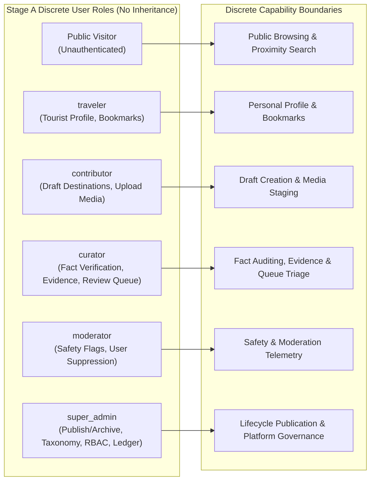

# API Authorization & Permission Matrix

## 1. Executive Summary & Authorization Principles

This document defines the authoritative access control matrix for all **Stage A** REST API endpoints of **My Travelroad**. The platform utilizes a defense-in-depth authorization model combining **Role-Based Access Control (RBAC)** for operational capabilities and **Attribute-Based Access Control (ABAC)** for user-owned resource isolation.

### Core Authorization Invariants
1. **Server-Side Enforcement**: All authorization policies are asserted at the API gateway and backend controller tier. Frontend navigational guards and role checks are purely user-experience conveniences and are never trusted.
2. **Explicit Denial**: Access is denied by default. An endpoint requires explicit permission granting; if a role is not listed as permitted, requests are rejected immediately.
3. **Appropriate Rejection Status Codes**:
   - `401 Unauthorized`: Request lacks valid authentication credentials (missing, invalid, or expired Bearer token).
   - `403 Forbidden`: Caller identity is verified, but the account role lacks required permissions or fails resource ownership assertions.
4. **Root System Account Exclusion**: The Root System Account (`00000000-0000-4000-8000-000000000001`) and any account with `type = 'system'` are programmatic identities reserved for internal database integrity. They are barred from authenticating via public endpoints and cannot invoke interactive APIs.

---

## 2. Actor Tiers & Discrete Capability Domains

| Actor Tier | Role Code | Account Classification | Core Responsibilities & Capabilities |
| :--- | :--- | :--- | :--- |
| **Public Visitor** | *(none)* | Unauthenticated | Browse published destinations, view active categories, search geographically, read public tourist profiles. |
| **Authenticated Tourist** | `traveler` | `individual` | Manage own profile, manage personal wishlist/saved destinations, view personalized travel preferences. |
| **Contributor** | `contributor` | `individual` / `business` | Submit initial destination drafts, contribute media assets, and submit fact update suggestions for curation. |
| **Curator** | `curator` | `individual` | Triage verification queues, assign curators, upload official evidence, certify/dispute fact fields, manage media assets. |
| **Moderator** | `moderator` | `individual` | Review flagged content, resolve safety reports, manage user status flags and content suppression. |
| **Super Administrator** | `super_admin` | `individual` | Full governance authority: publish/archive destinations, manage categories, elevate account roles, access audit logs. |

> [!IMPORTANT]
> **Discrete Role Architecture (No Implicit Inheritance)**:
> Roles (`traveler`, `contributor`, `curator`, `moderator`, `super_admin`) are discrete, non-overlapping classifications defined by the domain enum `UserRole`. Capabilities are evaluated strictly per endpoint. Roles do **not** automatically inherit permissions from other roles:
> - `moderator` does not have permission to verify facts or certify evidence.
> - `curator` does not have permission to moderate accounts or manage suspensions.
> - `contributor` cannot access curator queues or publish destinations.
> - `super_admin` has administrative platform authority where explicitly granted in this matrix.

---

## 3. Comprehensive Stage A API Authorization Matrix

### Legend
- ✅ **Allowed**: Caller tier is permitted to execute this endpoint.
- ❌ **Denied**: Caller tier is rejected (`401 Unauthorized` if unauthenticated, `403 Forbidden` if authenticated).
- 👤 **Owner Only**: Permitted only if the authenticated account matches the entity owner (`Account.id === Resource.accountId`).
- 🛡️ **Masked**: Permitted, but sensitive fields (e.g., restricted coordinates, PII) are filtered/sanitized.

---

### Module A: Authentication (`/api/v1/auth`)

| Method & Endpoint | Public | Traveler | Contributor | Curator | Moderator | Super Admin | Ownership Check | Field Restrictions / Masking | Rejection Code |
| :--- | :---: | :---: | :---: | :---: | :---: | :---: | :---: | :--- | :--- |
| `POST /auth/register` | ✅ | ❌ | ❌ | ❌ | ❌ | ❌ | No | Creates `traveler` role only. | `400 / 409` |
| `POST /auth/login` | ✅ | ✅ | ✅ | ✅ | ✅ | ✅ | No | System accounts (`type='system'`) rejected. | `401 INVALID_CREDENTIALS` |
| `POST /auth/logout` | ❌ | ✅ | ✅ | ✅ | ✅ | ✅ | Token owner | Clears caller's session tokens. | `401 AUTHENTICATION_REQUIRED` |
| `POST /auth/refresh` | ❌ | ✅ | ✅ | ✅ | ✅ | ✅ | Cookie owner | Refresh token family validation. | `401 TOKEN_INVALID` |
| `GET /auth/me` | ❌ | ✅ | ✅ | ✅ | ✅ | ✅ | Self (`Account.id`) | Excludes password hash & MFA secrets. | `401 AUTHENTICATION_REQUIRED` |
| `POST /auth/verify-email` | ✅ | ✅ | ✅ | ✅ | ✅ | ✅ | Token-based | Token verified against database. | `400 BAD_REQUEST` |
| `POST /auth/resend-verification` | ✅ | ✅ | ✅ | ✅ | ✅ | ✅ | Dual (Token/Session) | Generates new verification token. Anti-enumeration. | `429 RATE_LIMIT_EXCEEDED` |
| `POST /auth/forgot-password` | ✅ | ✅ | ✅ | ✅ | ✅ | ✅ | No | Never confirms if email exists (anti-enumeration). | `429 RATE_LIMIT_EXCEEDED` |
| `POST /auth/reset-password` | ✅ | ✅ | ✅ | ✅ | ✅ | ✅ | Token-based | Single-use token invalidation. | `400 / 401 TOKEN_INVALID` |

---

### Module B: Tourist Profiles (`/api/v1/profiles`)

| Method & Endpoint | Public | Traveler | Contributor | Curator | Moderator | Super Admin | Ownership Check | Field Restrictions / Masking | Rejection Code |
| :--- | :---: | :---: | :---: | :---: | :---: | :---: | :---: | :--- | :--- |
| `GET /profiles/me` | ❌ | 👤 | 👤 | 👤 | 👤 | 👤 | Yes (`accountId`) | Full profile with travel preferences. | `401 AUTHENTICATION_REQUIRED` |
| `PATCH /profiles/me` | ❌ | 👤 | 👤 | 👤 | 👤 | 👤 | Yes (`accountId`) | Cannot alter `id`, `accountId`, or `handle`. | `401 / 403 FORBIDDEN_ACCESS` |
| `PATCH /profiles/me/visibility` | ❌ | 👤 | 👤 | 👤 | 👤 | 👤 | Yes (`accountId`) | Controls `isPublic` discovery flag. | `401 / 403 FORBIDDEN_ACCESS` |
| `GET /profiles/:handle` | ✅ | ✅ | ✅ | ✅ | ✅ | ✅ | If private: Owner | Hidden if `isPublic=false` unless owner/admin. | `404 RESOURCE_NOT_FOUND` |

---

### Module C: Destination Categories (`/api/v1/categories`)

| Method & Endpoint | Public | Traveler | Contributor | Curator | Moderator | Super Admin | Ownership Check | Field Restrictions / Masking | Rejection Code |
| :--- | :---: | :---: | :---: | :---: | :---: | :---: | :---: | :--- | :--- |
| `GET /categories` | ✅ | ✅ | ✅ | ✅ | ✅ | ✅ | No | Active categories only (`status='active'`). | *(none)* |
| `GET /categories/:slug` | ✅ | ✅ | ✅ | ✅ | ✅ | ✅ | No | Active category details & child categories. | `404 RESOURCE_NOT_FOUND` |
| `GET /categories/:slug/destinations` | ✅ | ✅ | ✅ | ✅ | ✅ | ✅ | No | Published destinations only (`status='published'`). | `404 RESOURCE_NOT_FOUND` |

---

### Module D: Destinations (`/api/v1/destinations`)

| Method & Endpoint | Public | Traveler | Contributor | Curator | Moderator | Super Admin | Ownership Check | Field Restrictions / Masking | Rejection Code |
| :--- | :---: | :---: | :---: | :---: | :---: | :---: | :---: | :--- | :--- |
| `GET /destinations` | ✅ | ✅ | ✅ | ✅ | ✅ | ✅ | No | Only `published` destinations returned. | *(none)* |
| `GET /destinations/:slug` | ✅ | ✅ | ✅ | ✅ | ✅ | ✅ | No | Published only. Restricted coords masked. | `404 RESOURCE_NOT_FOUND` |
| `GET /destinations/search` | ✅ | ✅ | ✅ | ✅ | ✅ | ✅ | No | Published only. Spatial proximity / bbox filters. | *(none)* |
| `GET /destinations/:slug/location` | 🛡️ | 🛡️ | 🛡️ | ✅ | ✅ | ✅ | No | 3-Tier coordinate privacy enforced via view. | `404 RESOURCE_NOT_FOUND` |
| `GET /destinations/:slug/media` | ✅ | ✅ | ✅ | ✅ | ✅ | ✅ | No | Only approved media assets (`status='approved'`). | `404 RESOURCE_NOT_FOUND` |
| `GET /destinations/:slug/opening-hours` | ✅ | ✅ | ✅ | ✅ | ✅ | ✅ | No | Operating patterns and tariffs. | `404 RESOURCE_NOT_FOUND` |

---

### Module E: Saved Destinations (`/api/v1/saved-destinations`)

| Method & Endpoint | Public | Traveler | Contributor | Curator | Moderator | Super Admin | Ownership Check | Field Restrictions / Masking | Rejection Code |
| :--- | :---: | :---: | :---: | :---: | :---: | :---: | :---: | :--- | :--- |
| `GET /saved-destinations` | ❌ | 👤 | 👤 | 👤 | 👤 | 👤 | Yes (`accountId`) | Caller's own bookmarks only. | `401 AUTHENTICATION_REQUIRED` |
| `POST /saved-destinations` | ❌ | 👤 | 👤 | 👤 | 👤 | 👤 | Yes (`accountId`) | Bookmark created for caller's account only. | `401 / 409 DUPLICATE_RESOURCE` |
| `DELETE /saved-destinations/:destinationId` | ❌ | 👤 | 👤 | 👤 | 👤 | 👤 | Yes (`accountId`) | Can only remove caller's own bookmark. | `401 / 404 RESOURCE_NOT_FOUND` |

---

### Module F: Administration (`/api/v1/admin`)

| Method & Endpoint | Public | Traveler | Contributor | Curator | Moderator | Super Admin | Ownership Check | Field Restrictions / Masking | Rejection Code |
| :--- | :---: | :---: | :---: | :---: | :---: | :---: | :---: | :--- | :--- |
| `GET /admin/dashboard` | ❌ | ❌ | ❌ | ✅ | ✅ | ✅ | No | High-level summary metrics. | `401 / 403 FORBIDDEN_ACCESS` |
| `GET /admin/destinations` | ❌ | ❌ | ❌ | ✅ | ❌ | ✅ | No | All statuses (`draft`, `in_review`, `published`, `archived`). | `401 / 403 FORBIDDEN_ACCESS` |
| `POST /admin/destinations` | ❌ | ❌ | ✅ | ✅ | ❌ | ✅ | No | Creates `draft`. Produces `AuditLog`. | `401 / 403 FORBIDDEN_ACCESS` |
| `GET /admin/destinations/:id` | ❌ | ❌ | ❌ | ✅ | ❌ | ✅ | No | Privileged administrative view: unmasked coordinates, altitude, accuracy, restriction parameters. Produces `AuditLog` (`action: 'destination.privileged_location_read'`). Fail-closed: returns `500 AUDIT_LOG_FAILURE` and suppresses coordinates if audit write fails. Telemetry metadata sanitized (no raw coordinates). | `401 / 403 FORBIDDEN_ACCESS` |
| `PATCH /admin/destinations/:id` | ❌ | ❌ | ❌ | ✅ | ❌ | ✅ | No | Updates metadata. Produces `AuditLog`. | `401 / 403 FORBIDDEN_ACCESS` |
| `POST /admin/destinations/:id/publish` | ❌ | ❌ | ❌ | ❌ | ❌ | ✅ | No | Requires `super_admin`. Produces `AuditLog`. | `401 / 403 FORBIDDEN_ACCESS` |
| `POST /admin/destinations/:id/archive` | ❌ | ❌ | ❌ | ❌ | ❌ | ✅ | No | Requires `super_admin`. Produces `AuditLog`. | `401 / 403 FORBIDDEN_ACCESS` |
| `POST /admin/categories` | ❌ | ❌ | ❌ | ❌ | ❌ | ✅ | No | Taxonomy creation. Produces `AuditLog`. | `401 / 403 FORBIDDEN_ACCESS` |
| `PATCH /admin/categories/:id` | ❌ | ❌ | ❌ | ❌ | ❌ | ✅ | No | Taxonomy mutation. Produces `AuditLog`. | `401 / 403 FORBIDDEN_ACCESS` |
| `POST /admin/uploads/presign` | ❌ | ❌ | ✅ | ✅ | ❌ | ✅ | No | Issues short-lived SigV4 PUT URL. Media vs private evidence scoping. | `401 / 403 FORBIDDEN_ACCESS` |
| `POST /admin/destinations/:id/media` | ❌ | ❌ | ✅ | ✅ | ❌ | ✅ | No | Contributors create `pending_review` media. | `401 / 403 FORBIDDEN_ACCESS` |
| `PATCH /admin/media/:id` | ❌ | ❌ | ❌ | ✅ | ❌ | ✅ | No | Set cover, moderate, reorder. Produces `AuditLog`. | `401 / 403 FORBIDDEN_ACCESS` |
| `DELETE /admin/media/:id` | ❌ | ❌ | ❌ | ✅ | ❌ | ✅ | No | Disassociates media asset. Produces `AuditLog`. | `401 / 403 FORBIDDEN_ACCESS` |
| `PUT /admin/destinations/:id/opening-hours` | ❌ | ❌ | ❌ | ✅ | ❌ | ✅ | No | Updates hours and fees. Produces atomic `AuditLog` (`action: 'destination.opening_hours_update'`). | `401 / 403 FORBIDDEN_ACCESS` |

---

### Module G: Destination Verification (`/api/v1/admin/verification`)

| Method & Endpoint | Public | Traveler | Contributor | Curator | Moderator | Super Admin | Ownership Check | Field Restrictions / Masking | Rejection Code |
| :--- | :---: | :---: | :---: | :---: | :---: | :---: | :---: | :--- | :--- |
| `GET /admin/verification/queue` | ❌ | ❌ | ❌ | ✅ | ❌ | ✅ | No | Verification queue triage. | `401 / 403 FORBIDDEN_ACCESS` |
| `GET /admin/verification/:destinationId` | ❌ | ❌ | ❌ | ✅ | ❌ | ✅ | No | Full fact statuses & evidence list. | `401 / 403 FORBIDDEN_ACCESS` |
| `POST /admin/verification/:destinationId/assign` | ❌ | ❌ | ❌ | ✅ | ❌ | ✅ | No | Assigns curator (`assignedCuratorId`). | `401 / 403 FORBIDDEN_ACCESS` |
| `POST /admin/verification/:destinationId/evidence` | ❌ | ❌ | ❌ | ✅ | ❌ | ✅ | No | Attaches documentary proof artifact. Confidential: restricted to curators/super admins. | `401 / 403 FORBIDDEN_ACCESS` |
| `POST /admin/verification/:destinationId/verify-field` | ❌ | ❌ | ❌ | ✅ | ❌ | ✅ | No | Certifies single fact. Produces `VerificationRecord`. | `401 / 403 FORBIDDEN_ACCESS` |
| `POST /admin/verification/:destinationId/dispute-field` | ❌ | ❌ | ❌ | ✅ | ❌ | ✅ | No | Flags fact as disputed or needs update. | `401 / 403 FORBIDDEN_ACCESS` |
| `GET /admin/verification/:destinationId/history` | ❌ | ❌ | ❌ | ✅ | ❌ | ✅ | No | Complete audit trail of verification records. | `401 / 403 FORBIDDEN_ACCESS` |

---

## 4. Special Access Policies & Field-Level Security

### 4.1 Coordinate Privacy Masking Rules
- When an unauthenticated visitor, traveler, or contributor requests destination location data:
  1. The API backend queries the database through view `v_public_destination_locations`.
  2. If `is_restricted = FALSE`: Exact GPS coordinates (`coordinates`) are projected.
  3. If `is_restricted = TRUE` and `public_approximate_centroid` is non-null: The approximate centroid coordinate is projected, and `locality` is replaced by `public_approximate_display_name`.
  4. If `is_restricted = TRUE` and `public_approximate_centroid` is null: `public_coordinates` is strictly `NULL`.
- Only callers authenticated with role `curator` or `super_admin` can retrieve raw coordinates through the administrative endpoint `GET /api/v1/admin/destinations/:id` for official verification and auditing purposes.

### 4.2 Account Elevation & Privileged Role Governance
- Public registration (`POST /api/v1/auth/register`) strictly assigns the `traveler` role.
- Elevation to privileged roles (`contributor`, `curator`, `moderator`, `super_admin`) is **never self-service**.
- Elevation must be performed by a `super_admin` through an atomic database transaction that generates an immutable `AuditLog` entry (`action: 'account.role_elevate'`).

### 4.3 PII and Telemetry Sanitization
- `AuditLogTelemetry` records (`ipAddress`, `userAgent`, state snapshots) are strictly internal.
- No public or traveler endpoint exposes historical IP addresses, user agents, or password histories.
- Profile responses (`GET /api/v1/profiles/:handle`) never include account email addresses, phone numbers, or internal account status flags.

### 4.4 Account Status Authorization Policies
In addition to role-based evaluations, caller permissions are strictly modulated by `Account.status`:
- **`pending_verification`**:
  - May authenticate (`POST /auth/login`) and receive a scoped JWT with claim `"emailVerified": false`.
  - Permitted endpoints: `GET /auth/me`, `GET /profiles/me`, `POST /auth/verify-email`, `POST /auth/resend-verification`, `POST /auth/logout`.
  - Denied endpoints: Any mutation (`PATCH /profiles/me`, `POST /saved-destinations`, `POST /admin/*`) is rejected with `403 Forbidden` (`code: 'EMAIL_VERIFICATION_REQUIRED'`).
- **`active`**:
  - Fully permitted according to role and ownership checks.
- **`suspended`**:
  - Login (`POST /auth/login`) rejected with `403 Forbidden` (`code: 'ACCOUNT_SUSPENDED'`).
  - Refresh (`POST /auth/refresh`) rejected with `403 Forbidden` (`code: 'ACCOUNT_SUSPENDED'`) and active refresh sessions are revoked immediately from Redis.
- **`deactivated`**:
  - Login and token refresh rejected with `403 Forbidden` (`code: 'ACCOUNT_DEACTIVATED'`).

### 4.5 Immediate Stateless JWT Revocation Mechanics
While short-lived JWT access tokens have a maximum 15-minute lifespan, status changes (suspension, deactivation, or role demotion) and credential revocations (password reset, future Stage A+ logout-all) take effect immediately:
1. **Privileged & Mutating Live Checks**: Every mutating route (POST, PATCH, PUT, DELETE) and privileged route (`curator`, `moderator`, `super_admin`) asserts live database status and token generation (`SELECT status, role, token_generation FROM accounts WHERE id = :id`) within the execution pipeline. If account status is not `active`, the request is immediately rejected (`403 ACCOUNT_SUSPENDED` or `403 ACCOUNT_DEACTIVATED`). If `jwt.gen !== account.token_generation`, the token is immediately rejected (`401 TOKEN_INVALID`).
2. **High-Performance Gateway Fast-Path Cache**: When an administrator suspends or deactivates an account, or upon account-wide revocation (password reset, future Stage A+ logout-all), the backend writes an ephemeral tombstone key to Redis: `revoked_accounts:{accountId}` with a TTL matching the 15-minute token lifetime. Edge middleware and gateway proxies assert this key in sub-millisecond time, rejecting all cached JWTs before hitting downstream services. This key is explicitly an ephemeral gateway cache, never the authoritative revocation barrier. If Redis is unavailable or the tombstone expires, validity is never restored to invalidated credentials because database `token_generation` checks are durable and permanent.
3. **Durable Revocation & Session Invalidation**: Initiating operations (password reset, future Stage A+ logout-all) atomically increment `accounts.token_generation` in PostgreSQL and enqueue an outbox job in `account_revocation_jobs` before touching Redis. The application then writes the fast-path tombstone `revoked_accounts:{accountId}`, enumerates all resolvable `"{familyId}:{sessionId}"` pairs in `account_sessions:{accountId}`, resolves the exact `activeTokenHash` and `activeSessionId` for each family, and executes the deterministic atomic family revocation script on each `{familyId}` shard across Redis nodes with state revalidation (deleting `family:{familyId}`, `session:{familyId}:{activeSessionId}`, and `token_lookup:{familyId}:{activeTokenHash}`). Each member is removed via `SREM`, and `account_sessions:{accountId}` is deleted only after all family revocations succeed, after which the outbox job is marked completed. Cross-slot Lua execution and non-executable wildcard deletions are strictly eliminated; background workers resume incomplete jobs via transactional outbox polling (`SELECT ... FOR UPDATE SKIP LOCKED` with explicit lease claiming and heartbeats); stale or missing index members cannot authorize access; and live database account-status and exact generation equality checks (`===`) guarantee immediate fail-closed access revocation across all worker crash boundaries. In Stage A, the platform enforces single-session `POST /auth/logout`, password reset invalidation via `passwordChangedAt` timestamp evaluation, and live status checks; multi-device `POST /auth/logout-all` is explicitly designated as a future Stage A+ endpoint.
