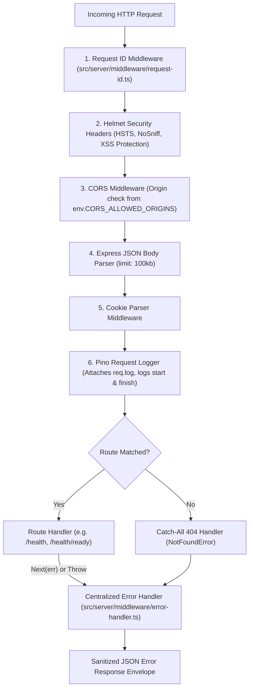

# Backend Foundation Architecture Specification

## 1. Overview & System Purpose

The **My Travelroad** backend is built as a secure, maintainable, modular-monolith web service utilizing Node.js, Express.js, TypeScript, PostgreSQL, and Prisma ORM.

This foundation establishes the core application infrastructure:
- Type-safe runtime environment validation using Zod.
- High-performance structured logging with Pino and automated sensitive field redaction.
- Request correlation tracing via deterministic `X-Request-Id` validation and UUIDv4 generation.
- Defense-in-depth HTTP security via Helmet and strict CORS origin controls.
- Express body parsing with explicit size boundaries (100kb limit).
- Centralized operational error taxonomy and standardized JSON response envelopes.
- Health and readiness probes (`/health`, `/health/ready`) integrating non-leaking database health verification.
- Graceful shutdown lifecycle management coordinating active HTTP connections and Prisma client teardown.

---

## 2. Directory Structure

```text
src/
├── config/
│   ├── env.ts                  # Zod environment schema & validated runtime configuration
│   └── logger.ts               # Structured Pino logger with sensitive data redaction
├── lib/
│   ├── db.ts                   # Prisma client singleton, connection lifecycle & PostGIS helpers
│   └── utils.ts                # Shared general utilities
├── server/
│   ├── app.ts                  # Express application factory (createApp)
│   ├── index.ts                # Server bootstrap entrypoint & graceful shutdown handlers
│   ├── auth/
│   │   ├── index.ts            # Auth module barrel exports
│   │   ├── password.ts         # Argon2id password hashing, verification & re-hash checking
│   │   ├── password.schema.ts  # Zod password validation schemas (creation & login)
│   │   ├── token.types.ts      # Auth token, claims, session metadata & cookie types
│   │   ├── jwt.ts              # HS256 JWT access token signing & verification (jose)
│   │   ├── refresh-token.ts    # CSPRNG refresh token generation (rt_<familyId>_<entropy>), SHA-256 hashing & validation
│   │   └── cookie.ts           # Centralized auth cookie options (HttpOnly, Secure, SameSite=Strict, Path=/api/v1/auth)
│   ├── errors/
│   │   ├── app-error.ts        # AppError base class & specialized error subclasses
│   │   └── error-codes.ts      # Machine-readable error code constants
│   ├── middleware/
│   │   ├── cors.ts             # CORS configuration bounded by validated environment origins
│   │   ├── error-handler.ts    # Centralized 404 handler and error response middleware
│   │   ├── request-id.ts       # Request ID validation and generation
│   │   └── request-logger.ts   # Correlated request/response Pino logging middleware
│   ├── routes/
│   │   ├── health.routes.ts    # /health and /health/ready endpoints
│   │   └── index.ts            # Root API router aggregation
│   └── types/
│       ├── express.d.ts        # Ambient type extensions for Express.Request (req.id, req.log)
│       └── response.types.ts   # Canonical API response and error envelope interfaces
```

---

## 3. Environment Configuration & Validation

Environment variables are validated on application startup via `src/config/env.ts` using Zod. Missing or malformed configurations trigger an immediate, descriptive startup failure without logging raw secrets or stack traces.

### Variable Definitions

| Variable | Type | Default | Description |
| :--- | :--- | :--- | :--- |
| `NODE_ENV` | `enum('development', 'test', 'production')` | `development` | Runtime environment. In `test`, log level defaults to `silent`. |
| `PORT` | `number (1-65535)` | `4000` | HTTP listener port. Avoids port 3000 used by Next.js. |
| `DATABASE_URL` | `string` | *(Required)* | PostgreSQL + PostGIS connection string for Prisma. |
| `DIRECT_URL` | `string` | *(Optional)* | Direct PostgreSQL connection string bypassing poolers. |
| `CORS_ALLOWED_ORIGINS` | `string` (comma-separated) | `http://localhost:3000` | Allowed origins for cross-origin requests. Every entry must strictly conform to RFC 6454 HTTP(S) serialized origins (`http://host[:port]` or `https://host[:port]`). Wildcards (`*`), credentials, paths, query strings, fragments, and empty entries are rejected at startup with generic, non-reflecting error messages to prevent credential leakage. |
| `LOG_LEVEL` | `enum('fatal', 'error', 'warn', 'info', 'debug', 'trace', 'silent')` | `info` | Active Pino log level threshold. |
| `JWT_SECRET` | `string (min 32 chars)` | *(Required)* | Secret key used to sign and verify HMAC-SHA256 (`HS256`) access tokens. Must contain at least 32 characters (256 bits) of entropy. |
| `JWT_ISSUER` | `string` | `https://mytravelroad.com` | Expected JWT issuer claim (`iss`). |
| `JWT_AUDIENCE` | `string` | `https://mytravelroad.com` | Expected JWT audience claim (`aud`). |

---

## 4. Middleware Pipeline & Execution Flow

Incoming requests pass through a strictly ordered middleware pipeline:



### Request ID & Path-Only URL Logging
- If the incoming request contains an `X-Request-Id` header matching `^[a-zA-Z0-9_-]{1,64}$`, that value is preserved.
- If missing, empty, or containing invalid characters, a new UUIDv4 is generated via Node.js `crypto.randomUUID()`.
- The ID is bound to `req.id` and echoed back via the `X-Request-Id` response header.
- **Pathname-Only Logging**: To prevent sensitive query parameters (`?token=...`, `?password=...`) from leaking into persistent log storage, the request logger strips all query strings and logs strictly the sanitized pathname (`path: req.originalUrl.split('?')[0]`).
- **Injectable Logger Middleware Factory**: `createRequestLoggerMiddleware(customLogger?: Logger)` allows injecting custom or test loggers into the actual production logging pipeline while exporting `requestLoggerMiddleware` by default.

### CORS Origin Validation & Sanitized Error Responses
- CORS origins are strictly matched against the validated allowlist.
- When an unauthorized origin attempts cross-origin access, the request is rejected with a generic HTTP `403 FORBIDDEN_ACCESS` error envelope (`"message": "Cross-origin request forbidden by CORS policy"`).
- Attacker-controlled origin strings are **never reflected** in error response payloads, eliminating XSS and reflection vectors.
- Environment validation of CORS configuration likewise uses generic error messages (`"CORS_ALLOWED_ORIGINS contains an invalid HTTP(S) origin entry."`) to prevent user credentials or tokens configured in origin strings from leaking into startup logs.

### Sensitive Data Redaction in Logging
Pino is configured to redact credentials, tokens, and sensitive headers across all log records:
- `req.headers.authorization`
- `req.headers.cookie`
- `res.headers['set-cookie']`
- `password`, `*.password`
- `token`, `*.token`
- `refreshToken`, `*.refreshToken`
- `accessToken`, `*.accessToken`
- `secret`, `*.secret`
- `credentials`, `*.credentials`

Redacted values are replaced with `[REDACTED]`.

---

## 5. API Response Envelopes & Error Taxonomy

### 5.1 Success Envelope
```json
{
  "success": true,
  "data": { ... },
  "meta": {
    "pagination": {
      "page": 1,
      "limit": 20,
      "totalItems": 100,
      "totalPages": 5,
      "hasNextPage": true,
      "hasPrevPage": false
    },
    "timestamp": "2026-11-17T03:00:00.000Z"
  }
}
```

### 5.2 Error Envelope
```json
{
  "success": false,
  "error": {
    "code": "VALIDATION_FAILED",
    "message": "The request body failed schema validation.",
    "details": [
      {
        "field": "title",
        "issue": "Title must be at least 3 characters long."
      }
    ],
    "requestId": "550e8400-e29b-41d4-a716-446655440000",
    "timestamp": "2026-11-17T03:00:00.000Z"
  }
}
```

### 5.3 Error Code Mapping
| Error Code | HTTP Status | Description |
| :--- | :--- | :--- |
| `BAD_REQUEST` | `400` | Malformed JSON syntax, invalid query parameters, or missing mandatory headers. |
| `AUTHENTICATION_REQUIRED` | `401` | Missing, expired, or malformed authentication token. |
| `INVALID_CREDENTIALS` | `401` | Incorrect username/email or password. |
| `FORBIDDEN_ACCESS` | `403` | Caller lacks the necessary permission or role. |
| `RESOURCE_NOT_FOUND` | `404` | The requested route, ID, or entity does not exist. |
| `DUPLICATE_RESOURCE` | `409` | Unique constraint violation. |
| `VALIDATION_FAILED` | `422` | Zod schema validation failed on one or more payload fields. |
| `SERVICE_UNAVAILABLE` | `503` | Readiness check failed or downstream dependency unavailable. |
| `INTERNAL_SERVER_ERROR` | `500` | Unhandled server exception. Raw errors and stack traces are suppressed. |

---

## 6. Health & Readiness Endpoints

### 6.1 Basic Process Health
- **Endpoint**: `GET /health`
- **Purpose**: Verifies that the Node.js process is alive and responsive.
- **Response**: HTTP 200 OK
  ```json
  {
    "success": true,
    "data": {
      "status": "ok",
      "uptime": 45.21,
      "timestamp": "2026-11-17T03:00:00.000Z"
    }
  }
  ```

### 6.2 Database Readiness Probe
- **Endpoint**: `GET /health/ready`
- **Purpose**: Verifies active connectivity to PostgreSQL using `SELECT 1`.
- **Success Response**: HTTP 200 OK
  ```json
  {
    "success": true,
    "data": {
      "status": "ready",
      "database": "connected",
      "timestamp": "2026-11-17T03:00:00.000Z"
    }
  }
  ```
- **Failure Response**: HTTP 503 Service Unavailable
  ```json
  {
    "success": false,
    "error": {
      "code": "SERVICE_UNAVAILABLE",
      "message": "Database readiness check failed",
      "requestId": "550e8400-e29b-41d4-a716-446655440000",
      "timestamp": "2026-11-17T03:00:00.000Z"
    }
  }
  ```
- **Security Invariant**: Failure responses **never** expose PostgreSQL error codes, database credentials, connection strings, or internal stack traces.

---

## 7. Database Infrastructure & Lifecycle Management

- **Prisma Client Singleton**: `src/lib/db.ts` uses the global singleton pattern to prevent duplicate connection pools during hot-reloading in development.
- **Query Logging Hardening**: Prisma Client is configured strictly with `log: PRISMA_LOG_CONFIG` where `PRISMA_LOG_CONFIG: Prisma.LogLevel[] = ["error", "warn"]` across all environments. Raw SQL query logging (`"query"`) is prohibited to prevent the emission of bound parameter values that may contain sensitive credentials, password hashes, or personally identifiable information.
- **Explicit Connection Lifecycle**:
  - `connectDatabase()`: Explicitly initiates connection pool creation (`prisma.$connect()`).
  - `disconnectDatabase()`: Cleanly drains connection pools on server shutdown (`prisma.$disconnect()`).
  - `checkDatabaseHealth()`: Executes `SELECT 1` without modifying state.
- **Preservation of Existing Assets**: All 39 PostGIS spatial helpers and custom WKT/bounding-box utilities in `src/lib/db.ts` are preserved.

---

## 8. Graceful Shutdown Protocol

The server bootstrap (`src/server/index.ts`) registers termination handlers for `SIGTERM` and `SIGINT`:
1. **Stop Incoming Traffic**: The HTTP listener calls `server.close()`, refusing new connections.
2. **Drain Existing Connections**: In-flight requests are granted a graceful drain period (up to 10 seconds).
3. **Database Teardown**: The Prisma client connection is closed via `disconnectDatabase()`.
4. **Clean Exit**: The process logs the shutdown completion and exits with code 0.
5. **Crash Safety**: Uncaught exceptions (`uncaughtException`) and unhandled promise rejections (`unhandledRejection`) log fatal diagnostic errors via Pino before initiating an exit with code 1.

---

## 9. Testing Strategy

The test suite is built on **Vitest** and **Supertest** located under `tests/server/`:
- `env.test.ts`: Validates Zod environment parsing, defaults, port boundary coercion, RFC 6454 origin validation, secret leakage prevention on malformed origins, and empty entry rejection.
- `app.test.ts`: Validates Express factory creation, Helmet headers, CORS headers, and JSON body parsing 100kb limit.
- `health.test.ts`: Validates process health (200), database readiness (200), and database connection failure (503 with safe sanitization).
- `error-handler.test.ts`: Validates 404 handler, custom `AppError` subclasses, Zod validation formatting, body parser syntax errors, and 500 stack sanitization.
- `request-id.test.ts`: Validates generation of UUIDv4, validation/preservation of valid incoming headers, sanitization of malicious headers, and header echo.
- `logging.test.ts`: Validates Pino redaction rules against authorization headers, cookies, passwords, and tokens; tests actual `requestLoggerMiddleware` query-stripping behavior; asserts on `PRISMA_LOG_CONFIG` to guarantee query logging suppression.
- `auth/password.test.ts`: Validates Argon2id MCF generation, constant-time verification, rejection of incorrect passwords, unique CSPRNG salts, safe malformed hash handling, `needsRehash` parameter detection, and Zod password complexity rules.
- `auth/jwt.test.ts`: Validates HMAC-SHA256 access token signing, claim preservation, algorithm-confusion attack rejection (`alg: none`, `alg: HS512`), expiration enforcement, and issuer/audience verification.
- `auth/refresh-token.test.ts`: Validates CSPRNG opaque refresh token generation (`rt_<uuid>_<64hex>`), timing-safe SHA-256 hash verification, family ID extraction, format regex checking, and centralized cookie options generation.

---

## 10. Password Security & Cryptography Foundation

The authentication module (`src/server/auth/`) provides reusable cryptographic utilities strictly adhering to **RFC 9106** and **OWASP Password Storage Guidelines**:

### 10.1 Argon2id Configuration Parameters
- **Algorithm**: `argon2id` (v=19 / 0x13)
- **Memory Cost ($m$)**: $65536\text{ KiB}$ ($64\text{ MiB}$)
- **Time Cost ($t$)**: $3\text{ iterations}$
- **Parallelism ($p$)**: $4\text{ threads / lanes}$
- **Salt Length**: $16\text{ bytes}$ ($128\text{ bits}$ CSPRNG generated automatically by `argon2`)
- **Key / Digest Length**: $32\text{ bytes}$ ($256\text{ bits}$)
- **Format**: Standard Modular Crypt Format (MCF): `$argon2id$v=19$m=65536,t=3,p=4$<salt>$<digest>`

### 10.2 Cryptographic Invariants
1. **No Plaintext Persistence**: Passwords are never stored, logged, or reflected in responses or traces.
2. **Safe Error Handling**: `verifyPassword` catches malformed hashes, corrupted salts, and internal library exceptions, returning `false` safely without exposing internal details or crashing.
3. **Lazy Re-Hashing**: `needsRehash` checks whether stored MCF strings match current target cost parameters, enabling zero-downtime parameter upgrades during authenticated logins.
4. **Password Input Policy (Zod & Unicode Code-Point Semantics)**:
   - Password lengths are strictly evaluated in **Unicode code points** (`countCodePoints(str)` via `Array.from(str).length`), correctly accommodating supplementary characters (e.g. emoji, astral symbols) spanning surrogate pairs.
   - The 72-character maximum threshold is an **application-level API policy** established for payload bounding and DoS mitigation, distinct from Argon2id's maximum supported input length (which natively supports inputs up to $2^{32}-1$ bytes).
   - `passwordCreationSchema`: 8–72 Unicode code points, $\ge 1$ uppercase ASCII letter, $\ge 1$ lowercase ASCII letter, $\ge 1$ numeric digit. Whitespace is strictly preserved without silent trimming.
   - `loginPasswordSchema`: 1–72 Unicode code points, non-empty string. Both schemas and the hashing boundary enforce identical 72-code-point boundaries.

---

## 11. Authentication Token & Session Security Foundation

The token and session security module (`src/server/auth/`) establishes reusable primitives for stateless access verification, stateful refresh rotation, and centralized cookie management:

### 11.1 Access Token Architecture (JWT)
- **Signing Algorithm**: HMAC-SHA256 (`HS256`) via `jose` library.
- **Key Derivation**: Sourced from `env.JWT_SECRET` (minimum 32 characters / 256 bits of entropy).
- **Lifetime**: 15 minutes (`900` seconds).
- **Algorithm Pinning & Confusion Defense**: Both signing and verification pin strictly to `HS256` (`algorithms: ["HS256"]`). Tokens signed with `none`, `RS256`, `HS384`, or `HS512` are rejected.
- **Payload & Claims**:
  - `sub`: User UUIDv4 (Subject)
  - `role`: Canonical role (`traveler`, `agency_admin`, `agency_agent`, `super_admin`)
  - `email`: User primary email
  - `emailVerified`: Boolean verification status
  - `type`: Account classification (`individual`, `business`)
  - `status`: Account status (`active`, `suspended`, `pending_verification`, `archived`)
  - `gen`: Token generation sequence counter (`number`)
  - `iat`: Issued-at Unix timestamp (seconds)
  - `exp`: Expiration Unix timestamp (seconds, `iat + 900`)
  - `iss`: Issuer URI (`env.JWT_ISSUER`, default `https://mytravelroad.com`)
  - `aud`: Audience URI (`env.JWT_AUDIENCE`, default `https://mytravelroad.com`)
- **Error Handling**: Missing, expired, malformed, or invalid tokens throw `UnauthorizedError` with canonical error codes (`TOKEN_EXPIRED`, `TOKEN_INVALID`), preventing secret exposure.

### 11.2 Refresh Token Architecture
- **Format**: Structured opaque string: `rt_<familyId>_<entropy>`
  - `familyId`: UUIDv4 routing shard key. Contains zero user, role, or authorization data.
  - `entropy`: 32 bytes of cryptographically secure random bytes generated via `crypto.randomBytes(32)` formatted as a 64-character lowercase hex string (256 bits entropy).
  - Validated via regex: `^rt_[0-9a-f]{8}-[0-9a-f]{4}-4[0-9a-f]{3}-[89ab][0-9a-f]{3}-[0-9a-f]{12}_[0-9a-f]{64}$`.
- **Storage & Hashing**:
  - Refresh tokens are **never stored in plaintext** in any storage tier.
  - The server computes a SHA-256 hex digest (`hashRefreshToken(token)`).
  - Storage verification uses constant-time comparison via `crypto.timingSafeEqual` (`verifyRefreshTokenHash(token, hash)`).
- **Lifetime**: 30 days (`2592000` seconds).
- **Rotation & Replay Detection**:
  - Every token refresh issues a new refresh token within the same `familyId` and invalidates the previous hash.
  - If an expired, already-rotated, or invalid refresh token is presented, replay detection triggers: the entire token family is immediately revoked, defeating token hijacking.

### 11.3 Centralized Cookie Configuration
- **Cookie Name**: `refreshToken`
- **Path**: Restricted strictly to `/api/v1/auth` (preventing transmission on general API requests or static assets).
- **HttpOnly**: `true` (prohibiting JavaScript access and mitigating XSS token theft).
- **Secure**: `true` in production (`env.NODE_ENV === "production"`); `false` in development/test.
- **SameSite**: `Strict` (defending against Cross-Site Request Forgery).
- **MaxAge**: 30 days (`30 * 24 * 60 * 60 * 1000` ms) on token issuance; `0` on logout or session clearing.

### 11.4 Ephemeral & Durable Storage Partitioning
- **Redis (Ephemeral Session State)**:
  - Stores active family sessions (`session:{familyId}`) and refresh token hashes with a 30-day TTL.
  - Stores account-wide revocation generation markers (`user:revocations:{userId}`).
  - **Failure Mode**: Fail-closed posture (`REDIS_FAIL_MODE=fail_closed`). If Redis is unavailable or partitioned, authentication verification operations reject requests to prevent split-brain authorization.
- **PostgreSQL (Durable Source of Truth)**:
  - Stores persistent account status, role, verified email state, and `token_generation` counter on the `users` table.
  - Survives complete Redis cluster flushing or restarts.
