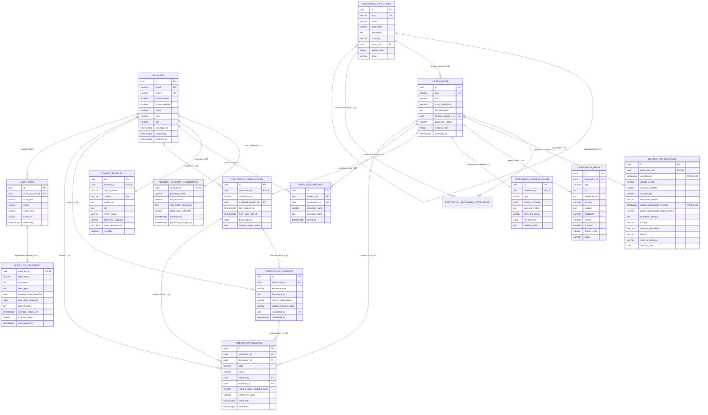

# My Travelroad — Database Architecture & Relational Schema Specification

## 1. Executive Summary

**My Travelroad** is a next-generation tourism discovery and trip-planning platform launching initially in **Malappuram, Kerala, India**, architected for horizontal expansion across Kerala, the Republic of India, and international travel corridors.

This document establishes the production-grade relational database architecture for **Stage A (Core Discovery, Verification, Curation & Accounts)**. It translates the approved TypeScript domain models (`src/types/domain/*`) and domain architecture (`docs/architecture/domain-model.md`) into a PostgreSQL and PostGIS physical data model.

### Key Architectural Pillars
1. **Relational Data Integrity**: Strict schema-level constraints (foreign keys, check constraints, composite unique indexes, and domain enumerations) enforce business invariants at the database engine level, independent of application code.
2. **PostGIS Geodetic Modeling**: Native spherical geospatial calculation using `GEOGRAPHY(Point, 4326)` with canonical `[longitude, latitude]` coordinate order, indexed via Generalized Search Trees (GiST) for fast radial and bounding-box queries.
3. **Decoupled Fact-Level Verification**: Verification stamps and documentary evidence are separated from core destination storytelling, enabling independent, granular fact verification (coordinates, timings, fees, safety advisories) without altering publication state.
4. **Defense-in-Depth Privacy & Security**: Credential isolation via dedicated security tables, coordinate masking for ecologically fragile or restricted sites, and an append-only immutable audit trail.
5. **Phase-Gated Growth**: Strict isolation between Stage A transactional discovery entities and future-phase social/community systems (reviews, UGC posts, comments, social graph).

---

## 2. Database Technology Decisions and Rationale

| Architectural Component | Decision | Technical Rationale |
| :--- | :--- | :--- |
| **Relational Database Engine** | **PostgreSQL 16+** | Mature ACID compliance, advanced indexing (GiST, GIN, B-tree, BRIN), native JSONB support with expression indexing, row-level security (RLS), and PostGIS extension support. |
| **Geospatial Engine** | **PostGIS 3.4+** | Industry-standard spatial extension providing spherical geodetic calculations, spatial indexing, spatial relationship predicates (`ST_DWithin`, `ST_Intersects`), and GeoJSON conversion. |
| **Geospatial Column Type** | **`GEOGRAPHY(Point, 4326)`** | `GEOGRAPHY` operates natively on the WGS 84 ellipsoid (SRID 4326). Distance calculations (`ST_Distance`, `ST_DWithin`) return exact metric meters without requiring regional planar UTM projection re-mapping as the platform scales from Malappuram to global jurisdictions. |
| **Primary Key Strategy** | **UUID v4 (`UUID DEFAULT gen_random_uuid()`)** | Universally unique identifiers prevent sequential ID enumeration attacks, facilitate distributed client-side ID generation, simplify database replication/sharding, and match domain nominal types. |
| **ORM / Migration Layer** | **Prisma ORM (Schema + Raw SQL Spatial Extensions)** | Prisma provides strong TypeScript type safety and declarative schema definition. Because Prisma treats PostGIS columns as `Unsupported("geography(Point, 4326)")`, all spatial columns, GiST indexes, and spatial query patterns will be provisioned via Prisma's native `prisma migrate diff` and raw SQL migration scripts (`$queryRaw`). |
| **Temporal Data Types** | **`TIMESTAMPTZ` (`TIMESTAMP WITH TIME ZONE`)** | All temporal timestamps are stored in UTC with timezone awareness to avoid DST ambiguity and facilitate cross-timezone scaling. |

---

## 3. Stage A Table Specifications

Stage A encompasses:
- **13 Core Domain Tables** representing primary entities.
- **1 Auxiliary Audit Privacy Extension Table** (`audit_log_telemetry`) for privacy lifecycle and telemetry management.
- **1 Junction Table** (`destination_secondary_categories`) for secondary taxonomy associations.

The 13 Stage A Core Domain Tables:
1. `accounts` (Core identity & authentication status)
2. `account_security_credentials` (Argon2id credential secrets & lockouts)
3. `tourist_profiles` (Public traveler profile & preferences)
4. `destination_categories` (Hierarchical taxonomy)
5. `destinations` (Core destination entity)
6. `destination_locations` (PostGIS `GEOGRAPHY(Point, 4326)` & privacy attributes)
7. `destination_media` (Visual gallery & attribution assets)
8. `destination_opening_hours` (Structured operational schedules)
9. `destination_verifications` (Verification container & drift audit schedules)
10. `verification_evidence` (Documentary proof & government citations)
11. `verification_records` (Granular fact-level certified audit stamps)
12. `saved_destinations` (Private traveler wishlists & bookmarks)
13. `audit_logs` (Immutable core administrative audit ledger)

Auxiliary Tables:
- `audit_log_telemetry` (1:1 privacy extension table resolving the audit immutability vs. anonymization contradiction)
- `destination_secondary_categories` (N:M taxonomy junction table)

*(Note: User-generated content moderation (`moderation_records`) is explicitly deferred to **Section 11: Future-Phase Database Boundaries** alongside community posts, reviews, and user reports. Stage A editorial curation is comprehensively managed via `destination_verifications`, `verification_records`, `verification_evidence`, and `audit_logs`.)*

---

### 3.1 `accounts`
Stores system identity and authentication metadata. Decoupled from public profiles.

```sql
CREATE TABLE accounts (
    id UUID PRIMARY KEY DEFAULT gen_random_uuid(),
    email VARCHAR(255) NOT NULL,
    phone VARCHAR(32) NULL,
    email_verified BOOLEAN NOT NULL DEFAULT FALSE,
    phone_verified BOOLEAN NOT NULL DEFAULT FALSE,
    status VARCHAR(32) NOT NULL DEFAULT 'pending_verification',
    type VARCHAR(32) NOT NULL DEFAULT 'individual',
    role VARCHAR(32) NOT NULL DEFAULT 'traveler',
    last_login_at TIMESTAMPTZ NULL,
    created_at TIMESTAMPTZ NOT NULL DEFAULT CURRENT_TIMESTAMP,
    updated_at TIMESTAMPTZ NOT NULL DEFAULT CURRENT_TIMESTAMP,

    CONSTRAINT uq_accounts_email UNIQUE (email),
    CONSTRAINT uq_accounts_phone UNIQUE (phone),
    CONSTRAINT ck_accounts_status CHECK (status IN ('active', 'suspended', 'pending_verification', 'deactivated')),
    CONSTRAINT ck_accounts_type CHECK (type IN ('individual', 'business', 'system')),
    CONSTRAINT ck_accounts_role CHECK (role IN ('traveler', 'contributor', 'curator', 'moderator', 'super_admin')),
    CONSTRAINT ck_accounts_email_format CHECK (email ~* '^[A-Za-z0-9._%+-]+@[A-Za-z0-9.-]+\.[A-Za-z]{2,}$')
);

-- Case-insensitive unique index on email
CREATE UNIQUE INDEX idx_accounts_email_lower ON accounts (LOWER(email));
CREATE INDEX idx_accounts_status ON accounts (status);
CREATE INDEX idx_accounts_role ON accounts (role);
```

---

### 3.2 `account_security_credentials`
Isolated authentication secrets and security lockouts. Exactly 1:1 with `accounts`.

```sql
CREATE TABLE account_security_credentials (
    account_id UUID PRIMARY KEY,
    password_hash VARCHAR(255) NULL,
    mfa_enabled BOOLEAN NOT NULL DEFAULT FALSE,
    mfa_secret_encrypted TEXT NULL,
    failed_login_attempts INTEGER NOT NULL DEFAULT 0,
    locked_until TIMESTAMPTZ NULL,
    password_changed_at TIMESTAMPTZ NULL,
    created_at TIMESTAMPTZ NOT NULL DEFAULT CURRENT_TIMESTAMP,
    updated_at TIMESTAMPTZ NOT NULL DEFAULT CURRENT_TIMESTAMP,

    CONSTRAINT fk_security_account FOREIGN KEY (account_id) 
        REFERENCES accounts(id) ON DELETE CASCADE ON UPDATE CASCADE,
    CONSTRAINT ck_security_failed_attempts CHECK (failed_login_attempts >= 0)
);

CREATE INDEX idx_security_locked_until ON account_security_credentials (locked_until) WHERE locked_until IS NOT NULL;
```

#### Cryptographic Architecture & Password Security Specification
1. **Argon2id Hashing Standard**:
   In strict compliance with **RFC 9106** and **OWASP Password Storage Guidelines**, all user passwords must be hashed using the **Argon2id** hybrid algorithm, which provides state-of-the-art resistance against both GPU/ASIC side-channel attacks and trade-off cache attacks.
2. **Modular Crypt Format (MCF)**:
   The `password_hash` column stores the complete self-contained standard MCF string:
   ```text
   $argon2id$v=19$m=65536,t=3,p=4$<16-byte-base64-salt>$<32-byte-base64-hash>
   ```
3. **Elimination of the Separate Salt Column**:
   The legacy `password_salt` column is explicitly removed from the schema. Because the standard Argon2id encoded string embeds the algorithm identifier (`argon2id`), algorithm version (`v=19`), memory cost ($m$), iteration cost ($t$), parallelism factor ($p$), unique cryptographically secure salt, and resulting hash digest, storing a separate salt column is redundant, increases storage waste, and introduces synchronization hazards.
4. **Target Cost Parameters (RFC 9106 Recommended for Memory-Constrained Backend Servers)**:
   - **Type**: `Argon2id` (v=19 / 0x13)
   - **Memory Cost ($m$)**: $65536\text{ KiB}$ ($64\text{ MiB}$)
   - **Time Cost ($t$)**: $3\text{ iterations}$
   - **Parallelism ($p$)**: $4\text{ lanes / worker threads}$
   - **Salt Length**: $16\text{ bytes}$ ($128\text{ bits}$ CSPRNG via OS random device)
   - **Key / Digest Length**: $32\text{ bytes}$ ($256\text{ bits}$)
5. **Transparent Re-Hash Migration Strategy**:
   - When authenticating a traveler or administrative user, the backend application verifies the plaintext password against the stored MCF string using `argon2.verify()`.
   - After successful authentication, the application invokes `argon2.needsRehash(storedHash, currentOptions)` to check whether the hash was generated with older cost parameters (e.g., if upgrading to $m=128\text{ MiB}$ in future infrastructure tiers or if importing legacy hashes).
   - If `needsRehash` returns `true`, the application transparently computes an updated Argon2id hash using the current production parameters and executes:
     ```sql
     UPDATE account_security_credentials
     SET password_hash = :new_argon2id_hash,
         updated_at = CURRENT_TIMESTAMP
     WHERE account_id = :authenticated_account_id;
     ```
   - This migration occurs seamlessly during live logins without requiring a forced password reset or temporary plaintext storage. Under no circumstances are plaintext passwords ever logged, cached, or written to disk.

---

### 3.3 `tourist_profiles`
Public user-facing profile and personalization preferences. Exactly 1:1 with `accounts`.

```sql
CREATE TABLE tourist_profiles (
    id UUID PRIMARY KEY DEFAULT gen_random_uuid(),
    account_id UUID NOT NULL,
    display_name VARCHAR(120) NOT NULL,
    handle VARCHAR(50) NOT NULL,
    avatar_url TEXT NULL,
    bio TEXT NULL,
    home_region VARCHAR(120) NULL,
    preferred_language VARCHAR(10) NOT NULL DEFAULT 'en',
    travel_preferences TEXT[] NOT NULL DEFAULT '{}',
    is_public BOOLEAN NOT NULL DEFAULT TRUE,
    created_at TIMESTAMPTZ NOT NULL DEFAULT CURRENT_TIMESTAMP,
    updated_at TIMESTAMPTZ NOT NULL DEFAULT CURRENT_TIMESTAMP,

    CONSTRAINT uq_profiles_account_id UNIQUE (account_id),
    CONSTRAINT uq_profiles_handle UNIQUE (handle),
    CONSTRAINT fk_profiles_account FOREIGN KEY (account_id) 
        REFERENCES accounts(id) ON DELETE CASCADE ON UPDATE CASCADE,
    CONSTRAINT ck_profiles_handle_format CHECK (handle ~ '^[a-zA-Z0-9_]{3,50}$'),
    CONSTRAINT ck_profiles_display_name_length CHECK (length(trim(display_name)) >= 2)
);

-- Case-insensitive unique index on public handle
CREATE UNIQUE INDEX idx_profiles_handle_lower ON tourist_profiles (LOWER(handle));
CREATE INDEX idx_profiles_travel_preferences ON tourist_profiles USING GIN (travel_preferences);
```

---

### 3.4 `destination_categories`
Taxonomy classification with self-referencing hierarchy for sub-categories.

```sql
CREATE TABLE destination_categories (
    id UUID PRIMARY KEY DEFAULT gen_random_uuid(),
    slug VARCHAR(100) NOT NULL,
    name VARCHAR(100) NOT NULL,
    short_label VARCHAR(50) NOT NULL,
    description TEXT NOT NULL,
    icon_key VARCHAR(50) NOT NULL,
    parent_id UUID NULL,
    display_order INTEGER NOT NULL DEFAULT 0,
    status VARCHAR(20) NOT NULL DEFAULT 'active',
    created_at TIMESTAMPTZ NOT NULL DEFAULT CURRENT_TIMESTAMP,
    updated_at TIMESTAMPTZ NOT NULL DEFAULT CURRENT_TIMESTAMP,

    CONSTRAINT uq_categories_slug UNIQUE (slug),
    CONSTRAINT fk_categories_parent FOREIGN KEY (parent_id) 
        REFERENCES destination_categories(id) ON DELETE RESTRICT ON UPDATE CASCADE,
    CONSTRAINT ck_categories_slug_format CHECK (slug ~ '^[a-z0-9-]+$'),
    CONSTRAINT ck_categories_status CHECK (status IN ('active', 'inactive', 'archived')),
    CONSTRAINT ck_categories_no_self_parent CHECK (id <> parent_id)
);

CREATE INDEX idx_categories_parent_id ON destination_categories (parent_id);
CREATE INDEX idx_categories_status_order ON destination_categories (status, display_order);
```

---

### 3.5 `destinations`
Core tourism destination entity.

```sql
CREATE TABLE destinations (
    id UUID PRIMARY KEY DEFAULT gen_random_uuid(),
    slug VARCHAR(120) NOT NULL,
    title VARCHAR(200) NOT NULL,
    short_description VARCHAR(500) NOT NULL,
    full_description TEXT NOT NULL,
    primary_category_id UUID NOT NULL,
    publication_status VARCHAR(32) NOT NULL DEFAULT 'draft',
    featured_rank INTEGER NULL,
    created_at TIMESTAMPTZ NOT NULL DEFAULT CURRENT_TIMESTAMP,
    updated_at TIMESTAMPTZ NOT NULL DEFAULT CURRENT_TIMESTAMP,
    published_at TIMESTAMPTZ NULL,

    CONSTRAINT uq_destinations_slug UNIQUE (slug),
    CONSTRAINT fk_destinations_primary_category FOREIGN KEY (primary_category_id) 
        REFERENCES destination_categories(id) ON DELETE RESTRICT ON UPDATE CASCADE,
    CONSTRAINT ck_destinations_slug_format CHECK (slug ~ '^[a-z0-9-]+$'),
    CONSTRAINT ck_destinations_publication_status CHECK (
        publication_status IN ('draft', 'submitted', 'in_review', 'published', 'archived', 'suspended')
    ),
    CONSTRAINT ck_destinations_featured_rank CHECK (featured_rank IS NULL OR featured_rank > 0)
);

CREATE INDEX idx_destinations_primary_cat ON destinations (primary_category_id);
CREATE INDEX idx_destinations_status ON destinations (publication_status);
CREATE INDEX idx_destinations_published_featured ON destinations (publication_status, featured_rank) 
    WHERE publication_status = 'published' AND featured_rank IS NOT NULL;
CREATE INDEX idx_destinations_created_at ON destinations (created_at DESC);
```

---

### 3.6 `destination_secondary_categories` (Junction Table)
Many-to-many relationship supporting secondary cross-cutting category tags.

```sql
CREATE TABLE destination_secondary_categories (
    destination_id UUID NOT NULL,
    category_id UUID NOT NULL,
    created_at TIMESTAMPTZ NOT NULL DEFAULT CURRENT_TIMESTAMP,

    PRIMARY KEY (destination_id, category_id),
    CONSTRAINT fk_sec_cat_destination FOREIGN KEY (destination_id) 
        REFERENCES destinations(id) ON DELETE CASCADE ON UPDATE CASCADE,
    CONSTRAINT fk_sec_cat_category FOREIGN KEY (category_id) 
        REFERENCES destination_categories(id) ON DELETE RESTRICT ON UPDATE CASCADE
);

CREATE INDEX idx_sec_cat_category ON destination_secondary_categories (category_id);
```

---

### 3.7 `destination_locations`
PostGIS spherical location data, administrative hierarchy, and coordinate sensitivity flags. Exactly 1:1 with `destinations`.

```sql
CREATE TABLE destination_locations (
    id UUID PRIMARY KEY DEFAULT gen_random_uuid(),
    destination_id UUID NOT NULL,
    coordinates GEOGRAPHY(Point, 4326) NOT NULL,
    altitude_meters NUMERIC(7,2) NULL,
    accuracy_meters NUMERIC(6,2) NULL,
    is_restricted BOOLEAN NOT NULL DEFAULT FALSE,
    restriction_reason VARCHAR(50) NULL,
    public_approximate_centroid GEOGRAPHY(Point, 4326) NULL,
    public_approximate_display_name VARCHAR(150) NULL,
    formatted_address TEXT NOT NULL,
    locality VARCHAR(120) NULL,
    taluk_or_subdivision VARCHAR(100) NOT NULL,
    district VARCHAR(100) NOT NULL,
    state_or_province VARCHAR(100) NOT NULL,
    country_code CHAR(2) NOT NULL DEFAULT 'IN',
    postal_code VARCHAR(20) NULL,
    nearest_transit_hub JSONB NULL,
    created_at TIMESTAMPTZ NOT NULL DEFAULT CURRENT_TIMESTAMP,
    updated_at TIMESTAMPTZ NOT NULL DEFAULT CURRENT_TIMESTAMP,

    CONSTRAINT uq_locations_destination_id UNIQUE (destination_id),
    CONSTRAINT fk_locations_destination FOREIGN KEY (destination_id) 
        REFERENCES destinations(id) ON DELETE CASCADE ON UPDATE CASCADE,
    CONSTRAINT ck_locations_country_code CHECK (length(country_code) = 2 AND country_code = upper(country_code)),
    CONSTRAINT ck_locations_coord_range CHECK (
        ST_X(coordinates::geometry) >= -180.0 AND ST_X(coordinates::geometry) <= 180.0 AND
        ST_Y(coordinates::geometry) >= -90.0 AND ST_Y(coordinates::geometry) <= 90.0
    ),
    CONSTRAINT ck_locations_coord_valid CHECK (
        ST_IsValid(coordinates::geometry)
    ),
    CONSTRAINT ck_locations_restriction_reason CHECK (
        restriction_reason IS NULL OR restriction_reason IN (
            'wildlife_protection', 'tribal_settlement', 'defense_boundary', 'hazardous_terrain', 'private_property'
        )
    ),
    CONSTRAINT ck_locations_restricted_centroid CHECK (
        is_restricted = FALSE OR public_approximate_display_name IS NOT NULL
    )
);

-- PostGIS GiST Spatial Indexes
CREATE INDEX idx_locations_coordinates ON destination_locations USING GIST (coordinates);
CREATE INDEX idx_locations_public_centroid ON destination_locations USING GIST (public_approximate_centroid) 
    WHERE public_approximate_centroid IS NOT NULL;
CREATE INDEX idx_locations_public_coord_expr ON destination_locations USING GIST (
    (CASE WHEN is_restricted THEN public_approximate_centroid ELSE coordinates END)
);

-- B-Tree Administrative Hierarchy Indexes
CREATE INDEX idx_locations_district ON destination_locations (district);
CREATE INDEX idx_locations_state_country ON destination_locations (country_code, state_or_province, district);
CREATE INDEX idx_locations_taluk ON destination_locations (taluk_or_subdivision);
CREATE INDEX idx_locations_restricted ON destination_locations (is_restricted);
```

#### Geospatial Integrity Guarantees:
- **`ck_locations_coord_range`**: Validates at the database engine level that the projected longitude (X) falls strictly within `[-180.0, 180.0]` and latitude (Y) falls strictly within `[-90.0, 90.0]`. This prevents inverted coordinate entry or mathematical singularities from corrupting geodetic spatial calculations.
- **`ck_locations_coord_valid`**: Guarantees that the point geometry conforms to Open Geospatial Consortium (OGC) Simple Features specifications (`ST_IsValid`).
- **`ck_locations_restricted_centroid`**: Enforces that any destination flagged as `is_restricted = TRUE` must carry an approved `public_approximate_display_name` (e.g. *"Nilambur Eco-Zone Buffer Area"*). For Tiers 1 and 2 (Approved Gateway or Reviewed Administrative Centroid), `public_approximate_centroid` is populated; for Tier 3 (Coordinate Suppression), `public_approximate_centroid` is explicitly `NULL` to suppress map pin rendering while allowing textual locality presentation.
- **`idx_locations_public_coord_expr`**: Expression GiST index that indexes the exact coalesced coordinate expression projected by `v_public_destination_locations`, ensuring direct index scans for all public map searches.

---

### 3.8 `destination_media`
High-resolution images, videos, and 360-degree virtual tour media. Exactly 1:N with `destinations`.

```sql
CREATE TABLE destination_media (
    id UUID PRIMARY KEY DEFAULT gen_random_uuid(),
    destination_id UUID NOT NULL,
    type VARCHAR(32) NOT NULL DEFAULT 'image',
    url TEXT NOT NULL,
    thumbnail_url TEXT NULL,
    alt_text VARCHAR(255) NOT NULL,
    caption TEXT NULL,
    attribution VARCHAR(200) NULL,
    license VARCHAR(50) NOT NULL DEFAULT 'cc_by',
    is_cover BOOLEAN NOT NULL DEFAULT FALSE,
    display_order INTEGER NOT NULL DEFAULT 0,
    status VARCHAR(32) NOT NULL DEFAULT 'pending_review',
    created_at TIMESTAMPTZ NOT NULL DEFAULT CURRENT_TIMESTAMP,
    updated_at TIMESTAMPTZ NOT NULL DEFAULT CURRENT_TIMESTAMP,

    CONSTRAINT fk_media_destination FOREIGN KEY (destination_id) 
        REFERENCES destinations(id) ON DELETE CASCADE ON UPDATE CASCADE,
    CONSTRAINT ck_media_type CHECK (type IN ('image', 'video', 'panorama_360')),
    CONSTRAINT ck_media_status CHECK (status IN ('pending_review', 'approved', 'rejected')),
    CONSTRAINT ck_media_license CHECK (license IN (
        'public_domain', 'cc_by', 'cc_by_sa', 'official_department_press', 'contributor_licensed', 'proprietary'
    ))
);

-- Partial unique index: Only one primary cover media item per destination
CREATE UNIQUE INDEX idx_media_single_cover ON destination_media (destination_id) WHERE is_cover = TRUE;
CREATE INDEX idx_media_destination_order ON destination_media (destination_id, display_order);
CREATE INDEX idx_media_status ON destination_media (status);
```

---

### 3.9 `destination_opening_hours`
Operating patterns, weekly schedule intervals, seasonal monsoon advisories, and admission fee policies. Exactly 1:1 with `destinations`.

```sql
CREATE TABLE destination_opening_hours (
    id UUID PRIMARY KEY DEFAULT gen_random_uuid(),
    destination_id UUID NOT NULL,
    type VARCHAR(32) NOT NULL DEFAULT 'always_open',
    weekly_schedule JSONB NULL,
    seasonal_notes TEXT NULL,
    entry_fee_policy VARCHAR(32) NOT NULL DEFAULT 'free',
    fee_structure JSONB NULL,
    advisory_note TEXT NULL,
    created_at TIMESTAMPTZ NOT NULL DEFAULT CURRENT_TIMESTAMP,
    updated_at TIMESTAMPTZ NOT NULL DEFAULT CURRENT_TIMESTAMP,

    CONSTRAINT uq_opening_hours_destination UNIQUE (destination_id),
    CONSTRAINT fk_opening_hours_destination FOREIGN KEY (destination_id) 
        REFERENCES destinations(id) ON DELETE CASCADE ON UPDATE CASCADE,
    CONSTRAINT ck_opening_hours_type CHECK (type IN ('always_open', 'seasonal', 'scheduled', 'temporarily_closed')),
    CONSTRAINT ck_opening_hours_fee_policy CHECK (entry_fee_policy IN ('free', 'paid', 'partially_paid', 'restricted_permit'))
);

CREATE INDEX idx_opening_hours_fee_policy ON destination_opening_hours (entry_fee_policy);
```

---

### 3.10 `destination_verifications`
Overall verification container aggregating fact-level verifications and curator audit dates. Exactly 1:1 with `destinations`.

```sql
CREATE TABLE destination_verifications (
    id UUID PRIMARY KEY DEFAULT gen_random_uuid(),
    destination_id UUID NOT NULL,
    overall_status VARCHAR(32) NOT NULL DEFAULT 'unverified',
    assigned_curator_id UUID NULL,
    last_audited_at TIMESTAMPTZ NULL,
    next_audit_due_at TIMESTAMPTZ NULL,
    field_statuses JSONB NOT NULL DEFAULT '{}',
    curator_queue_notes TEXT NULL,
    created_at TIMESTAMPTZ NOT NULL DEFAULT CURRENT_TIMESTAMP,
    updated_at TIMESTAMPTZ NOT NULL DEFAULT CURRENT_TIMESTAMP,

    CONSTRAINT uq_verifications_destination UNIQUE (destination_id),
    CONSTRAINT fk_verifications_destination FOREIGN KEY (destination_id) 
        REFERENCES destinations(id) ON DELETE CASCADE ON UPDATE CASCADE,
    CONSTRAINT fk_verifications_curator FOREIGN KEY (assigned_curator_id) 
        REFERENCES accounts(id) ON DELETE SET NULL ON UPDATE CASCADE,
    CONSTRAINT ck_verifications_status CHECK (
        overall_status IN ('unverified', 'in_review', 'needs_update', 'partially_verified', 'verified', 'flagged')
    )
);

CREATE INDEX idx_verifications_status ON destination_verifications (overall_status);
CREATE INDEX idx_verifications_curator ON destination_verifications (assigned_curator_id) WHERE assigned_curator_id IS NOT NULL;
CREATE INDEX idx_verifications_next_due ON destination_verifications (next_audit_due_at) WHERE next_audit_due_at IS NOT NULL;
```

---

### 3.11 `verification_evidence`
Physical or documentary evidence (government gazettes, DTPC circulars, GPS tracks, photos) supporting fact verification claims.

```sql
CREATE TABLE verification_evidence (
    id UUID PRIMARY KEY DEFAULT gen_random_uuid(),
    verification_id UUID NOT NULL,
    evidence_type VARCHAR(50) NOT NULL,
    document_url TEXT NULL,
    source_organization VARCHAR(150) NOT NULL,
    official_reference_code VARCHAR(100) NULL,
    notes TEXT NULL,
    submitted_by UUID NOT NULL,
    submitted_at TIMESTAMPTZ NOT NULL DEFAULT CURRENT_TIMESTAMP,

    CONSTRAINT fk_evidence_verification FOREIGN KEY (verification_id) 
        REFERENCES destination_verifications(id) ON DELETE CASCADE ON UPDATE CASCADE,
    CONSTRAINT fk_evidence_submitter FOREIGN KEY (submitted_by) 
        REFERENCES accounts(id) ON DELETE RESTRICT ON UPDATE CASCADE,
    CONSTRAINT ck_evidence_type CHECK (evidence_type IN (
        'government_gazette', 'department_circular', 'official_website', 
        'on_site_gps_track', 'photographic_proof', 'curator_affidavit', 'field_survey_sheet'
    ))
);

CREATE INDEX idx_evidence_verification_id ON verification_evidence (verification_id);
CREATE INDEX idx_evidence_type ON verification_evidence (evidence_type);
```

---

### 3.12 `verification_records`
Granular historical fact audit stamps per field (`location_coordinates`, `opening_hours`, etc.). Exactly 1:N with `destination_verifications`.

```sql
CREATE TABLE verification_records (
    id UUID PRIMARY KEY DEFAULT gen_random_uuid(),
    verification_id UUID NOT NULL,
    destination_id UUID NOT NULL,
    field VARCHAR(50) NOT NULL,
    status VARCHAR(32) NOT NULL DEFAULT 'unverified',
    verified_by UUID NOT NULL,
    evidence_id UUID NULL,
    verified_value_snapshot_hash VARCHAR(64) NULL,
    confidence_level VARCHAR(50) NOT NULL,
    notes TEXT NULL,
    timestamp TIMESTAMPTZ NOT NULL DEFAULT CURRENT_TIMESTAMP,
    valid_until TIMESTAMPTZ NULL,

    CONSTRAINT fk_records_verification FOREIGN KEY (verification_id) 
        REFERENCES destination_verifications(id) ON DELETE CASCADE ON UPDATE CASCADE,
    CONSTRAINT fk_records_destination FOREIGN KEY (destination_id) 
        REFERENCES destinations(id) ON DELETE CASCADE ON UPDATE CASCADE,
    CONSTRAINT fk_records_verifier FOREIGN KEY (verified_by) 
        REFERENCES accounts(id) ON DELETE RESTRICT ON UPDATE CASCADE,
    CONSTRAINT fk_records_evidence FOREIGN KEY (evidence_id) 
        REFERENCES verification_evidence(id) ON DELETE SET NULL ON UPDATE CASCADE,
    CONSTRAINT ck_records_field CHECK (field IN (
        'location_coordinates', 'opening_hours', 'entry_fees', 'safety_advisories', 
        'accessibility', 'contact_info', 'historical_facts', 'governing_authority'
    )),
    CONSTRAINT ck_records_status CHECK (status IN ('verified', 'disputed', 'needs_update', 'unverified')),
    CONSTRAINT ck_records_confidence CHECK (confidence_level IN (
        'official_authority', 'on_site_inspection', 'documentary_cross_reference', 'community_consensus'
    ))
);

CREATE INDEX idx_records_dest_field ON verification_records (destination_id, field);
CREATE INDEX idx_records_verification_id ON verification_records (verification_id);
CREATE INDEX idx_records_timestamp ON verification_records (timestamp DESC);
```

---

### 3.13 `saved_destinations`
Authenticated traveler bookmarks and trip wishlist collections. Strictly prevents duplicate saves per account.

```sql
CREATE TABLE saved_destinations (
    id UUID PRIMARY KEY DEFAULT gen_random_uuid(),
    account_id UUID NOT NULL,
    destination_id UUID NOT NULL,
    collection_name VARCHAR(100) NULL,
    personal_notes TEXT NULL,
    saved_at TIMESTAMPTZ NOT NULL DEFAULT CURRENT_TIMESTAMP,

    CONSTRAINT uq_saved_destinations_account_dest UNIQUE (account_id, destination_id),
    CONSTRAINT fk_saved_account FOREIGN KEY (account_id) 
        REFERENCES accounts(id) ON DELETE CASCADE ON UPDATE CASCADE,
    CONSTRAINT fk_saved_destination FOREIGN KEY (destination_id) 
        REFERENCES destinations(id) ON DELETE CASCADE ON UPDATE CASCADE
);

CREATE INDEX idx_saved_account_id ON saved_destinations (account_id);
CREATE INDEX idx_saved_destination_id ON saved_destinations (destination_id);
CREATE INDEX idx_saved_collection ON saved_destinations (account_id, collection_name) WHERE collection_name IS NOT NULL;
```

---

### 3.14 `audit_logs` (Core Immutable Ledger)
Strictly append-only, immutable administrative audit trail. Stores non-identifying regulatory provenance and event metadata.

```sql
CREATE TABLE audit_logs (
    id UUID PRIMARY KEY DEFAULT gen_random_uuid(),
    actor_account_id UUID NOT NULL,
    actor_role VARCHAR(32) NOT NULL,
    action VARCHAR(64) NOT NULL,
    entity_type VARCHAR(64) NOT NULL,
    entity_id VARCHAR(64) NOT NULL,
    timestamp TIMESTAMPTZ NOT NULL DEFAULT CURRENT_TIMESTAMP,

    CONSTRAINT fk_audit_actor FOREIGN KEY (actor_account_id) 
        REFERENCES accounts(id) ON DELETE RESTRICT ON UPDATE CASCADE
);

CREATE INDEX idx_audit_actor ON audit_logs (actor_account_id);
CREATE INDEX idx_audit_entity ON audit_logs (entity_type, entity_id);
CREATE INDEX idx_audit_timestamp ON audit_logs (timestamp DESC);
CREATE INDEX idx_audit_action ON audit_logs (action);
```

---

### 3.15 `audit_log_telemetry` (Auxiliary Privacy Extension)
Stores personal, forensic, and state-snapshot telemetry associated with audit events. Exactly 1:1 with `audit_logs`. Decoupled from `audit_logs` to enable legal data minimization, 90-day telemetry truncation, and GDPR Right-to-Erasure sanitization without compromising ledger immutability.

```sql
CREATE TABLE audit_log_telemetry (
    audit_log_id UUID PRIMARY KEY,
    actor_email VARCHAR(255) NULL,
    ip_address INET NULL,
    user_agent TEXT NULL,
    previous_state_snapshot JSONB NULL,
    new_state_snapshot JSONB NULL,
    context_notes TEXT NULL,
    retention_expires_at TIMESTAMPTZ NOT NULL,
    is_anonymized BOOLEAN NOT NULL DEFAULT FALSE,
    anonymized_at TIMESTAMPTZ NULL,

    CONSTRAINT fk_telemetry_audit FOREIGN KEY (audit_log_id) 
        REFERENCES audit_logs(id) ON DELETE CASCADE ON UPDATE CASCADE
);

CREATE INDEX idx_telemetry_expiry ON audit_log_telemetry (retention_expires_at) WHERE is_anonymized = FALSE;
CREATE INDEX idx_telemetry_actor_email ON audit_log_telemetry (actor_email) WHERE actor_email IS NOT NULL;
```

#### Reconstructing the TypeScript Domain Model
In `src/types/domain/audit.types.ts`, the application expects an `AuditLog` object containing both event metadata and actor telemetry. The relational layer projects this composite domain shape cleanly via a database view:

```sql
CREATE OR REPLACE VIEW v_domain_audit_logs AS
SELECT 
    al.id,
    al.actor_account_id,
    alt.actor_email,
    al.actor_role,
    alt.ip_address,
    alt.user_agent,
    al.action,
    al.entity_type,
    al.entity_id,
    alt.previous_state_snapshot,
    alt.new_state_snapshot,
    alt.context_notes,
    al.timestamp
FROM audit_logs al
LEFT JOIN audit_log_telemetry alt ON alt.audit_log_id = al.id;
```
When operational telemetry expires after 90 days or an account is erased, `alt.ip_address` and `alt.user_agent` evaluate to `NULL`, cleanly matching the TypeScript domain interface `ipAddress?: string | null`.

#### Editorial Curation vs. Future Moderation Boundary Note:
Stage A editorial workflows (destination approval, rejection, fact auditing, and corrections) are strictly governed by `destination_verifications`, `verification_records`, and `audit_logs`. The general-purpose user-generated content moderation entity (`moderation_records`) is deferred to **Section 11 (Future-Phase Database Boundaries)** alongside `user_reports`, `community_posts`, and `destination_reviews`.

---

## 4. PostGIS Geospatial Architecture

### 4.1 Canonical Coordinate System & Storage Mapping

In accordance with RFC 7946 GeoJSON and PostGIS Point geometry standards:
- **Canonical Tuple**: `[longitude: number, latitude: number]` (X = Longitude / Easting, Y = Latitude / Northing).
- **Coordinate System**: WGS 84 (SRID 4326).
- **PostgreSQL Column**: `coordinates GEOGRAPHY(Point, 4326)`.
- **Conversion to PostGIS Point**:
  ```sql
  -- Inserting from canonical [longitude, latitude]:
  ST_SetSRID(ST_MakePoint(:longitude, :latitude), 4326)::geography
  ```
- **Conversion from PostGIS Point back to GeoJSON / TypeScript**:
  ```sql
  -- Projecting as canonical [longitude, latitude]:
  ARRAY[ST_X(coordinates::geometry), ST_Y(coordinates::geometry)] AS coordinates
  ```

### 4.2 GiST Spatial Indexing

Traditional B-tree indexes cannot index multi-dimensional spatial points. PostGIS utilizes **Generalized Search Tree (GiST)** indexing with R-Tree bounding-box hierarchies:
```sql
CREATE INDEX idx_locations_coordinates ON destination_locations USING GIST (coordinates);
```

### 4.3 High-Performance Query Patterns

#### 1. Nearby Destination Search (Radial Distance in Meters)
Find destinations within $R$ meters of a traveler's coordinates, ordered by geodetic proximity:
```sql
SELECT 
    d.id,
    d.title,
    d.slug,
    d.short_description,
    c.name AS category_name,
    ST_Distance(dl.coordinates, ST_SetSRID(ST_MakePoint(:user_lng, :user_lat), 4326)::geography) AS distance_meters,
    CASE 
        WHEN dl.is_restricted THEN dl.public_approximate_display_name
        ELSE dl.locality
    END AS display_locality
FROM destinations d
JOIN destination_locations dl ON dl.destination_id = d.id
JOIN destination_categories c ON c.id = d.primary_category_id
WHERE d.publication_status = 'published'
  AND ST_DWithin(dl.coordinates, ST_SetSRID(ST_MakePoint(:user_lng, :user_lat), 4326)::geography, :radius_meters)
ORDER BY distance_meters ASC
LIMIT :limit OFFSET :offset;
```
*Performance Optimization*: `ST_DWithin` leverages the GiST bounding box index directly on `geography`, avoiding full-table scans.

#### 2. Map Viewport Bounding-Box Query & Antimeridian Crossing

Fetch destinations inside the traveler's active interactive map bounding box (`min_lng, min_lat, max_lng, max_lat`).

##### A. Technical Breakdown of the `&&` Operator on `GEOGRAPHY(Point, 4326)`
In PostgreSQL/PostGIS, the `&&` operator is the **2D bounding-box intersection operator**.
- When applied to `geography`, PostGIS computes geodetic bounding boxes on the WGS 84 ellipsoid and tests overlap against the GiST index (`idx_locations_coordinates` or `idx_locations_public_coord_expr`).
- This test discards non-matching rows using bounding-box spatial tree traversal without computing computationally heavy geodetic spherical trigonometric formulas on candidate points.

##### B. Handling the 180° Antimeridian (International Date Line)
When an interactive map spans across the 180° meridian (e.g. Pacific island tourism corridors or global viewports), the viewport's Western boundary has a positive longitude (`min_lng > 0`) while the Eastern boundary has a negative longitude (`max_lng < 0`), resulting in `min_lng > max_lng` (for example, `min_lng = 175.0` and `max_lng = -175.0`).
- If passed directly to `ST_MakeEnvelope(min_lng, min_lat, max_lng, max_lat, 4326)`, the constructor treats `min_lng` as greater than `max_lng`, creating an inverted envelope that either raises an error or queries the opposite 350° of the globe.
- **Flaw of Procedural `CASE` in `WHERE`**: Embedding conditional logic inside a SQL `CASE` expression in the `WHERE` clause interferes with the PostgreSQL query optimizer. Because the planner treats `CASE` procedurally, it often fails to push down the spatial predicates into the GiST index, falling back to an unindexed sequential scan (`Seq Scan`) across the entire table.
- **Index-Friendly Application Dispatch Pattern**: The trusted backend service inspects the bounding coordinates before dispatching the query:

```sql
-- Pattern A: Standard Viewport Query (min_lng <= max_lng)
-- Employs direct GiST Bitmap Index Scan against idx_locations_public_coord_expr
SELECT 
    d.id,
    d.title,
    d.slug,
    vdl.is_restricted,
    ST_X(vdl.public_coordinates::geometry) AS longitude,
    ST_Y(vdl.public_coordinates::geometry) AS latitude,
    vdl.public_locality_name,
    vdl.district,
    vdl.state_or_province
FROM destinations d
JOIN v_public_destination_locations vdl ON vdl.destination_id = d.id
WHERE d.publication_status = 'published'
  AND vdl.public_coordinates IS NOT NULL
  AND vdl.public_coordinates && ST_MakeEnvelope(:min_lng, :min_lat, :max_lng, :max_lat, 4326)::geography
LIMIT :limit;
```

```sql
-- Pattern B: Antimeridian-Crossing Viewport Query (min_lng > max_lng)
-- Dispatches two valid geodetic envelopes joined by OR, allowing GiST BitmapOr index scans
SELECT 
    d.id,
    d.title,
    d.slug,
    vdl.is_restricted,
    ST_X(vdl.public_coordinates::geometry) AS longitude,
    ST_Y(vdl.public_coordinates::geometry) AS latitude,
    vdl.public_locality_name,
    vdl.district,
    vdl.state_or_province
FROM destinations d
JOIN v_public_destination_locations vdl ON vdl.destination_id = d.id
WHERE d.publication_status = 'published'
  AND vdl.public_coordinates IS NOT NULL
  AND (
      vdl.public_coordinates && ST_MakeEnvelope(:min_lng, :min_lat, 180.0, :max_lat, 4326)::geography
      OR
      vdl.public_coordinates && ST_MakeEnvelope(-180.0, :min_lat, :max_lng, :max_lat, 4326)::geography
  )
LIMIT :limit;
```

##### C. Execution Plan Verification Protocol via `EXPLAIN (ANALYZE, BUFFERS)`
To verify that queries utilize the GiST spatial index and minimize disk I/O, developers and DBAs must run execution plan analyses on staging instances loaded with representative data:

```sql
EXPLAIN (ANALYZE, BUFFERS)
SELECT 
    d.id, d.title, vdl.public_locality_name
FROM destinations d
JOIN v_public_destination_locations vdl ON vdl.destination_id = d.id
WHERE d.publication_status = 'published'
  AND vdl.public_coordinates IS NOT NULL
  AND vdl.public_coordinates && ST_MakeEnvelope(75.5, 10.5, 76.5, 11.5, 4326)::geography;
```

**1. View Inlining & Index Pushdown Eligibility**:
- In PostgreSQL, simple views without aggregates, window functions, `LIMIT`, `OFFSET`, or `UNION` are automatically inlined into the parent query tree during the query rewrite phase.
- `v_public_destination_locations` is a simple projected view over `destination_locations`. When a query references `vdl.public_coordinates`, PostgreSQL substitutes the underlying expression:
  ```sql
  (CASE WHEN dl.is_restricted THEN dl.public_approximate_centroid ELSE dl.coordinates END)
  ```
- Because this expression matches `idx_locations_public_coord_expr` identically, the query optimizer recognizes the expression and considers the GiST index path.

**2. Testing with Representative Data**:
- In development environments with small table cardinalities (e.g., 5 to 50 destinations), the PostgreSQL cost-based optimizer will calculate that reading a single sequential table page (`cost = 1.05`) is significantly cheaper than traversing a multi-level GiST tree and performing random page lookups (`cost = 8.00+`). Under such conditions, `EXPLAIN` will intentionally choose a `Seq Scan`.
- To verify index behavior accurately, staging environments must populate representative spatial data (e.g. 10,000 synthetic geolocations across Kerala) followed by `ANALYZE destination_locations;` before evaluating execution plans.

**3. Plan Verification Criteria**:
- **Node Types**: On representative datasets, the plan should show `Bitmap Index Scan` on `idx_locations_public_coord_expr` leading to a `Bitmap Heap Scan`.
- **Buffer Hit Ratio**: In warm cache scenarios, `Buffers: shared hit` should account for the vast majority of page accesses, with `shared read = 0` or minimal.
- **Performance Realism**: Execution durations must never be claimed speculatively in architecture documentation. Real-world latency depends on table cardinality, spatial density of points in the viewport, disk I/O throughput, available shared memory (`shared_buffers`), and database server concurrency. Benchmarking must occur on representative staging infrastructure.

**4. Remediation Protocol if PostgreSQL Chooses a Sequential Scan on Large Datasets**:
If a sequential scan occurs on production-scale data, DBAs must execute the following diagnostic checklist:
1. *Update Statistics*: Execute `ANALYZE destination_locations;` to ensure the optimizer has current spatial bounding-box histograms.
2. *Tune Page Cost Constants*: The default `random_page_cost = 4.0` reflects spinning HDDs. On modern cloud SSD / NVMe volumes (AWS EBS gp3, GCP Hyperdisk), setting `random_page_cost = 1.1` accurately models random page retrieval, encouraging index selection.
3. *Diagnostic Forced Index Scan*: Execute `SET LOCAL enable_seqscan = off;` within the test session. If the planner successfully switches to `Bitmap Index Scan`, compare the estimated cost against the sequential scan cost to identify whether tuning `random_page_cost` or `cpu_operator_cost` is needed.
4. *Verify Expression Symmetry*: Verify that no implicit type cast or function signature variance has been introduced into the view definition or query that alters the exact expression signature indexed by `idx_locations_public_coord_expr`.

##### D. Application-Level Parameter Validation & Sanitization
To prevent denial-of-service through excessive spatial queries or coordinate errors, the application API layer enforces:
1. **Latitude Clamping**: Latitude must be strictly bounded between `-85.05112878` and `85.05112878` (Web Mercator boundary) or `-90.0` and `90.0` (WGS 84 bounds). Values outside this raise `400 Bad Request`.
2. **Longitude Normalization**: Longitudes are wrapped/clamped to `[-180.0, 180.0]`.
3. **Radial Search Radius Limit**: For nearby searches, `:radius_meters` is strictly clamped between `100` meters and `500000` meters ($500\text{ km}$). Unbounded radius queries are rejected to prevent full-table index bypass.
4. **Pagination Limit**: `:limit` is constrained between `1` and `100`.

---

### 4.4 Coordinate Privacy & Sensitivity Protection Architecture

Fragile ecosystems (e.g. Kadalundi migratory bird nesting banks, private tribal settlements in Nilambur, defense border zones) must never expose exact GPS coordinates to public discovery queries, client browsers, or data exports.

#### 1. PostgreSQL View Ownership & Access Security Model
PostgreSQL 15+ supports fine-grained control over view execution semantics. To prevent unauthorized access to restricted coordinates:

- **View Ownership (`schema_owner`)**:
  The view `v_public_destination_locations` is owned by the trusted database schema role (`schema_owner`), not by the web application role.
- **Definer Semantics (`security_invoker = false`)**:
  By default in PostgreSQL, views execute with the privileges of the **view owner** (`security_invoker = false`). This architectural decision is deliberate and necessary:
  - `schema_owner` possesses `SELECT` privilege on the underlying `destination_locations` table and can execute the coordinate masking logic.
  - The public application role (`app_user`) has **zero table-level privileges** on `destination_locations`:
    ```sql
    -- 1. Strictly revoke all direct table access from public web role
    REVOKE ALL ON destination_locations FROM PUBLIC, app_user;

    -- 2. Grant SELECT exclusively on the privacy-protecting view
    GRANT SELECT ON v_public_destination_locations TO app_user;

    -- 3. Set view owner to schema owner
    ALTER VIEW v_public_destination_locations OWNER TO schema_owner;
    ```
  - If `security_invoker = true` were set, PostgreSQL would evaluate underlying table permissions against `app_user`, causing all public queries to fail with `permission denied for relation destination_locations`. Leaving `security_invoker = false` enables the view to serve as a secure privilege gateway.
- **Row-Level Security (RLS) Interaction**:
  If Row-Level Security is enabled on `destination_locations`, PostgreSQL enforces that a view with `security_invoker = false` evaluates RLS policies as the view owner (`schema_owner`). Because `schema_owner` is the table owner, it bypasses RLS, ensuring that the view can access all rows to produce the sanitized output. `app_user` remains completely blocked from the underlying table.
- **Prevention of Side-Channel Leaks & Leaky Functions**:
  - *No Custom Functions*: `app_user` has `REVOKE CREATE ON SCHEMA public FROM app_user;`, preventing malicious users from defining custom procedural functions that could be evaluated by the query optimizer before the view's projection.
  - *No Distance-to-Target Probing*: Because `v_public_destination_locations` only projects `public_coordinates`, any spatial calculations executed by `app_user` (such as `ST_Distance`) operate strictly on the public centroid or safe coordinates. It is mathematically impossible to probe distance against the secret exact coordinates.
- **Privileged Access Pool (`admin_service_role`)**:
  Internal administrative and curation services connect using a dedicated connection pool authenticated as `admin_service_role`:
  ```sql
  GRANT SELECT, INSERT, UPDATE ON destination_locations TO admin_service_role;
  GRANT SELECT ON v_public_destination_locations TO admin_service_role;
  ```

#### 2. Public Database View Definition (`v_public_destination_locations`)
All public-facing search queries, radial endpoints, and interactive map layers read exclusively from this view:
```sql
CREATE OR REPLACE VIEW v_public_destination_locations AS
SELECT 
    dl.destination_id,
    dl.is_restricted,
    dl.restriction_reason,
    -- Projected coordinate: returns centroid if restricted, exact if public, or NULL if suppressed
    CASE 
        WHEN dl.is_restricted THEN dl.public_approximate_centroid
        ELSE dl.coordinates
    END AS public_coordinates,
    CASE 
        WHEN dl.is_restricted THEN dl.public_approximate_display_name
        ELSE dl.locality
    END AS public_locality_name,
    dl.taluk_or_subdivision,
    dl.district,
    dl.state_or_province,
    dl.country_code,
    dl.postal_code,
    dl.nearest_transit_hub,
    dl.created_at,
    dl.updated_at
FROM destination_locations dl;
```

#### 3. Restricted-Coordinate Publication Hierarchy (Rejection of Gaussian Jitter)
The previous proposal to apply automatic pseudo-random Gaussian jitter (e.g. 1.5 to 3.0 km random displacement) is **explicitly rejected** on technical and safety grounds:
- *Physical Safety Hazards*: Unsupervised algorithmic coordinate displacement can inadvertently place a map pin in a deep gorge, active quarry, river current, cliff face, or private estate, creating life-safety hazards for tourists attempting to navigate there.
- *Statistical Triangulation Vulnerability*: If randomized jitter were computed dynamically or across multiple exports, an adversary could collect multiple noisy samples and compute their arithmetic mean, mathematically recovering the true sensitive coordinates.

Instead, My Travelroad mandates a human-governed **3-Tier Publication Policy**:

```
+----------------------------------------------------------------------------------------------------+
|                       RESTRICTED SITE COORDINATE PUBLICATION HIERARCHY                             |
+----------------------------------------------------------------------------------------------------+
| PRIORITY 1: APPROVED OFFICIAL PUBLIC VISITOR ACCESS POINT                                         |
| - Curated gateway: Forest Dept counter, official parking area, ticketing office, boat jetty.       |
| - Safe, legally accessible to tourists, located outside the ecological/tribal perimeter.           |
| - public_approximate_centroid = ST_SetSRID(ST_MakePoint(lng, lat), 4326)::geography               |
+----------------------------------------------------------------------------------------------------+
                                      | (If no official visitor gateway exists)
                                      v
+----------------------------------------------------------------------------------------------------+
| PRIORITY 2: REVIEWED SAFE ADMINISTRATIVE-AREA CENTROID                                             |
| - Verified administrative buffer: Taluk headquarters, village center, or buffer zone hub.          |
| - Human-reviewed by curator to ensure it lands in an accessible public town/road location.          |
| - public_approximate_centroid = Reviewed Centroid; display_name = "Nilambur Buffer Area"           |
+----------------------------------------------------------------------------------------------------+
                                      | (If neither option is safe or available)
                                      v
+----------------------------------------------------------------------------------------------------+
| PRIORITY 3: COMPLETE COORDINATE SUPPRESSION (NO MAP PIN)                                          |
| - public_approximate_centroid = NULL                                                               |
| - Map pin is entirely suppressed in UI and API (public_coordinates IS NULL).                       |
| - Public displays show textual administrative locality only (e.g. "District: Malappuram").         |
+----------------------------------------------------------------------------------------------------+
```

#### 4. Approval Governance & Uniform Redaction Across Stacks
- **Curator Approval Responsibility**: Setting coordinates for Tiers 1 and 2 or designating Tier 3 suppression requires human review and sign-off by an authorized curator (`curator` or `super_admin`) during the destination verification workflow.
- **Application Logging**: Production log formatters must intercept and redact coordinates for restricted entities, replacing raw coordinates with `[REDACTED_SENSITIVE_COORDINATE]`.
- **Edge CDN & Client Caching**: Cache keys and payloads for public discovery must strictly consume the sanitized view data.
- **Bulk GeoJSON / CSV Export Endpoints**: Public data export APIs must never query the base `destination_locations` table; exports must strictly project `v_public_destination_locations` to prevent accidental mass leakage of sensitive ecological locations.

---

## 5. Relationship Cardinalities & Foreign-Key Integrity

| Parent Entity | Child Entity | Cardinality | Foreign Key Column | Delete Policy | Update Policy | Integrity Rationale |
| :--- | :--- | :---: | :--- | :--- | :--- | :--- |
| `accounts` | `tourist_profiles` | 1:1 | `account_id` | **CASCADE** | CASCADE | Profile is an identity projection of Account; deleting an account purges its public profile. |
| `accounts` | `account_security_credentials` | 1:1 | `account_id` | **CASCADE** | CASCADE | Credentials cannot exist without the parent identity. |
| `accounts` | `saved_destinations` | 1:N | `account_id` | **CASCADE** | CASCADE | Deleting a traveler account purges their private bookmark wishlist. |
| `accounts` | `destination_verifications` | 1:N | `assigned_curator_id` | **SET NULL** | CASCADE | If a curator account is deleted, existing verification queues remain intact with unassigned curator state. |
| `accounts` | `verification_evidence` | 1:N | `submitted_by` | **RESTRICT** | CASCADE | Historical audit proof cannot be orphaned; account must be retained or reassigned. |
| `accounts` | `verification_records` | 1:N | `verified_by` | **RESTRICT** | CASCADE | Certified audit stamps must permanently retain the certified curator's account reference. |
| `accounts` | `audit_logs` | 1:N | `actor_account_id` | **RESTRICT** | CASCADE | Audit log integrity requires preserving historical administrative actors. |
| `audit_logs` | `audit_log_telemetry` | 1:1 | `audit_log_id` | **CASCADE** | CASCADE | Privacy telemetry extension; purging an audit log cascades to its ephemeral telemetry. |
| `destination_categories` | `destination_categories` | 1:N | `parent_id` | **RESTRICT** | CASCADE | A parent category cannot be deleted while sub-categories depend on it. |
| `destination_categories` | `destinations` | 1:N | `primary_category_id` | **RESTRICT** | CASCADE | A category cannot be deleted while destinations reference it as their primary taxonomy. |
| `destinations` | `destination_secondary_categories` | 1:N | `destination_id` | **CASCADE** | CASCADE | Deleting a destination cleans up secondary tag associations. |
| `destination_categories` | `destination_secondary_categories` | 1:N | `category_id` | **RESTRICT** | CASCADE | Cannot delete category without removing secondary mappings first. |
| `destinations` | `destination_locations` | 1:1 | `destination_id` | **CASCADE** | CASCADE | Location coordinates belong to the destination entity lifecycle. |
| `destinations` | `destination_media` | 1:N | `destination_id` | **CASCADE** | CASCADE | Gallery assets are owned by the destination. |
| `destinations` | `destination_opening_hours` | 1:1 | `destination_id` | **CASCADE** | CASCADE | Operational schedules belong directly to the destination lifecycle. |
| `destinations` | `destination_verifications` | 1:1 | `destination_id` | **CASCADE** | CASCADE | Deleting a destination cleans up its associated verification container. |
| `destinations` | `saved_destinations` | 1:N | `destination_id` | **CASCADE** | CASCADE | Deleting a destination removes it from traveler wishlists. |
| `destination_verifications` | `verification_evidence` | 1:N | `verification_id` | **CASCADE** | CASCADE | Evidence links belong to the verification container. |
| `destination_verifications` | `verification_records` | 1:N | `verification_id` | **CASCADE** | CASCADE | Audit records belong to the verification container. |
| `verification_evidence` | `verification_records` | 1:N | `evidence_id` | **SET NULL** | CASCADE | Deleting an evidence document flags records as lacking proof rather than dropping the audit history. |

### Account Deactivation, Tombstone Anonymization & Audit Retention Lifecycle

#### 1. The Conflict: Cascading User Deletion vs. Restrictive Audit Foreign Keys
A fundamental tension exists in production database architectures between **user privacy rights (GDPR Art. 17 Right to Erasure)** and **regulatory compliance / non-repudiation (Audit Trail Integrity)**:
- Cascading deletion (`ON DELETE CASCADE`) is configured on `accounts -> tourist_profiles`, `accounts -> account_security_credentials`, and `accounts -> saved_destinations`.
- Restrictive deletion (`ON DELETE RESTRICT`) is configured on `accounts -> audit_logs`, `accounts -> verification_evidence`, and `accounts -> verification_records`.
- If an account has ever performed an audited event (e.g. curator approvals, admin setting changes, contributor submissions), executing `DELETE FROM accounts WHERE id = :id` will immediately fail with a foreign key constraint violation.

#### 2. The Comprehensive PII Reality in Historical Audit Logs
A naïve tombstone pattern that only scrubs the `accounts` and `tourist_profiles` tables is legally and technically defective if historical audit records still store personal data. The red-team audit identified six potentially identifying vectors in `audit_logs`:
1. **`actor_email`**: Plaintext corporate or personal email addresses stored on every audited action.
2. **`ip_address`**: Client IP addresses (classified as personal data under CJEU *Breyer* ruling).
3. **`user_agent`**: Device and browser fingerprints.
4. **`previous_state_snapshot` (JSONB)**: Historical state snapshots containing plaintext personal data (`email`, `phone`, `display_name`, `bio`, `avatar_url`).
5. **`new_state_snapshot` (JSONB)**: Updated state snapshots containing the same personal data.
6. **`context_notes`**: Free-text operational notes that may reference names, phone numbers, or email addresses.

#### 3. Legally Grounded 3-Phase Retention & Erasure Lifecycle
Under GDPR Article 5(1)(e) (Storage Limitation) and Article 6(1)(f) (Legitimate Interest), personal telemetry cannot be retained indefinitely under the blanket guise of "audit logging." My Travelroad enforces a structured lifecycle:

```
+----------------------------------------------------------------------------------------------------+
|                                ACCOUNT LIFECYCLE & RETENTION SCHEDULE                              |
+----------------------------------------------------------------------------------------------------+
| PHASE 1: ACTIVE OPERATIONAL SECURITY (0 - 90 DAYS)                                                 |
| - Full telemetry retained: ip_address, user_agent, actor_email, snapshots.                         |
| - Legal Basis: Legitimate interest in cybersecurity, anti-abuse, and fraud forensics (Recital 49). |
+----------------------------------------------------------------------------------------------------+
                                      |
                                      v (Automated daily scheduled batch job)
+----------------------------------------------------------------------------------------------------+
| PHASE 2: TELEMETRY TRUNCATION (> 90 DAYS)                                                          |
| - Automated background task truncates sensitive telemetry for all audit logs older than 90 days:   |
|   ip_address -> NULL; user_agent -> 'Anonymized-Client-Telemetry'                                  |
| - Core audit provenance (who did what to which entity) is preserved without network fingerprints.  |
+----------------------------------------------------------------------------------------------------+
                                      |
                                      v (Upon confirmed user account deletion request)
+----------------------------------------------------------------------------------------------------+
| PHASE 3: RIGHT-TO-ERASURE & TOMBSTONE EXECUTION                                                    |
| - 30-day recovery grace period expires.                                                            |
| - IF zero audit/verification records: Physical cascade purge (DELETE FROM accounts).                |
| - IF historical audit/verification records exist: Atomic Tombstone Anonymization Job executed.      |
+----------------------------------------------------------------------------------------------------+
```

#### 4. The Atomic Tombstone Anonymization & PII Sanitization Job
When an account with historical audit or verification records is erased, an automated administrative job executes the following atomic transaction:

```sql
BEGIN;

-- 1. Anonymize accounts table (scrub PII while preserving UUID key and email format constraint)
UPDATE accounts 
SET 
    email = 'deleted_' || id || '@anonymized.mytravelroad.local',
    phone = NULL,
    email_verified = FALSE,
    phone_verified = FALSE,
    status = 'deactivated',
    updated_at = CURRENT_TIMESTAMP
WHERE id = :target_account_id;

-- 2. Anonymize public tourist profile
UPDATE tourist_profiles
SET
    display_name = 'Former Traveler',
    handle = 'deleted_' || substr(id::text, 1, 8),
    avatar_url = NULL,
    bio = NULL,
    home_region = NULL,
    travel_preferences = '{}',
    is_public = FALSE,
    updated_at = CURRENT_TIMESTAMP
WHERE account_id = :target_account_id;

-- 3. Permanently purge authentication secrets (passwords, MFA secrets, lockouts)
DELETE FROM account_security_credentials WHERE account_id = :target_account_id;

-- 4. Permanently purge private bookmarks and wishlists
DELETE FROM saved_destinations WHERE account_id = :target_account_id;

-- 5. Anonymize historical audit log actor identities and truncate immediate telemetry in audit_log_telemetry
-- (CRITICAL: audit_logs is NEVER updated, preserving complete ledger immutability)
UPDATE audit_log_telemetry
SET 
    actor_email = 'deleted_' || al.actor_account_id || '@anonymized.mytravelroad.local',
    ip_address = NULL,
    user_agent = 'Erased-Client-Telemetry',
    is_anonymized = TRUE,
    anonymized_at = CURRENT_TIMESTAMP
FROM audit_logs al
WHERE audit_log_telemetry.audit_log_id = al.id
  AND al.actor_account_id = :target_account_id;

-- 6. Sanitize JSONB State Snapshots in audit_log_telemetry
-- Strips all personal keys from JSONB snapshots where this account was the target entity
UPDATE audit_log_telemetry
SET 
    previous_state_snapshot = CASE 
        WHEN previous_state_snapshot IS NOT NULL THEN 
            (previous_state_snapshot - 'email' - 'phone' - 'display_name' - 'bio' - 'avatar_url' - 'home_region')
            || '{"_erasure_redacted": true}'::jsonb
        ELSE NULL 
    END,
    new_state_snapshot = CASE 
        WHEN new_state_snapshot IS NOT NULL THEN 
            (new_state_snapshot - 'email' - 'phone' - 'display_name' - 'bio' - 'avatar_url' - 'home_region')
            || '{"_erasure_redacted": true}'::jsonb
        ELSE NULL 
    END,
    context_notes = 'Operational context redacted upon GDPR Right-to-Erasure compliance.'
FROM audit_logs al
WHERE audit_log_telemetry.audit_log_id = al.id
  AND ((al.entity_type IN ('account', 'tourist_profile') AND al.entity_id = :target_account_id::text)
       OR (al.actor_account_id = :target_account_id));

-- 7. Record an irreversible system tombstone event (append-only write)
WITH new_event AS (
    INSERT INTO audit_logs (
        actor_account_id, actor_role, action, entity_type, entity_id
    ) VALUES (
        :target_account_id, 'system', 'account.anonymized_tombstone', 'account', :target_account_id::text
    ) RETURNING id
)
INSERT INTO audit_log_telemetry (
    audit_log_id, actor_email, ip_address, user_agent, 
    new_state_snapshot, context_notes, retention_expires_at, is_anonymized, anonymized_at
) 
SELECT 
    id, 'system@anonymized.mytravelroad.local', NULL, 'System-Sanitizer',
    '{"tombstone_applied": true}'::jsonb,
    'GDPR Right-to-Erasure executed. All PII, credentials, wishlists, and JSON snapshots sanitized.',
    CURRENT_TIMESTAMP, TRUE, CURRENT_TIMESTAMP
FROM new_event;

COMMIT;
```

#### 5. Verification Records & Evidence Retention
- **`verification_records`**: Retains the certified audit stamp (`field`, `status`, `confidence_level`, `valid_until`, `timestamp`) and the certified fact SHA-256 hash. The `verified_by` column points to the tombstone UUID. This ensures an auditor can prove that field $F$ was certified by a qualified staff member at time $T$, without retaining the former employee's personal contact details.
- **`verification_evidence`**: Official documents (government gazettes, DTPC circulars, forest department survey maps) are public administrative records and remain permanently retained. If any evidence item contained personal employee badges or IDs, the underlying asset is scrubbed from secure storage and replaced with an administrative redaction flag.

---

## 6. Complete Mermaid Entity-Relationship (ER) Diagram



---

## 7. Indexing Strategy

Indexes accelerate lookups but incur storage overhead and slow down insert/update writes. The strategy below prioritizes critical query paths while explicitly avoiding speculative indexes.

### 7.1 Required Production Indexes

| Table | Index Name | Type | Indexed Columns | Justification / Target Query |
| :--- | :--- | :---: | :--- | :--- |
| `accounts` | `idx_accounts_email_lower` | B-tree (Unique) | `LOWER(email)` | Case-insensitive authentication lookup during login and registration. |
| `accounts` | `idx_accounts_status` | B-tree | `status` | Admin user directory filtering (`active`, `suspended`, `pending_verification`). |
| `accounts` | `idx_accounts_role` | B-tree | `role` | Role-based authorization queries and curator filtering. |
| `tourist_profiles` | `idx_profiles_handle_lower` | B-tree (Unique) | `LOWER(handle)` | User profile lookup by `@handle` in public discovery URLs. |
| `tourist_profiles` | `idx_profiles_travel_preferences`| GIN | `travel_preferences` | Array containment queries (`WHERE travel_preferences @> ARRAY['ecotourism_nature']`). |
| `destinations` | `uq_destinations_slug` | B-tree (Unique) | `slug` | Primary lookup for destination public landing pages (`/destinations/[slug]`). |
| `destinations` | `idx_destinations_status` | B-tree | `publication_status` | Filters out non-published drafts in public discovery queries. |
| `destinations` | `idx_destinations_primary_cat` | B-tree | `primary_category_id` | Category-specific destination listings (`/categories/[slug]`). |
| `destinations` | `idx_destinations_published_featured` | B-tree (Partial) | `(publication_status, featured_rank)` | Accelerates homepage hero showcases: `WHERE publication_status = 'published' AND featured_rank IS NOT NULL`. |
| `destination_locations` | `idx_locations_coordinates` | **GiST** | `coordinates` | Spatial index powering `ST_DWithin` proximity queries on exact coordinates. |
| `destination_locations` | `idx_locations_public_centroid` | **GiST** (Partial) | `public_approximate_centroid` | Spatial index for approximate public centroids when coordinates are restricted. |
| `destination_locations` | `idx_locations_public_coord_expr` | **GiST** | `(CASE WHEN is_restricted THEN public_approximate_centroid ELSE coordinates END)` | Direct GiST index scan on the coalesced public coordinate projection evaluated by `v_public_destination_locations`. |
| `destination_locations` | `idx_locations_state_country` | B-tree (Composite) | `(country_code, state_or_province, district)` | Regional filtering as platform expands from Malappuram to Kerala, India, and global. |
| `destination_locations` | `idx_locations_taluk` | B-tree | `taluk_or_subdivision` | Sub-district filtering (e.g. 'Nilambur', 'Tirur', 'Eranad'). |
| `destination_media` | `idx_media_single_cover` | B-tree (Partial Unique) | `destination_id WHERE is_cover = TRUE` | Enforces and instantly resolves the single cover photo per destination. |
| `destination_media` | `idx_media_destination_order` | B-tree (Composite) | `(destination_id, display_order)` | Fast rendering of gallery slideshows in display sequence. |
| `destination_verifications` | `idx_verifications_status` | B-tree | `overall_status` | Admin verification queue triage (`pending`, `needs_update`, `flagged`). |
| `destination_verifications` | `idx_verifications_curator` | B-tree (Partial) | `assigned_curator_id WHERE assigned_curator_id IS NOT NULL` | Curators filtering their assigned verification workload. |
| `verification_records` | `idx_records_dest_field` | B-tree (Composite) | `(destination_id, field)` | Fast fact-level audit verification checks for specific fields. |
| `saved_destinations` | `uq_saved_destinations_account_dest` | B-tree (Unique) | `(account_id, destination_id)` | Prevents duplicate saves and powers 1-click wishlist toggle checks. |
| `saved_destinations` | `idx_saved_account_id` | B-tree | `account_id` | Fetches traveler's saved items (`/saved`). |
| `audit_logs` | `idx_audit_actor` | B-tree | `actor_account_id` | Auditor inspection of specific administrator activity. |
| `audit_logs` | `idx_audit_entity` | B-tree (Composite) | `(entity_type, entity_id)` | History trail of changes to a specific destination or record. |
| `audit_logs` | `idx_audit_timestamp` | B-tree | `timestamp DESC` | Reverse-chronological audit feed. |
| `audit_log_telemetry` | `idx_telemetry_expiry` | B-tree (Partial) | `retention_expires_at WHERE is_anonymized = FALSE` | Fast batch identification of telemetry records eligible for 90-day truncation. |
| `audit_log_telemetry` | `idx_telemetry_actor_email` | B-tree (Partial) | `actor_email WHERE actor_email IS NOT NULL` | Identification of historical actor emails for Right-to-Erasure sanitization. |

### 7.2 Indexes Explicitly Avoided at Stage A
- **Full-Text Search (tsvector GIN) on `destinations.full_description`**: Avoided at Stage A because destination volume (~hundreds) is efficiently handled via short description / title B-tree prefix searches or PostgreSQL `ILIKE`. Trigram/tsvector GIN indexes will be provisioned in Stage B when full-text search requirements are profiled.
- **B-tree on `audit_log_telemetry.new_state_snapshot`**: Large JSONB payloads should not be indexed arbitrarily; only specific query keys should be indexed via expression indexes if audit filtering needs arise.
- **Index on `accounts.phone`**: While unique, a separate non-unique index is redundant with the `UNIQUE` constraint index.

---

## 8. Security, Data Privacy & Safeguards

### 8.1 Password Hash and Auth Isolation
- **Credential Segregation**: Authentication credentials (`password_hash`, `mfa_secret_encrypted`, failed attempt counters, lockouts) are stored exclusively in the isolated `account_security_credentials` table. Public profiles (`tourist_profiles`) and core account metadata (`accounts`) contain zero cryptographic secrets.
- **Argon2id Hybrid Hashing**: In accordance with RFC 9106 and OWASP, passwords are never stored in plaintext and are hashed using **Argon2id** ($m=65536\text{ KiB}$, $t=3\text{ iterations}$, $p=4\text{ lanes}$, 16-byte cryptographically secure random salt).
- **Self-Contained MCF String**: The standard Modular Crypt Format (MCF) embeds the algorithm version, salt, and cost parameters, completely eliminating the need for a separate salt column.
- **Transparent Re-Hashing**: When login cost parameters are upgraded in the future, the backend application re-hashes the verified password and writes the updated hash to `account_security_credentials` during the authenticated login session, without user friction or password resets.
- **Zero-Logging Mandate**: Plaintext passwords and decrypted MFA secrets are strictly forbidden from appearing in application logs, database query logs, error traces, or memory caches.

### 8.2 Role and Privilege Escalation Prevention

#### 1. Why Session-Variable Checks & Target Fallbacks Are Insecure
The red-team review correctly flagged two significant flaws in the previous design:
1. **Forgeable Session Variables**: In PostgreSQL, custom configuration settings (GUCs) like `app.actor_account_id` are caller-controlled. Any client connection can run `SET LOCAL app.actor_account_id = '<arbitrary-uuid>';`. Checking such variables does **not** establish a trusted human identity.
2. **Misattribution via `NEW.id` Fallback**: In the previous trigger, falling back to `NEW.id` when no session setting was found resulted in attributing the role change to the *target account* (the user being promoted). If an administrator promotes User X from traveler to curator, the database would record that User X promoted themselves. This is completely false attribution and defeats audit integrity.

#### 2. The Architectural Reality: Database Roles vs. Human Identity
In modern web applications utilizing connection pooling:
- The database engine authenticates the *shared database user* (`admin_service_role`), not the individual human administrator.
- The PostgreSQL database engine **cannot** independently verify which human administrator (e.g. Alice vs. Bob) authenticated to the web interface.
- Therefore, human identity verification and actor attribution are strictly **application-tier responsibilities**. Claims that a database trigger can independently verify human identity without application context are technically unfounded.

#### 3. Database Privilege Configuration & Role Separation
To guarantee defense-in-depth, database engine-level privileges prevent unauthorized callers from modifying roles:

```sql
-- ==============================================================================
-- DATABASE PRIVILEGE MATRIX: ROLE ELEVATION PROTECTION
-- ==============================================================================

-- 1. Standard Web Application Role (app_user)
-- Can read/write regular entities, but strictly barred from role updates
REVOKE UPDATE ON accounts FROM app_user;
GRANT UPDATE (email, phone, status, last_login_at, updated_at) ON accounts TO app_user;
-- Any query like: UPDATE accounts SET role = 'super_admin' executed by app_user
-- will be immediately halted by PostgreSQL: ERROR: permission denied for column "role"

-- 2. Privileged Administrative Service Role (admin_service_role)
-- Used exclusively by authenticated administrative workers / server actions
GRANT UPDATE (role, status, updated_at) ON accounts TO admin_service_role;
```

#### 4. Role Change Auditing Across All Operational Scenarios

##### Scenario A: Authoritative Application-Tier Role Change (Standard Flow)
All legitimate administrative operations go through the server-side `AccountAdministrationService`:
1. The service validates the administrator's JWT, MFA credentials, and verifies that `actor.role === 'super_admin'`.
2. The service establishes a connection as `admin_service_role` and executes an atomic transaction:
   ```sql
   BEGIN;
   -- 1. Update the account role
   UPDATE accounts 
   SET role = :new_role, updated_at = CURRENT_TIMESTAMP 
   WHERE id = :target_account_id;

   -- 2. Insert immutable audit event with verified human administrator attribution
   WITH event AS (
       INSERT INTO audit_logs (
           actor_account_id, actor_role, action, entity_type, entity_id
       ) VALUES (
           :verified_admin_account_id, 'super_admin', 'account.role_elevate', 'account', :target_account_id::text
       ) RETURNING id
   )
   -- 3. Insert attributable telemetry and administrative justification
   INSERT INTO audit_log_telemetry (
       audit_log_id, actor_email, ip_address, user_agent,
       previous_state_snapshot, new_state_snapshot, context_notes,
       retention_expires_at, is_anonymized
   )
   SELECT 
       id, :verified_admin_email, :admin_ip::inet, :admin_user_agent,
       jsonb_build_object('role', :old_role),
       jsonb_build_object('role', :new_role),
       :justification_ticket_reference,
       CURRENT_TIMESTAMP + INTERVAL '90 days',
       FALSE
   FROM event;
   COMMIT;
   ```

##### Scenario B: Failed or Unauthorized Role Change Attempts
1. **Unauthorized Web API Request**: If an unauthorized traveler or attacker issues an API request to modify a role, the application authorization layer rejects the request with `403 Forbidden`. The API tier asynchronously logs a security event via an isolated logging connection (`action = 'security.unauthorized_role_elevation_attempt'`), capturing the caller's IP, account ID, and timestamp.
2. **Direct SQL Injection on `app_user`**: If an attacker attempts `UPDATE accounts SET role = ...` via an application SQL injection on `app_user`, PostgreSQL halts the query with `ERROR: permission denied for column "role" of relation "accounts"`. The failure is recorded in the PostgreSQL server log.

##### Scenario C: Exceptional / Out-of-Band Direct Database Updates (DBA Safety Net)
If an update to `accounts.role` is executed directly via `psql` or an external tool using `admin_service_role` or a PostgreSQL superuser outside the application service, a database safety trigger fires to ensure non-repudiation:

```sql
CREATE OR REPLACE FUNCTION trg_audit_out_of_band_role_change()
RETURNS TRIGGER AS $$
DECLARE
    v_audit_id UUID;
BEGIN
    -- NEVER fall back to NEW.id! Attribute to dedicated SYSTEM / OUT-OF-BAND identity
    INSERT INTO audit_logs (
        actor_account_id,
        actor_role,
        action,
        entity_type,
        entity_id
    ) VALUES (
        '00000000-0000-0000-0000-000000000000'::uuid, -- Dedicated System/Out-of-Band UUID
        session_user::text,                           -- Captures PostgreSQL session role
        'account.role_change_out_of_band',
        'account',
        NEW.id::text
    ) RETURNING id INTO v_audit_id;

    INSERT INTO audit_log_telemetry (
        audit_log_id,
        actor_email,
        ip_address,
        user_agent,
        previous_state_snapshot,
        new_state_snapshot,
        context_notes,
        retention_expires_at,
        is_anonymized
    ) VALUES (
        v_audit_id,
        session_user || '@database.local',
        inet_client_addr(),
        'PostgreSQL Direct Connection / DBA Tool',
        jsonb_build_object('role', OLD.role),
        jsonb_build_object('role', NEW.role),
        'CRITICAL: Role modified directly in database outside application service layer. Investigating DBA session.',
        CURRENT_TIMESTAMP + INTERVAL '365 days',
        FALSE
    );

    RETURN NEW;
END;
$$ LANGUAGE plpgsql SECURITY DEFINER;

CREATE TRIGGER trg_audit_account_role_elevation
AFTER UPDATE OF role ON accounts
FOR EACH ROW 
WHEN (OLD.role IS DISTINCT FROM NEW.role)
EXECUTE FUNCTION trg_audit_out_of_band_role_change();
```

#### 5. Assumptions and Limitations
1. **Connection Pool Isolation**: The security model relies on strict physical connection pool separation: standard user traffic connects via `app_user`, and administrative actions connect via `admin_service_role`.
2. **No Role Inheritance**: `app_user` must not be granted `admin_service_role` or `SUPERUSER`.
3. **Application Layer Trust Boundary**: In pooled environments, the database trusts `admin_service_role` queries to carry accurately asserted administrative actor IDs. This requires thorough code reviews, authenticated internal APIs, and audited server actions.

---

### 8.3 Audit Log Immutability & Two-Table Privilege Separation
To resolve the contradiction between immutable ledgers and data-privacy regulations (GDPR / DPDP), privileges are separated across the two audit tables:

#### 1. Core Ledger Immutability (`audit_logs`)
The core ledger is 100% append-only and mathematically immutable. No role, including `admin_service_role`, can modify or delete historical audit entries:

```sql
-- Database-level immutability enforcement on audit_logs
REVOKE UPDATE, DELETE, TRUNCATE ON audit_logs FROM PUBLIC, app_user, admin_service_role;

-- Unconditional trigger preventing ANY mutation on the core audit ledger
CREATE OR REPLACE FUNCTION trg_prevent_audit_log_mutation()
RETURNS TRIGGER AS $$
BEGIN
    RAISE EXCEPTION 'Audit log entries in audit_logs are permanently immutable and cannot be updated or deleted.';
END;
$$ LANGUAGE plpgsql;

CREATE TRIGGER trg_audit_logs_immutable
BEFORE UPDATE OR DELETE ON audit_logs
FOR EACH ROW EXECUTE FUNCTION trg_prevent_audit_log_mutation();
```

#### 2. Auxiliary Privacy Telemetry Privileges (`audit_log_telemetry`)
Personal telemetry and state snapshots live in `audit_log_telemetry`, subject to strict lifecycle controls:

```sql
-- Restrict telemetry access from standard web pool
REVOKE ALL ON audit_log_telemetry FROM PUBLIC, app_user;

-- Administrative service can insert new telemetry and read for audit reporting
GRANT SELECT, INSERT ON audit_log_telemetry TO admin_service_role;

-- Narrowly scoped maintenance role for retention truncation and Right-to-Erasure
GRANT SELECT, UPDATE, DELETE ON audit_log_telemetry TO audit_maintenance_role;
```
- `audit_maintenance_role` is a specialized database user used exclusively by the scheduled batch retention worker and the GDPR erasure processor.
- Neither `app_user` nor `admin_service_role` has `UPDATE` or `DELETE` on `audit_log_telemetry`.
- Because `audit_logs` is never updated, the immutable trigger `trg_audit_logs_immutable` is never violated. Immutability and privacy compliance co-exist without architectural contradiction.

---

### 8.4 Coordinate Redaction for Sensitive Sites
- **3-Tier Publication Hierarchy**:
  1. *Priority 1*: Approved Official Visitor Access Point (parking, check-post, ticketing desk).
  2. *Priority 2*: Reviewed Safe Administrative Centroid (taluk or forest range buffer center).
  3. *Priority 3*: Complete Map Pin Suppression (`public_approximate_centroid = NULL`; text locality only).
- **Rejection of Algorithmic Jitter**: Automatic pseudo-random Gaussian jitter is barred due to physical tourist hazard risks and mathematical triangulation vulnerabilities.
- **Engine Enforcement**: `CONSTRAINT ck_locations_restricted_centroid` enforces that restricted sites carry an approved public display name, while permitting null centroids for Tier 3 suppression.
- **View Masking**: All public discovery queries read from `v_public_destination_locations`, projecting only approved public centroids or returning `NULL` for suppressed sites. Raw coordinates are never exposed to `app_user`.
- **Application & Export Redaction**: Application log formatters redact coordinates for restricted entities (`[REDACTED_COORDINATES]`), and public CSV/GeoJSON exports query only the sanitized view.

---

### 8.5 Private Saved Destinations
- Saved destinations belong strictly to the owning account.
- Application queries enforce `WHERE account_id = :session_account_id`.
- Foreign key `ON DELETE CASCADE` ensures that account deletion completely expunges private bookmarks without leaving orphaned trace records.

---

## 9. Deletion and Data Retention Policies

### 9.1 Legally Grounded Retention Schedule

| Entity / Data Category | Data Fields / Attributes | Lawful Basis (GDPR / Data Protection) | Active Retention Duration | Anonymization, Truncation & Purge Mechanism |
| :--- | :--- | :--- | :--- | :--- |
| **`accounts` (Active Profile)** | `email`, `phone`, `status`, `role` | GDPR Art. 6(1)(b) (Contract Performance) | Duration of active account + 30-day deletion grace period. | Anonymized to `deleted_<uuid>@anonymized.mytravelroad.local`, phone scrubbed, status set to `deactivated`. |
| **`account_security_credentials`** | `password_hash`, `mfa_secret_encrypted`, lockouts | GDPR Art. 6(1)(b) (Security of Processing) | Duration of active account. | **Hard-deleted** immediately upon deletion request execution. |
| **`tourist_profiles`** | `display_name`, `handle`, `avatar_url`, `bio`, `preferences` | GDPR Art. 6(1)(a) (Consent / Profile) | Duration of active account. | Scrubbed to generic `Former Traveler`, avatar/bio purged, preferences cleared. |
| **`saved_destinations`** | `(account_id, destination_id)`, personal notes | GDPR Art. 6(1)(a) (User Feature) | Duration of active account. | **Hard-deleted** via cascade upon account deletion execution. |
| `audit_logs` (Core Ledger) | `actor_account_id`, `actor_role`, `action`, `entity_type`, `entity_id`, `timestamp` | GDPR Art. 6(1)(c) (Legal Obligation: Non-repudiation) | **Permanent / 7+ years** for regulatory accountability. | **100% Immutable**. Never updated or deleted. Unconditional trigger blocks mutation. |
| `audit_log_telemetry` (Security Telemetry) | `ip_address`, `user_agent` | GDPR Art. 6(1)(f) (Legitimate Interest: Abuse defense) | **90 days** from event timestamp. | Truncated to `NULL` / generic telemetry string via daily automated maintenance job. |
| `audit_log_telemetry` (State Snapshots & Context) | `actor_email`, `previous_state_snapshot`, `new_state_snapshot`, `context_notes` | GDPR Art. 6(1)(c) & Art. 17 (Right-to-Erasure) | Retained with audit event; sanitized upon account erasure. | Historical actor email anonymized to tombstone alias; JSON snapshots stripped of personal keys (`email`, `phone`, `bio`, etc.). |
| **`verification_records`** | `field`, `status`, `hash`, `timestamp`, `verified_by` | Tourism Data Integrity & Factual Accuracy | **Permanent**. | Certified fact stamps preserved. `verified_by` references the anonymous staff tombstone UUID. |
| **`verification_evidence`** | Government gazettes, circulars, official survey maps | Public Information & Administrative Record | **Permanent**. | Public official citations preserved. Personal employee identification documents scrubbed. |
| **`destinations`** | Title, description, operational schedule, gallery | Platform Content | Indefinite archival (`archived` status) for historical URLs. | Soft-archived to preserve URL integrity and search indexing history. |

---

## 10. Migration & Schema Evolution Strategy

### Phase 1: Core Extension & Foundation Migration
1. Enable extensions: `CREATE EXTENSION IF NOT EXISTS "uuid-ossp";` and `CREATE EXTENSION IF NOT EXISTS "postgis";`.
2. Provision `accounts`, `account_security_credentials` (Argon2id without salt column), `tourist_profiles`.

### Phase 2: Taxonomy & Destination Structure
3. Provision `destination_categories` with self-referencing hierarchy.
4. Provision `destinations`, `destination_secondary_categories`, `destination_locations` with PostGIS `GEOGRAPHY(Point, 4326)`, coordinate range constraints (`ck_locations_coord_range`, `ck_locations_coord_valid`), GiST spatial index (`idx_locations_coordinates`), and expression GiST index (`idx_locations_public_coord_expr`).
5. Provision `destination_media` and `destination_opening_hours`.

### Phase 3: Verification & Audit Layer (Stage A Completion)
6. Provision `destination_verifications`, `verification_evidence`, `verification_records`.
7. Provision `saved_destinations`, `audit_logs` (core ledger), and `audit_log_telemetry` (auxiliary privacy extension).
8. Apply immutability triggers (`trg_audit_logs_immutable`), safety role audit triggers (`trg_audit_account_role_elevation`), and public views (`v_public_destination_locations`, `v_domain_audit_logs`).
9. Configure PostgreSQL database roles (`app_user`, `admin_service_role`, `audit_maintenance_role`) and column-level update privileges.

### Phase 4: Social & UGC Moderation Expansion (Future Phase Milestone)
10. Provision `business_profiles`, `community_posts`, `destination_reviews`, `user_reports`, and `moderation_records`.

### Zero-Downtime Schema Expansion Rules
- New columns must be added as `NULL` or with safe default values.
- Column renames are executed in two-phase deployments: add new column, sync writes, migrate reads, drop old column.
- Spatial index creation on large tables in production uses `CREATE INDEX CONCURRENTLY`.

---

## 11. Future-Phase Database Boundaries

The following models are specified conceptually for future milestones. **They are strictly deferred from Stage A migrations:**

```
+---------------------------------------------------------------------------------+
| FUTURE PHASE ENTITIES (Deferred from Stage A)                                   |
+---------------------------------------------------------------------------------+
| 1. business_profiles       | Claimed listings & verification for commercial     |
|                            | tour operators, homestays, and Ayurvedic clinics.  |
| 2. community_posts         | UGC traveler stories, trip logs, and photography.  |
| 3. post_media              | Media items attached to community posts.           |
| 4. comments                | Threaded replies on community posts.               |
| 5. likes                   | Social engagement graph (posts, comments, reviews).|
| 6. follows                 | Traveler-to-traveler following graph.              |
| 7. destination_reviews     | Visitor subjective feedback (1-5 stars).           |
| 8. user_reports            | Community content flagging & reporting mechanism.  |
| 9. moderation_records      | Moderator triage decisions on user reports & UGC.  |
+---------------------------------------------------------------------------------+
```

### Relational Schema Blueprint for Future Phase

```sql
-- CONCEPTUAL SCHEMA FOR FUTURE EXPANSION ONLY (DO NOT RUN IN STAGE A)

CREATE TABLE business_profiles (
    id UUID PRIMARY KEY DEFAULT gen_random_uuid(),
    account_id UUID NOT NULL UNIQUE REFERENCES accounts(id) ON DELETE CASCADE,
    business_name VARCHAR(150) NOT NULL,
    registration_number VARCHAR(100) NULL,
    category VARCHAR(50) NOT NULL,
    contact_email VARCHAR(255) NOT NULL,
    contact_phone VARCHAR(32) NOT NULL,
    website_url TEXT NULL,
    physical_address TEXT NULL,
    verification_status VARCHAR(32) NOT NULL DEFAULT 'unverified',
    created_at TIMESTAMPTZ NOT NULL DEFAULT CURRENT_TIMESTAMP,
    updated_at TIMESTAMPTZ NOT NULL DEFAULT CURRENT_TIMESTAMP
);

CREATE TABLE community_posts (
    id UUID PRIMARY KEY DEFAULT gen_random_uuid(),
    author_account_id UUID NOT NULL REFERENCES accounts(id) ON DELETE CASCADE,
    tagged_destination_id UUID NULL REFERENCES destinations(id) ON DELETE SET NULL,
    title VARCHAR(200) NOT NULL,
    body TEXT NOT NULL,
    like_count INTEGER NOT NULL DEFAULT 0,
    comment_count INTEGER NOT NULL DEFAULT 0,
    status VARCHAR(32) NOT NULL DEFAULT 'draft',
    created_at TIMESTAMPTZ NOT NULL DEFAULT CURRENT_TIMESTAMP,
    updated_at TIMESTAMPTZ NOT NULL DEFAULT CURRENT_TIMESTAMP
);

CREATE TABLE destination_reviews (
    id UUID PRIMARY KEY DEFAULT gen_random_uuid(),
    destination_id UUID NOT NULL REFERENCES destinations(id) ON DELETE CASCADE,
    author_account_id UUID NOT NULL REFERENCES accounts(id) ON DELETE CASCADE,
    rating SMALLINT NOT NULL CHECK (rating BETWEEN 1 AND 5),
    title VARCHAR(150) NULL,
    comment TEXT NOT NULL,
    visit_date VARCHAR(7) NULL, -- 'YYYY-MM'
    helpful_count INTEGER NOT NULL DEFAULT 0,
    status VARCHAR(32) NOT NULL DEFAULT 'pending_moderation',
    created_at TIMESTAMPTZ NOT NULL DEFAULT CURRENT_TIMESTAMP,
    updated_at TIMESTAMPTZ NOT NULL DEFAULT CURRENT_TIMESTAMP,
    CONSTRAINT uq_reviews_dest_author UNIQUE (destination_id, author_account_id)
);

CREATE TABLE user_reports (
    id UUID PRIMARY KEY DEFAULT gen_random_uuid(),
    reporter_account_id UUID NOT NULL REFERENCES accounts(id) ON DELETE CASCADE,
    target_type VARCHAR(32) NOT NULL,
    target_id VARCHAR(64) NOT NULL,
    reason VARCHAR(64) NOT NULL,
    description TEXT NULL,
    status VARCHAR(32) NOT NULL DEFAULT 'pending',
    created_at TIMESTAMPTZ NOT NULL DEFAULT CURRENT_TIMESTAMP,
    CONSTRAINT ck_reports_target_type CHECK (
        target_type IN ('destination', 'review', 'community_post', 'comment', 'user_profile')
    ),
    CONSTRAINT ck_reports_status CHECK (
        status IN ('pending', 'investigating', 'resolved', 'dismissed')
    )
);

CREATE TABLE moderation_records (
    id UUID PRIMARY KEY DEFAULT gen_random_uuid(),
    report_id UUID NULL REFERENCES user_reports(id) ON DELETE SET NULL,
    target_type VARCHAR(32) NOT NULL,
    target_id VARCHAR(64) NOT NULL,
    moderator_account_id UUID NOT NULL REFERENCES accounts(id) ON DELETE RESTRICT ON UPDATE CASCADE,
    action VARCHAR(50) NOT NULL,
    justification_reason TEXT NOT NULL,
    internal_notes TEXT NULL,
    created_at TIMESTAMPTZ NOT NULL DEFAULT CURRENT_TIMESTAMP,
    CONSTRAINT ck_moderation_target_type CHECK (
        target_type IN ('destination', 'review', 'community_post', 'comment', 'user_profile')
    ),
    CONSTRAINT ck_moderation_action CHECK (action IN (
        'dismiss_report', 'hide_content', 'unhide_content', 'edit_content', 
        'delete_content', 'warn_user', 'suspend_user', 'escalate_to_curator', 'mark_resolved'
    ))
);

CREATE INDEX idx_moderation_target ON moderation_records (target_type, target_id);
CREATE INDEX idx_moderation_moderator ON moderation_records (moderator_account_id);
CREATE INDEX idx_moderation_created ON moderation_records (created_at DESC);
CREATE INDEX idx_reports_target ON user_reports (target_type, target_id);
CREATE INDEX idx_reports_status ON user_reports (status);
```

*Architectural Boundary Rule*: Under no circumstances should unverified community reviews or posts write directly to `destinations` or `destination_verifications`. Verified facts and user reviews remain separate database concerns. Editorial curation decisions are managed in Stage A via `destination_verifications` and `audit_logs`, while community moderation decisions on UGC will use `moderation_records` upon Stage B activation.

---

## 12. Open Architectural Decisions, Assumptions & Risk Analysis

### 12.1 Operational Schedules: JSONB vs. Relational Child Tables
- **Decision**: Modeled `weekly_schedule` and `fee_structure` as validated JSONB columns on `destination_opening_hours`.
- **Rationale**: Weekly opening hours and multi-tier entry fees (adult, child, foreigner, camera, parking) are accessed and edited as atomic units on destination pages. Storing them in JSONB avoids a 7-row join on every destination page request while check constraints and TypeScript schema validations maintain structure.

### 12.2 PostGIS GEOGRAPHY vs. GEOMETRY
- **Decision**: `GEOGRAPHY(Point, 4326)` selected over planar `GEOMETRY`.
- **Trade-Off**: `GEOGRAPHY` calculations (great-circle spherical distance) carry a minor computational premium compared to Euclidean planar calculations, but eliminate distortion and the need to re-project between different UTM coordinate zones as coverage expands across Kerala (UTM 43N) to the rest of India and worldwide.

### 12.3 Drift Detection Hashes
- **Decision**: `verification_records.verified_value_snapshot_hash` stores a SHA-256 hash of the verified field payload.
- **Workflow**: When an editor updates a destination field (e.g. entry fee), the application or a database trigger compares the SHA-256 hash of the new value against the snapshot hash. If different, the field status automatically flips from `verified` to `needs_update`.

### 12.4 Account Tombstone Anonymization vs. Hard Deletion
- **Decision**: Adopt the **Tombstone Anonymization Pattern** for accounts with historical certified records, while allowing pure hard deletion for passive accounts with zero certified footprints.
- **Trade-Off**: Maintaining an anonymized UUID record prevents foreign key cascading errors on immutable `audit_logs` and `verification_records`. All identifying user attributes (email, phone, display name, bio, credentials) are permanently overwritten, satisfying GDPR Right-to-Erasure while preserving regulatory non-repudiation.

### 12.5 Argon2id Memory Footprint vs. Server Concurrency
- **Decision**: RFC 9106 recommended parameters ($m = 64\text{ MiB}$, $t = 3$, $p = 4$).
- **Trade-Off**: A 64 MiB RAM requirement per hashing operation provides state-of-the-art resistance to GPU/ASIC brute-force cracking. On a standard backend server with 4 GB to 8 GB RAM, it allows handling 30 to 50 concurrent login operations without memory pressure. Rate-limiting login endpoints (e.g. max 5 attempts/min per IP) prevents malicious denial-of-service memory exhaustion.

### 12.6 PostgreSQL View Security: Definer Views (`security_invoker = false`) vs. Invoker Views
- **Decision**: Maintain standard PostgreSQL view-owner execution semantics (`security_invoker = false`) with ownership assigned to `schema_owner`.
- **Trade-Off**: In PostgreSQL 15+, setting `security_invoker = true` forces permission checks against the calling role (`app_user`). Because `app_user` must be strictly forbidden from accessing raw coordinates on `destination_locations`, setting `security_invoker = true` would cause all public map queries to fail with permission errors. Definer views allow `schema_owner` to read the base table, apply the 3-tier coordinate masking logic, and return only sanitized data, while `app_user` has zero table-level read privileges.

### 12.7 Two-Table Audit Ledger Architecture vs. Single-Table Mutable Triggers
- **Decision**: Decouple audit records into `audit_logs` (Core Immutable Ledger) and `audit_log_telemetry` (Auxiliary Privacy Extension).
- **Trade-Off**: A single-table design with an immutable trigger creates an inescapable contradiction: either the trigger must contain conditional bypass logic for maintenance roles (which compromises verifiable immutability and tamper-evidence guarantees), or data minimization and GDPR Right-to-Erasure cannot be legally executed. The Two-Table separation allows `audit_logs` to remain 100% append-only and unconditionally immutable, while personal telemetry (`ip_address`, `user_agent`, JSON snapshots) in `audit_log_telemetry` can be truncated after 90 days and sanitized on account erasure under strict maintenance role permissions. The application reconstructs the full domain model via view `v_domain_audit_logs`.

### 12.8 PostGIS View Inlining and Expression Index Pushdown
- **Decision**: Define `idx_locations_public_coord_expr` matching the exact expression projected by `v_public_destination_locations`.
- **Trade-Off**: Creating an expression index consumes additional disk storage and incurs a minor write overhead on destination insert/update. However, because simple non-aggregate views in PostgreSQL are inlined directly into query trees during the query rewrite phase, the expression index allows public map viewport queries (`&&`) to execute high-performance GiST bitmap index scans directly against the view without requiring caller queries to reference the underlying base table. On small datasets, PostgreSQL naturally chooses sequential scans due to cost calculations; production benchmarking requires representative data volume and updated statistics.
