# My Travelroad — Database Architecture & Relational Schema Specification

## 1. Executive Summary

**My Travelroad** is a next-generation tourism discovery and trip-planning platform launching initially in **Malappuram, Kerala, India**, architected for horizontal expansion across Kerala, the Republic of India, and international travel corridors.

This document establishes the production-grade relational database architecture for **Stage A (Core Discovery, Verification, Curation & Accounts)**. It translates the approved TypeScript domain models (`src/types/domain/*`) and domain architecture (`docs/architecture/domain-model.md`) into a PostgreSQL and PostGIS physical data model.

### Key Architectural Pillars
1. **Relational Data Integrity**: Strict schema-level constraints (foreign keys, check constraints, composite unique indexes, and domain enumerations) enforce business invariants at the database engine level, independent of application code.
2. **PostGIS Geodetic Modeling**: Native spherical geospatial calculation using `GEOGRAPHY(Point, 4326)` with canonical `[longitude, latitude]` coordinate order, indexed via Generalized Search Trees (GiST) for fast radial and bounding-box queries.
3. **Decoupled Fact-Level Verification**: Verification stamps and documentary evidence are separated from core destination storytelling, enabling independent, granular fact verification (coordinates, timings, fees, safety advisories) without altering publication state.
4. **Defense-in-Depth Privacy & Security**: Credential isolation via dedicated security tables, coordinate masking for ecologically fragile or restricted sites, and an append-only immutable audit trail.
5. **Phase-Gated Growth**: Strict isolation between Stage A transactional discovery entities and future-phase social/community systems (reviews, UGC posts, comments, social graph).

---

## 2. Database Technology Decisions and Rationale

| Architectural Component | Decision | Technical Rationale |
| :--- | :--- | :--- |
| **Relational Database Engine** | **PostgreSQL 16+** | Mature ACID compliance, advanced indexing (GiST, GIN, B-tree, BRIN), native JSONB support with expression indexing, row-level security (RLS), and PostGIS extension support. |
| **Geospatial Engine** | **PostGIS 3.4+** | Industry-standard spatial extension providing spherical geodetic calculations, spatial indexing, spatial relationship predicates (`ST_DWithin`, `ST_Intersects`), and GeoJSON conversion. |
| **Geospatial Column Type** | **`GEOGRAPHY(Point, 4326)`** | `GEOGRAPHY` operates natively on the WGS 84 ellipsoid (SRID 4326). Distance calculations (`ST_Distance`, `ST_DWithin`) return exact metric meters without requiring regional planar UTM projection re-mapping as the platform scales from Malappuram to global jurisdictions. |
| **Primary Key Strategy** | **UUID v4 (`UUID DEFAULT gen_random_uuid()`)** | Universally unique identifiers prevent sequential ID enumeration attacks, facilitate distributed client-side ID generation, simplify database replication/sharding, and match domain nominal types. |
| **ORM / Migration Layer** | **Prisma ORM (Schema + Raw SQL Spatial Extensions)** | Prisma provides strong TypeScript type safety and declarative schema definition. Because Prisma treats PostGIS columns as `Unsupported("geography(Point, 4326)")`, all spatial columns, GiST indexes, and spatial query patterns will be provisioned via Prisma's native `prisma migrate diff` and raw SQL migration scripts (`$queryRaw`). |
| **Temporal Data Types** | **`TIMESTAMPTZ` (`TIMESTAMP WITH TIME ZONE`)** | All temporal timestamps are stored in UTC with timezone awareness to avoid DST ambiguity and facilitate cross-timezone scaling. |

---

## 3. Stage A Table Specifications

Stage A encompasses **14 core tables** plus **1 junction table** for secondary categories.

---

### 3.1 `accounts`
Stores system identity and authentication metadata. Decoupled from public profiles.

```sql
CREATE TABLE accounts (
    id UUID PRIMARY KEY DEFAULT gen_random_uuid(),
    email VARCHAR(255) NOT NULL,
    phone VARCHAR(32) NULL,
    email_verified BOOLEAN NOT NULL DEFAULT FALSE,
    phone_verified BOOLEAN NOT NULL DEFAULT FALSE,
    status VARCHAR(32) NOT NULL DEFAULT 'pending_verification',
    type VARCHAR(32) NOT NULL DEFAULT 'individual',
    role VARCHAR(32) NOT NULL DEFAULT 'traveler',
    last_login_at TIMESTAMPTZ NULL,
    created_at TIMESTAMPTZ NOT NULL DEFAULT CURRENT_TIMESTAMP,
    updated_at TIMESTAMPTZ NOT NULL DEFAULT CURRENT_TIMESTAMP,

    CONSTRAINT uq_accounts_email UNIQUE (email),
    CONSTRAINT uq_accounts_phone UNIQUE (phone),
    CONSTRAINT ck_accounts_status CHECK (status IN ('active', 'suspended', 'pending_verification', 'deactivated')),
    CONSTRAINT ck_accounts_type CHECK (type IN ('individual', 'business', 'system')),
    CONSTRAINT ck_accounts_role CHECK (role IN ('traveler', 'contributor', 'curator', 'moderator', 'super_admin')),
    CONSTRAINT ck_accounts_email_format CHECK (email ~* '^[A-Za-z0-9._%+-]+@[A-Za-z0-9.-]+\.[A-Za-z]{2,}$')
);

-- Case-insensitive unique index on email
CREATE UNIQUE INDEX idx_accounts_email_lower ON accounts (LOWER(email));
CREATE INDEX idx_accounts_status ON accounts (status);
CREATE INDEX idx_accounts_role ON accounts (role);
```

---

### 3.2 `account_security_credentials`
Isolated authentication secrets and security lockouts. Exactly 1:1 with `accounts`.

```sql
CREATE TABLE account_security_credentials (
    account_id UUID PRIMARY KEY,
    password_hash VARCHAR(255) NULL,
    password_salt VARCHAR(128) NULL,
    mfa_enabled BOOLEAN NOT NULL DEFAULT FALSE,
    mfa_secret_encrypted TEXT NULL,
    failed_login_attempts INTEGER NOT NULL DEFAULT 0,
    locked_until TIMESTAMPTZ NULL,
    password_changed_at TIMESTAMPTZ NULL,
    created_at TIMESTAMPTZ NOT NULL DEFAULT CURRENT_TIMESTAMP,
    updated_at TIMESTAMPTZ NOT NULL DEFAULT CURRENT_TIMESTAMP,

    CONSTRAINT fk_security_account FOREIGN KEY (account_id) 
        REFERENCES accounts(id) ON DELETE CASCADE ON UPDATE CASCADE,
    CONSTRAINT ck_security_failed_attempts CHECK (failed_login_attempts >= 0)
);

CREATE INDEX idx_security_locked_until ON account_security_credentials (locked_until) WHERE locked_until IS NOT NULL;
```

---

### 3.3 `tourist_profiles`
Public user-facing profile and personalization preferences. Exactly 1:1 with `accounts`.

```sql
CREATE TABLE tourist_profiles (
    id UUID PRIMARY KEY DEFAULT gen_random_uuid(),
    account_id UUID NOT NULL,
    display_name VARCHAR(120) NOT NULL,
    handle VARCHAR(50) NOT NULL,
    avatar_url TEXT NULL,
    bio TEXT NULL,
    home_region VARCHAR(120) NULL,
    preferred_language VARCHAR(10) NOT NULL DEFAULT 'en',
    travel_preferences TEXT[] NOT NULL DEFAULT '{}',
    is_public BOOLEAN NOT NULL DEFAULT TRUE,
    created_at TIMESTAMPTZ NOT NULL DEFAULT CURRENT_TIMESTAMP,
    updated_at TIMESTAMPTZ NOT NULL DEFAULT CURRENT_TIMESTAMP,

    CONSTRAINT uq_profiles_account_id UNIQUE (account_id),
    CONSTRAINT uq_profiles_handle UNIQUE (handle),
    CONSTRAINT fk_profiles_account FOREIGN KEY (account_id) 
        REFERENCES accounts(id) ON DELETE CASCADE ON UPDATE CASCADE,
    CONSTRAINT ck_profiles_handle_format CHECK (handle ~ '^[a-zA-Z0-9_]{3,50}$'),
    CONSTRAINT ck_profiles_display_name_length CHECK (length(trim(display_name)) >= 2)
);

-- Case-insensitive unique index on public handle
CREATE UNIQUE INDEX idx_profiles_handle_lower ON tourist_profiles (LOWER(handle));
CREATE INDEX idx_profiles_travel_preferences ON tourist_profiles USING GIN (travel_preferences);
```

---

### 3.4 `destination_categories`
Taxonomy classification with self-referencing hierarchy for sub-categories.

```sql
CREATE TABLE destination_categories (
    id UUID PRIMARY KEY DEFAULT gen_random_uuid(),
    slug VARCHAR(100) NOT NULL,
    name VARCHAR(100) NOT NULL,
    short_label VARCHAR(50) NOT NULL,
    description TEXT NOT NULL,
    icon_key VARCHAR(50) NOT NULL,
    parent_id UUID NULL,
    display_order INTEGER NOT NULL DEFAULT 0,
    status VARCHAR(20) NOT NULL DEFAULT 'active',
    created_at TIMESTAMPTZ NOT NULL DEFAULT CURRENT_TIMESTAMP,
    updated_at TIMESTAMPTZ NOT NULL DEFAULT CURRENT_TIMESTAMP,

    CONSTRAINT uq_categories_slug UNIQUE (slug),
    CONSTRAINT fk_categories_parent FOREIGN KEY (parent_id) 
        REFERENCES destination_categories(id) ON DELETE RESTRICT ON UPDATE CASCADE,
    CONSTRAINT ck_categories_slug_format CHECK (slug ~ '^[a-z0-9-]+$'),
    CONSTRAINT ck_categories_status CHECK (status IN ('active', 'inactive', 'archived')),
    CONSTRAINT ck_categories_no_self_parent CHECK (id <> parent_id)
);

CREATE INDEX idx_categories_parent_id ON destination_categories (parent_id);
CREATE INDEX idx_categories_status_order ON destination_categories (status, display_order);
```

---

### 3.5 `destinations`
Core tourism destination entity.

```sql
CREATE TABLE destinations (
    id UUID PRIMARY KEY DEFAULT gen_random_uuid(),
    slug VARCHAR(120) NOT NULL,
    title VARCHAR(200) NOT NULL,
    short_description VARCHAR(500) NOT NULL,
    full_description TEXT NOT NULL,
    primary_category_id UUID NOT NULL,
    publication_status VARCHAR(32) NOT NULL DEFAULT 'draft',
    featured_rank INTEGER NULL,
    created_at TIMESTAMPTZ NOT NULL DEFAULT CURRENT_TIMESTAMP,
    updated_at TIMESTAMPTZ NOT NULL DEFAULT CURRENT_TIMESTAMP,
    published_at TIMESTAMPTZ NULL,

    CONSTRAINT uq_destinations_slug UNIQUE (slug),
    CONSTRAINT fk_destinations_primary_category FOREIGN KEY (primary_category_id) 
        REFERENCES destination_categories(id) ON DELETE RESTRICT ON UPDATE CASCADE,
    CONSTRAINT ck_destinations_slug_format CHECK (slug ~ '^[a-z0-9-]+$'),
    CONSTRAINT ck_destinations_publication_status CHECK (
        publication_status IN ('draft', 'submitted', 'in_review', 'published', 'archived', 'suspended')
    ),
    CONSTRAINT ck_destinations_featured_rank CHECK (featured_rank IS NULL OR featured_rank > 0)
);

CREATE INDEX idx_destinations_primary_cat ON destinations (primary_category_id);
CREATE INDEX idx_destinations_status ON destinations (publication_status);
CREATE INDEX idx_destinations_published_featured ON destinations (publication_status, featured_rank) 
    WHERE publication_status = 'published' AND featured_rank IS NOT NULL;
CREATE INDEX idx_destinations_created_at ON destinations (created_at DESC);
```

---

### 3.6 `destination_secondary_categories` (Junction Table)
Many-to-many relationship supporting secondary cross-cutting category tags.

```sql
CREATE TABLE destination_secondary_categories (
    destination_id UUID NOT NULL,
    category_id UUID NOT NULL,
    created_at TIMESTAMPTZ NOT NULL DEFAULT CURRENT_TIMESTAMP,

    PRIMARY KEY (destination_id, category_id),
    CONSTRAINT fk_sec_cat_destination FOREIGN KEY (destination_id) 
        REFERENCES destinations(id) ON DELETE CASCADE ON UPDATE CASCADE,
    CONSTRAINT fk_sec_cat_category FOREIGN KEY (category_id) 
        REFERENCES destination_categories(id) ON DELETE RESTRICT ON UPDATE CASCADE
);

CREATE INDEX idx_sec_cat_category ON destination_secondary_categories (category_id);
```

---

### 3.7 `destination_locations`
PostGIS spherical location data, administrative hierarchy, and coordinate sensitivity flags. Exactly 1:1 with `destinations`.

```sql
CREATE TABLE destination_locations (
    id UUID PRIMARY KEY DEFAULT gen_random_uuid(),
    destination_id UUID NOT NULL,
    coordinates GEOGRAPHY(Point, 4326) NOT NULL,
    altitude_meters NUMERIC(7,2) NULL,
    accuracy_meters NUMERIC(6,2) NULL,
    is_restricted BOOLEAN NOT NULL DEFAULT FALSE,
    restriction_reason VARCHAR(50) NULL,
    public_approximate_centroid GEOGRAPHY(Point, 4326) NULL,
    public_approximate_display_name VARCHAR(150) NULL,
    formatted_address TEXT NOT NULL,
    locality VARCHAR(120) NULL,
    taluk_or_subdivision VARCHAR(100) NOT NULL,
    district VARCHAR(100) NOT NULL,
    state_or_province VARCHAR(100) NOT NULL,
    country_code CHAR(2) NOT NULL DEFAULT 'IN',
    postal_code VARCHAR(20) NULL,
    nearest_transit_hub JSONB NULL,
    created_at TIMESTAMPTZ NOT NULL DEFAULT CURRENT_TIMESTAMP,
    updated_at TIMESTAMPTZ NOT NULL DEFAULT CURRENT_TIMESTAMP,

    CONSTRAINT uq_locations_destination_id UNIQUE (destination_id),
    CONSTRAINT fk_locations_destination FOREIGN KEY (destination_id) 
        REFERENCES destinations(id) ON DELETE CASCADE ON UPDATE CASCADE,
    CONSTRAINT ck_locations_country_code CHECK (length(country_code) = 2 AND country_code = upper(country_code)),
    CONSTRAINT ck_locations_restriction_reason CHECK (
        restriction_reason IS NULL OR restriction_reason IN (
            'wildlife_protection', 'tribal_settlement', 'defense_boundary', 'hazardous_terrain', 'private_property'
        )
    ),
    CONSTRAINT ck_locations_restricted_centroid CHECK (
        is_restricted = FALSE OR (public_approximate_centroid IS NOT NULL AND public_approximate_display_name IS NOT NULL)
    )
);

-- PostGIS GiST Spatial Indexes
CREATE INDEX idx_locations_coordinates ON destination_locations USING GIST (coordinates);
CREATE INDEX idx_locations_public_centroid ON destination_locations USING GIST (public_approximate_centroid) 
    WHERE public_approximate_centroid IS NOT NULL;

-- B-Tree Administrative Hierarchy Indexes
CREATE INDEX idx_locations_district ON destination_locations (district);
CREATE INDEX idx_locations_state_country ON destination_locations (country_code, state_or_province, district);
CREATE INDEX idx_locations_taluk ON destination_locations (taluk_or_subdivision);
CREATE INDEX idx_locations_restricted ON destination_locations (is_restricted);
```

---

### 3.8 `destination_media`
High-resolution images, videos, and 360-degree virtual tour media. Exactly 1:N with `destinations`.

```sql
CREATE TABLE destination_media (
    id UUID PRIMARY KEY DEFAULT gen_random_uuid(),
    destination_id UUID NOT NULL,
    type VARCHAR(32) NOT NULL DEFAULT 'image',
    url TEXT NOT NULL,
    thumbnail_url TEXT NULL,
    alt_text VARCHAR(255) NOT NULL,
    caption TEXT NULL,
    attribution VARCHAR(200) NULL,
    license VARCHAR(50) NOT NULL DEFAULT 'cc_by',
    is_cover BOOLEAN NOT NULL DEFAULT FALSE,
    display_order INTEGER NOT NULL DEFAULT 0,
    status VARCHAR(32) NOT NULL DEFAULT 'pending_review',
    created_at TIMESTAMPTZ NOT NULL DEFAULT CURRENT_TIMESTAMP,
    updated_at TIMESTAMPTZ NOT NULL DEFAULT CURRENT_TIMESTAMP,

    CONSTRAINT fk_media_destination FOREIGN KEY (destination_id) 
        REFERENCES destinations(id) ON DELETE CASCADE ON UPDATE CASCADE,
    CONSTRAINT ck_media_type CHECK (type IN ('image', 'video', 'panorama_360')),
    CONSTRAINT ck_media_status CHECK (status IN ('pending_review', 'approved', 'rejected')),
    CONSTRAINT ck_media_license CHECK (license IN (
        'public_domain', 'cc_by', 'cc_by_sa', 'official_department_press', 'contributor_licensed', 'proprietary'
    ))
);

-- Partial unique index: Only one primary cover media item per destination
CREATE UNIQUE INDEX idx_media_single_cover ON destination_media (destination_id) WHERE is_cover = TRUE;
CREATE INDEX idx_media_destination_order ON destination_media (destination_id, display_order);
CREATE INDEX idx_media_status ON destination_media (status);
```

---

### 3.9 `destination_opening_hours`
Operating patterns, weekly schedule intervals, seasonal monsoon advisories, and admission fee policies. Exactly 1:1 with `destinations`.

```sql
CREATE TABLE destination_opening_hours (
    id UUID PRIMARY KEY DEFAULT gen_random_uuid(),
    destination_id UUID NOT NULL,
    type VARCHAR(32) NOT NULL DEFAULT 'always_open',
    weekly_schedule JSONB NULL,
    seasonal_notes TEXT NULL,
    entry_fee_policy VARCHAR(32) NOT NULL DEFAULT 'free',
    fee_structure JSONB NULL,
    advisory_note TEXT NULL,
    created_at TIMESTAMPTZ NOT NULL DEFAULT CURRENT_TIMESTAMP,
    updated_at TIMESTAMPTZ NOT NULL DEFAULT CURRENT_TIMESTAMP,

    CONSTRAINT uq_opening_hours_destination UNIQUE (destination_id),
    CONSTRAINT fk_opening_hours_destination FOREIGN KEY (destination_id) 
        REFERENCES destinations(id) ON DELETE CASCADE ON UPDATE CASCADE,
    CONSTRAINT ck_opening_hours_type CHECK (type IN ('always_open', 'seasonal', 'scheduled', 'temporarily_closed')),
    CONSTRAINT ck_opening_hours_fee_policy CHECK (entry_fee_policy IN ('free', 'paid', 'partially_paid', 'restricted_permit'))
);

CREATE INDEX idx_opening_hours_fee_policy ON destination_opening_hours (entry_fee_policy);
```

---

### 3.10 `destination_verifications`
Overall verification container aggregating fact-level verifications and curator audit dates. Exactly 1:1 with `destinations`.

```sql
CREATE TABLE destination_verifications (
    id UUID PRIMARY KEY DEFAULT gen_random_uuid(),
    destination_id UUID NOT NULL,
    overall_status VARCHAR(32) NOT NULL DEFAULT 'unverified',
    assigned_curator_id UUID NULL,
    last_audited_at TIMESTAMPTZ NULL,
    next_audit_due_at TIMESTAMPTZ NULL,
    field_statuses JSONB NOT NULL DEFAULT '{}',
    curator_queue_notes TEXT NULL,
    created_at TIMESTAMPTZ NOT NULL DEFAULT CURRENT_TIMESTAMP,
    updated_at TIMESTAMPTZ NOT NULL DEFAULT CURRENT_TIMESTAMP,

    CONSTRAINT uq_verifications_destination UNIQUE (destination_id),
    CONSTRAINT fk_verifications_destination FOREIGN KEY (destination_id) 
        REFERENCES destinations(id) ON DELETE CASCADE ON UPDATE CASCADE,
    CONSTRAINT fk_verifications_curator FOREIGN KEY (assigned_curator_id) 
        REFERENCES accounts(id) ON DELETE SET NULL ON UPDATE CASCADE,
    CONSTRAINT ck_verifications_status CHECK (
        overall_status IN ('unverified', 'in_review', 'needs_update', 'partially_verified', 'verified', 'flagged')
    )
);

CREATE INDEX idx_verifications_status ON destination_verifications (overall_status);
CREATE INDEX idx_verifications_curator ON destination_verifications (assigned_curator_id) WHERE assigned_curator_id IS NOT NULL;
CREATE INDEX idx_verifications_next_due ON destination_verifications (next_audit_due_at) WHERE next_audit_due_at IS NOT NULL;
```

---

### 3.11 `verification_evidence`
Physical or documentary evidence (government gazettes, DTPC circulars, GPS tracks, photos) supporting fact verification claims.

```sql
CREATE TABLE verification_evidence (
    id UUID PRIMARY KEY DEFAULT gen_random_uuid(),
    verification_id UUID NOT NULL,
    evidence_type VARCHAR(50) NOT NULL,
    document_url TEXT NULL,
    source_organization VARCHAR(150) NOT NULL,
    official_reference_code VARCHAR(100) NULL,
    notes TEXT NULL,
    submitted_by UUID NOT NULL,
    submitted_at TIMESTAMPTZ NOT NULL DEFAULT CURRENT_TIMESTAMP,

    CONSTRAINT fk_evidence_verification FOREIGN KEY (verification_id) 
        REFERENCES destination_verifications(id) ON DELETE CASCADE ON UPDATE CASCADE,
    CONSTRAINT fk_evidence_submitter FOREIGN KEY (submitted_by) 
        REFERENCES accounts(id) ON DELETE RESTRICT ON UPDATE CASCADE,
    CONSTRAINT ck_evidence_type CHECK (evidence_type IN (
        'government_gazette', 'department_circular', 'official_website', 
        'on_site_gps_track', 'photographic_proof', 'curator_affidavit', 'field_survey_sheet'
    ))
);

CREATE INDEX idx_evidence_verification_id ON verification_evidence (verification_id);
CREATE INDEX idx_evidence_type ON verification_evidence (evidence_type);
```

---

### 3.12 `verification_records`
Granular historical fact audit stamps per field (`location_coordinates`, `opening_hours`, etc.). Exactly 1:N with `destination_verifications`.

```sql
CREATE TABLE verification_records (
    id UUID PRIMARY KEY DEFAULT gen_random_uuid(),
    verification_id UUID NOT NULL,
    destination_id UUID NOT NULL,
    field VARCHAR(50) NOT NULL,
    status VARCHAR(32) NOT NULL DEFAULT 'unverified',
    verified_by UUID NOT NULL,
    evidence_id UUID NULL,
    verified_value_snapshot_hash VARCHAR(64) NULL,
    confidence_level VARCHAR(50) NOT NULL,
    notes TEXT NULL,
    timestamp TIMESTAMPTZ NOT NULL DEFAULT CURRENT_TIMESTAMP,
    valid_until TIMESTAMPTZ NULL,

    CONSTRAINT fk_records_verification FOREIGN KEY (verification_id) 
        REFERENCES destination_verifications(id) ON DELETE CASCADE ON UPDATE CASCADE,
    CONSTRAINT fk_records_destination FOREIGN KEY (destination_id) 
        REFERENCES destinations(id) ON DELETE CASCADE ON UPDATE CASCADE,
    CONSTRAINT fk_records_verifier FOREIGN KEY (verified_by) 
        REFERENCES accounts(id) ON DELETE RESTRICT ON UPDATE CASCADE,
    CONSTRAINT fk_records_evidence FOREIGN KEY (evidence_id) 
        REFERENCES verification_evidence(id) ON DELETE SET NULL ON UPDATE CASCADE,
    CONSTRAINT ck_records_field CHECK (field IN (
        'location_coordinates', 'opening_hours', 'entry_fees', 'safety_advisories', 
        'accessibility', 'contact_info', 'historical_facts', 'governing_authority'
    )),
    CONSTRAINT ck_records_status CHECK (status IN ('verified', 'disputed', 'needs_update', 'unverified')),
    CONSTRAINT ck_records_confidence CHECK (confidence_level IN (
        'official_authority', 'on_site_inspection', 'documentary_cross_reference', 'community_consensus'
    ))
);

CREATE INDEX idx_records_dest_field ON verification_records (destination_id, field);
CREATE INDEX idx_records_verification_id ON verification_records (verification_id);
CREATE INDEX idx_records_timestamp ON verification_records (timestamp DESC);
```

---

### 3.13 `saved_destinations`
Authenticated traveler bookmarks and trip wishlist collections. Strictly prevents duplicate saves per account.

```sql
CREATE TABLE saved_destinations (
    id UUID PRIMARY KEY DEFAULT gen_random_uuid(),
    account_id UUID NOT NULL,
    destination_id UUID NOT NULL,
    collection_name VARCHAR(100) NULL,
    personal_notes TEXT NULL,
    saved_at TIMESTAMPTZ NOT NULL DEFAULT CURRENT_TIMESTAMP,

    CONSTRAINT uq_saved_destinations_account_dest UNIQUE (account_id, destination_id),
    CONSTRAINT fk_saved_account FOREIGN KEY (account_id) 
        REFERENCES accounts(id) ON DELETE CASCADE ON UPDATE CASCADE,
    CONSTRAINT fk_saved_destination FOREIGN KEY (destination_id) 
        REFERENCES destinations(id) ON DELETE CASCADE ON UPDATE CASCADE
);

CREATE INDEX idx_saved_account_id ON saved_destinations (account_id);
CREATE INDEX idx_saved_destination_id ON saved_destinations (destination_id);
CREATE INDEX idx_saved_collection ON saved_destinations (account_id, collection_name) WHERE collection_name IS NOT NULL;
```

---

### 3.14 `audit_logs`
Immutable, append-only security and administration audit trail.

```sql
CREATE TABLE audit_logs (
    id UUID PRIMARY KEY DEFAULT gen_random_uuid(),
    actor_account_id UUID NOT NULL,
    actor_email VARCHAR(255) NOT NULL,
    actor_role VARCHAR(32) NOT NULL,
    ip_address INET NULL,
    user_agent TEXT NULL,
    action VARCHAR(64) NOT NULL,
    entity_type VARCHAR(64) NOT NULL,
    entity_id VARCHAR(64) NOT NULL,
    previous_state_snapshot JSONB NULL,
    new_state_snapshot JSONB NULL,
    context_notes TEXT NULL,
    timestamp TIMESTAMPTZ NOT NULL DEFAULT CURRENT_TIMESTAMP,

    CONSTRAINT fk_audit_actor FOREIGN KEY (actor_account_id) 
        REFERENCES accounts(id) ON DELETE RESTRICT ON UPDATE CASCADE
);

CREATE INDEX idx_audit_actor ON audit_logs (actor_account_id);
CREATE INDEX idx_audit_entity ON audit_logs (entity_type, entity_id);
CREATE INDEX idx_audit_timestamp ON audit_logs (timestamp DESC);
CREATE INDEX idx_audit_action ON audit_logs (action);
```

---

### 3.15 `moderation_records`
Curator triage decisions for community flags and editorial corrections.

```sql
CREATE TABLE moderation_records (
    id UUID PRIMARY KEY DEFAULT gen_random_uuid(),
    report_id VARCHAR(64) NULL,
    target_type VARCHAR(32) NOT NULL,
    target_id VARCHAR(64) NOT NULL,
    moderator_account_id UUID NOT NULL,
    action VARCHAR(50) NOT NULL,
    justification_reason TEXT NOT NULL,
    internal_notes TEXT NULL,
    created_at TIMESTAMPTZ NOT NULL DEFAULT CURRENT_TIMESTAMP,

    CONSTRAINT fk_moderation_moderator FOREIGN KEY (moderator_account_id) 
        REFERENCES accounts(id) ON DELETE RESTRICT ON UPDATE CASCADE,
    CONSTRAINT ck_moderation_target_type CHECK (
        target_type IN ('destination', 'review', 'community_post', 'comment', 'user_profile')
    ),
    CONSTRAINT ck_moderation_action CHECK (action IN (
        'dismiss_report', 'hide_content', 'unhide_content', 'edit_content', 
        'delete_content', 'warn_user', 'suspend_user', 'escalate_to_curator', 'mark_resolved'
    ))
);

CREATE INDEX idx_moderation_target ON moderation_records (target_type, target_id);
CREATE INDEX idx_moderation_moderator ON moderation_records (moderator_account_id);
CREATE INDEX idx_moderation_created ON moderation_records (created_at DESC);
```

---

## 4. PostGIS Geospatial Architecture

### 4.1 Canonical Coordinate System & Storage Mapping

In accordance with RFC 7946 GeoJSON and PostGIS Point geometry standards:
- **Canonical Tuple**: `[longitude: number, latitude: number]` (X = Longitude / Easting, Y = Latitude / Northing).
- **Coordinate System**: WGS 84 (SRID 4326).
- **PostgreSQL Column**: `coordinates GEOGRAPHY(Point, 4326)`.
- **Conversion to PostGIS Point**:
  ```sql
  -- Inserting from canonical [longitude, latitude]:
  ST_SetSRID(ST_MakePoint(:longitude, :latitude), 4326)::geography
  ```
- **Conversion from PostGIS Point back to GeoJSON / TypeScript**:
  ```sql
  -- Projecting as canonical [longitude, latitude]:
  ARRAY[ST_X(coordinates::geometry), ST_Y(coordinates::geometry)] AS coordinates
  ```

### 4.2 GiST Spatial Indexing

Traditional B-tree indexes cannot index multi-dimensional spatial points. PostGIS utilizes **Generalized Search Tree (GiST)** indexing with R-Tree bounding-box hierarchies:
```sql
CREATE INDEX idx_locations_coordinates ON destination_locations USING GIST (coordinates);
```

### 4.3 High-Performance Query Patterns

#### 1. Nearby Destination Search (Radial Distance in Meters)
Find destinations within $R$ meters of a traveler's coordinates, ordered by geodetic proximity:
```sql
SELECT 
    d.id,
    d.title,
    d.slug,
    d.short_description,
    c.name AS category_name,
    ST_Distance(dl.coordinates, ST_SetSRID(ST_MakePoint(:user_lng, :user_lat), 4326)::geography) AS distance_meters,
    CASE 
        WHEN dl.is_restricted THEN dl.public_approximate_display_name
        ELSE dl.locality
    END AS display_locality
FROM destinations d
JOIN destination_locations dl ON dl.destination_id = d.id
JOIN destination_categories c ON c.id = d.primary_category_id
WHERE d.publication_status = 'published'
  AND ST_DWithin(dl.coordinates, ST_SetSRID(ST_MakePoint(:user_lng, :user_lat), 4326)::geography, :radius_meters)
ORDER BY distance_meters ASC
LIMIT :limit OFFSET :offset;
```
*Performance Optimization*: `ST_DWithin` leverages the GiST bounding box index directly on `geography`, avoiding full-table scans.

#### 2. Map Viewport Bounding-Box Query
Fetch destinations inside the traveler's active interactive map bounding box (`min_lng, min_lat, max_lng, max_lat`):
```sql
SELECT 
    d.id,
    d.title,
    d.slug,
    dl.is_restricted,
    CASE 
        WHEN dl.is_restricted THEN ST_X(dl.public_approximate_centroid::geometry)
        ELSE ST_X(dl.coordinates::geometry)
    END AS longitude,
    CASE 
        WHEN dl.is_restricted THEN ST_Y(dl.public_approximate_centroid::geometry)
        ELSE ST_Y(dl.coordinates::geometry)
    END AS latitude
FROM destinations d
JOIN destination_locations dl ON dl.destination_id = d.id
WHERE d.publication_status = 'published'
  AND dl.coordinates && ST_MakeEnvelope(:min_lng, :min_lat, :max_lng, :max_lat, 4326)::geography;
```
*Index Used*: The `&&` bounding-box overlap operator evaluates in sub-millisecond execution time against `idx_locations_coordinates`.

### 4.4 Coordinate Privacy & Sensitivity Protection

Fragile ecosystems (e.g. Kadalundi migratory bird nesting banks, private tribal settlements in Nilambur, defense border zones) must never expose exact GPS coordinates to public discovery queries:
1. **Schema Safeguard**:
   ```sql
   CONSTRAINT ck_locations_restricted_centroid CHECK (
       is_restricted = FALSE OR (public_approximate_centroid IS NOT NULL AND public_approximate_display_name IS NOT NULL)
   )
   ```
2. **Public Database View (`v_public_destinations`)**:
   Public API access is restricted to a curated database view that automatically redacts exact coordinates:
   ```sql
   CREATE VIEW v_public_destination_locations AS
   SELECT 
       destination_id,
       is_restricted,
       CASE 
           WHEN is_restricted THEN public_approximate_centroid
           ELSE coordinates
       END AS public_coordinates,
       CASE 
           WHEN is_restricted THEN public_approximate_display_name
           ELSE locality
       END AS public_locality_name,
       taluk_or_subdivision,
       district,
       state_or_province,
       country_code
   FROM destination_locations;
   ```
   *Security Invariant*: Direct queries against raw `destination_locations.coordinates` require internal `curator` or `super_admin` role credentials.

---

## 5. Relationship Cardinalities & Foreign-Key Integrity

| Parent Entity | Child Entity | Cardinality | Foreign Key Column | Delete Policy | Update Policy | Integrity Rationale |
| :--- | :--- | :---: | :--- | :--- | :--- | :--- |
| `accounts` | `tourist_profiles` | 1:1 | `account_id` | **CASCADE** | CASCADE | Profile is an identity projection of Account; deleting an account purges its public profile. |
| `accounts` | `account_security_credentials` | 1:1 | `account_id` | **CASCADE** | CASCADE | Credentials cannot exist without the parent identity. |
| `accounts` | `saved_destinations` | 1:N | `account_id` | **CASCADE** | CASCADE | Deleting a traveler account purges their private bookmark wishlist. |
| `accounts` | `destination_verifications` | 1:N | `assigned_curator_id` | **SET NULL** | CASCADE | If a curator account is deleted, existing verification queues remain intact with unassigned curator state. |
| `accounts` | `verification_evidence` | 1:N | `submitted_by` | **RESTRICT** | CASCADE | Historical audit proof cannot be orphaned; account must be retained or reassigned. |
| `accounts` | `verification_records` | 1:N | `verified_by` | **RESTRICT** | CASCADE | Certified audit stamps must permanently retain the certified curator's account reference. |
| `accounts` | `audit_logs` | 1:N | `actor_account_id` | **RESTRICT** | CASCADE | Audit log integrity requires preserving historical administrative actors. |
| `accounts` | `moderation_records` | 1:N | `moderator_account_id` | **RESTRICT** | CASCADE | Moderator decisions must remain attributable for legal and operational compliance. |
| `destination_categories` | `destination_categories` | 1:N | `parent_id` | **RESTRICT** | CASCADE | A parent category cannot be deleted while sub-categories depend on it. |
| `destination_categories` | `destinations` | 1:N | `primary_category_id` | **RESTRICT** | CASCADE | A category cannot be deleted while destinations reference it as their primary taxonomy. |
| `destinations` | `destination_secondary_categories` | 1:N | `destination_id` | **CASCADE** | CASCADE | Deleting a destination cleans up secondary tag associations. |
| `destination_categories` | `destination_secondary_categories` | 1:N | `category_id` | **RESTRICT** | CASCADE | Cannot delete category without removing secondary mappings first. |
| `destinations` | `destination_locations` | 1:1 | `destination_id` | **CASCADE** | CASCADE | Location coordinates belong to the destination entity lifecycle. |
| `destinations` | `destination_media` | 1:N | `destination_id` | **CASCADE** | CASCADE | Gallery assets are owned by the destination. |
| `destinations` | `destination_opening_hours` | 1:1 | `destination_id` | **CASCADE** | CASCADE | Operational schedules belong directly to the destination lifecycle. |
| `destinations` | `destination_verifications` | 1:1 | `destination_id` | **CASCADE** | CASCADE | Deleting a destination cleans up its associated verification container. |
| `destinations` | `saved_destinations` | 1:N | `destination_id` | **CASCADE** | CASCADE | Deleting a destination removes it from traveler wishlists. |
| `destination_verifications` | `verification_evidence` | 1:N | `verification_id` | **CASCADE** | CASCADE | Evidence links belong to the verification container. |
| `destination_verifications` | `verification_records` | 1:N | `verification_id` | **CASCADE** | CASCADE | Audit records belong to the verification container. |
| `verification_evidence` | `verification_records` | 1:N | `evidence_id` | **SET NULL** | CASCADE | Deleting an evidence document flags records as lacking proof rather than dropping the audit history. |

---

## 6. Complete Mermaid Entity-Relationship (ER) Diagram

```mermaid
erDiagram
    ACCOUNTS ||--|| ACCOUNT_SECURITY_CREDENTIALS : "has credentials (1:1)"
    ACCOUNTS ||--|| TOURIST_PROFILES : "has profile (1:1)"
    ACCOUNTS ||--o{ SAVED_DESTINATIONS : "bookmarks (1:N)"
    ACCOUNTS ||--o{ DESTINATION_VERIFICATIONS : "assigned to (1:N)"
    ACCOUNTS ||--o{ VERIFICATION_EVIDENCE : "submits (1:N)"
    ACCOUNTS ||--o{ VERIFICATION_RECORDS : "certifies (1:N)"
    ACCOUNTS ||--o{ AUDIT_LOGS : "executes (1:N)"
    ACCOUNTS ||--o{ MODERATION_RECORDS : "authorizes (1:N)"

    DESTINATION_CATEGORIES ||--o{ DESTINATION_CATEGORIES : "subcategories (1:N)"
    DESTINATION_CATEGORIES ||--o{ DESTINATIONS : "primary category (1:N)"
    DESTINATION_CATEGORIES ||--o{ DESTINATION_SECONDARY_CATEGORIES : "secondary category (1:N)"

    DESTINATIONS ||--o{ DESTINATION_SECONDARY_CATEGORIES : "cross tags (1:N)"
    DESTINATIONS ||--|| DESTINATION_LOCATIONS : "geospatial location (1:1)"
    DESTINATIONS ||--o{ DESTINATION_MEDIA : "gallery media (1:N)"
    DESTINATIONS ||--|| DESTINATION_OPENING_HOURS : "operational schedule (1:1)"
    DESTINATIONS ||--|| DESTINATION_VERIFICATIONS : "verification state (1:1)"
    DESTINATIONS ||--o{ SAVED_DESTINATIONS : "saved in wishlists (1:N)"
    DESTINATIONS ||--o{ VERIFICATION_RECORDS : "audited facts (1:N)"

    DESTINATION_VERIFICATIONS ||--o{ VERIFICATION_EVIDENCE : "holds evidence (1:N)"
    DESTINATION_VERIFICATIONS ||--o{ VERIFICATION_RECORDS : "contains audits (1:N)"
    VERIFICATION_EVIDENCE ||--o{ VERIFICATION_RECORDS : "substantiates (0..1:N)"

    ACCOUNTS {
        uuid id PK
        varchar email UK
        varchar phone UK
        boolean email_verified
        boolean phone_verified
        varchar status
        varchar type
        varchar role
        timestamptz last_login_at
        timestamptz created_at
        timestamptz updated_at
    }

    ACCOUNT_SECURITY_CREDENTIALS {
        uuid account_id PK,FK
        varchar password_hash
        varchar password_salt
        boolean mfa_enabled
        text mfa_secret_encrypted
        integer failed_login_attempts
        timestamptz locked_until
        timestamptz password_changed_at
    }

    TOURIST_PROFILES {
        uuid id PK
        uuid account_id FK,UK
        varchar display_name
        varchar handle UK
        text avatar_url
        text bio
        varchar home_region
        varchar preferred_language
        text_array travel_preferences
        boolean is_public
    }

    DESTINATION_CATEGORIES {
        uuid id PK
        varchar slug UK
        varchar name
        varchar short_label
        text description
        varchar icon_key
        uuid parent_id FK
        integer display_order
        varchar status
    }

    DESTINATIONS {
        uuid id PK
        varchar slug UK
        varchar title
        varchar short_description
        text full_description
        uuid primary_category_id FK
        varchar publication_status
        integer featured_rank
        timestamptz published_at
    }

    DESTINATION_LOCATIONS {
        uuid id PK
        uuid destination_id FK,UK
        geography coordinates "Point, 4326"
        numeric altitude_meters
        numeric accuracy_meters
        boolean is_restricted
        varchar restriction_reason
        geography public_approximate_centroid "Point, 4326"
        varchar public_approximate_display_name
        text formatted_address
        varchar locality
        varchar taluk_or_subdivision
        varchar district
        varchar state_or_province
        char country_code
    }

    DESTINATION_MEDIA {
        uuid id PK
        uuid destination_id FK
        varchar type
        text url
        text thumbnail_url
        varchar alt_text
        text caption
        varchar attribution
        varchar license
        boolean is_cover
        integer display_order
        varchar status
    }

    DESTINATION_OPENING_HOURS {
        uuid id PK
        uuid destination_id FK,UK
        varchar type
        jsonb weekly_schedule
        text seasonal_notes
        varchar entry_fee_policy
        jsonb fee_structure
        text advisory_note
    }

    DESTINATION_VERIFICATIONS {
        uuid id PK
        uuid destination_id FK,UK
        varchar overall_status
        uuid assigned_curator_id FK
        timestamptz last_audited_at
        timestamptz next_audit_due_at
        jsonb field_statuses
        text curator_queue_notes
    }

    VERIFICATION_EVIDENCE {
        uuid id PK
        uuid verification_id FK
        varchar evidence_type
        text document_url
        varchar source_organization
        varchar official_reference_code
        uuid submitted_by FK
        timestamptz submitted_at
    }

    VERIFICATION_RECORDS {
        uuid id PK
        uuid verification_id FK
        uuid destination_id FK
        varchar field
        varchar status
        uuid verified_by FK
        uuid evidence_id FK
        varchar verified_value_snapshot_hash
        varchar confidence_level
        timestamptz timestamp
        timestamptz valid_until
    }

    SAVED_DESTINATIONS {
        uuid id PK
        uuid account_id FK
        uuid destination_id FK
        varchar collection_name
        text personal_notes
        timestamptz saved_at
    }

    AUDIT_LOGS {
        uuid id PK
        uuid actor_account_id FK
        varchar actor_email
        varchar actor_role
        inet ip_address
        varchar action
        varchar entity_type
        varchar entity_id
        jsonb previous_state_snapshot
        jsonb new_state_snapshot
        timestamptz timestamp
    }

    MODERATION_RECORDS {
        uuid id PK
        varchar report_id
        varchar target_type
        varchar target_id
        uuid moderator_account_id FK
        varchar action
        text justification_reason
        timestamptz created_at
    }
```



---

## 7. Indexing Strategy

Indexes accelerate lookups but incur storage overhead and slow down insert/update writes. The strategy below prioritizes critical query paths while explicitly avoiding speculative indexes.

### 7.1 Required Production Indexes

| Table | Index Name | Type | Indexed Columns | Justification / Target Query |
| :--- | :--- | :---: | :--- | :--- |
| `accounts` | `idx_accounts_email_lower` | B-tree (Unique) | `LOWER(email)` | Case-insensitive authentication lookup during login and registration. |
| `accounts` | `idx_accounts_status` | B-tree | `status` | Admin user directory filtering (`active`, `suspended`, `pending_verification`). |
| `accounts` | `idx_accounts_role` | B-tree | `role` | Role-based authorization queries and curator filtering. |
| `tourist_profiles` | `idx_profiles_handle_lower` | B-tree (Unique) | `LOWER(handle)` | User profile lookup by `@handle` in public discovery URLs. |
| `tourist_profiles` | `idx_profiles_travel_preferences`| GIN | `travel_preferences` | Array containment queries (`WHERE travel_preferences @> ARRAY['ecotourism_nature']`). |
| `destinations` | `uq_destinations_slug` | B-tree (Unique) | `slug` | Primary lookup for destination public landing pages (`/destinations/[slug]`). |
| `destinations` | `idx_destinations_status` | B-tree | `publication_status` | Filters out non-published drafts in public discovery queries. |
| `destinations` | `idx_destinations_primary_cat` | B-tree | `primary_category_id` | Category-specific destination listings (`/categories/[slug]`). |
| `destinations` | `idx_destinations_published_featured` | B-tree (Partial) | `(publication_status, featured_rank)` | Accelerates homepage hero showcases: `WHERE publication_status = 'published' AND featured_rank IS NOT NULL`. |
| `destination_locations` | `idx_locations_coordinates` | **GiST** | `coordinates` | Spatial index powering `ST_DWithin` proximity and bounding-box `&&` viewport queries. |
| `destination_locations` | `idx_locations_public_centroid` | **GiST** (Partial) | `public_approximate_centroid` | Spatial index for approximate public centroids when coordinates are restricted. |
| `destination_locations` | `idx_locations_state_country` | B-tree (Composite) | `(country_code, state_or_province, district)` | Regional filtering as platform expands from Malappuram to Kerala, India, and global. |
| `destination_locations` | `idx_locations_taluk` | B-tree | `taluk_or_subdivision` | Sub-district filtering (e.g. 'Nilambur', 'Tirur', 'Eranad'). |
| `destination_media` | `idx_media_single_cover` | B-tree (Partial Unique) | `destination_id WHERE is_cover = TRUE` | Enforces and instantly resolves the single cover photo per destination. |
| `destination_media` | `idx_media_destination_order` | B-tree (Composite) | `(destination_id, display_order)` | Fast rendering of gallery slideshows in display sequence. |
| `destination_verifications` | `idx_verifications_status` | B-tree | `overall_status` | Admin verification queue triage (`pending`, `needs_update`, `flagged`). |
| `destination_verifications` | `idx_verifications_curator` | B-tree (Partial) | `assigned_curator_id WHERE assigned_curator_id IS NOT NULL` | Curators filtering their assigned verification workload. |
| `verification_records` | `idx_records_dest_field` | B-tree (Composite) | `(destination_id, field)` | Fast fact-level audit verification checks for specific fields. |
| `saved_destinations` | `uq_saved_destinations_account_dest` | B-tree (Unique) | `(account_id, destination_id)` | Prevents duplicate saves and powers 1-click wishlist toggle checks. |
| `saved_destinations` | `idx_saved_account_id` | B-tree | `account_id` | Fetches traveler's saved items (`/saved`). |
| `audit_logs` | `idx_audit_actor` | B-tree | `actor_account_id` | Auditor inspection of specific administrator activity. |
| `audit_logs` | `idx_audit_entity` | B-tree (Composite) | `(entity_type, entity_id)` | History trail of changes to a specific destination or record. |
| `audit_logs` | `idx_audit_timestamp` | B-tree | `timestamp DESC` | Reverse-chronological audit feed. |

### 7.2 Indexes Explicitly Avoided at Stage A
- **Full-Text Search (tsvector GIN) on `destinations.full_description`**: Avoided at Stage A because destination volume (~hundreds) is efficiently handled via short description / title B-tree prefix searches or PostgreSQL `ILIKE`. Trigram/tsvector GIN indexes will be provisioned in Stage B when full-text search requirements are profiled.
- **B-tree on `audit_logs.new_state_snapshot`**: Large JSONB payloads should not be indexed arbitrarily; only specific query keys should be indexed via expression indexes if audit filtering needs arise.
- **Index on `accounts.phone`**: While unique, a separate non-unique index is redundant with the `UNIQUE` constraint index.

---

## 8. Security, Data Privacy & Safeguards

### 8.1 Password Hash and Auth Isolation
- Authentication credentials (`password_hash`, `mfa_secret_encrypted`, lockouts) live exclusively in `account_security_credentials`.
- `tourist_profiles` and `accounts` contain zero security secret fields.
- Application ORM queries selecting user profile info cannot accidentally leak credential hashes in API responses.

### 8.2 Role and Privilege Escalation Prevention
- Database check constraint `ck_accounts_role` limits roles to valid values.
- Privilege elevation (`curator`, `moderator`, `super_admin`) is guarded by application logic that writes an immediate record to `audit_logs`.
- Database triggers can be added in production to forbid direct `UPDATE accounts SET role = ...` from normal application connection pools without explicit elevation procedures.

### 8.3 Audit Log Immutability
To guarantee compliance with regulatory audit standards:
```sql
-- Database-level immutability enforcement
REVOKE UPDATE, DELETE ON audit_logs FROM app_user;
REVOKE TRUNCATE ON audit_logs FROM app_user;

-- Defense trigger ensuring rows cannot be modified even if role privileges misconfigured
CREATE OR REPLACE FUNCTION trg_prevent_audit_log_mutation()
RETURNS TRIGGER AS $$
BEGIN
    RAISE EXCEPTION 'Audit log entries are immutable and cannot be updated or deleted.';
END;
$$ LANGUAGE plpgsql;

CREATE TRIGGER trg_audit_logs_immutable
BEFORE UPDATE OR DELETE ON audit_logs
FOR EACH ROW EXECUTE FUNCTION trg_prevent_audit_log_mutation();
```

### 8.4 Coordinate Redaction for Sensitive Sites
- Fragile eco-sanctuaries, nesting grounds, and defense perimeters carry `is_restricted = TRUE`.
- The database enforces that every restricted site has an approximate centroid:
  `CHECK (is_restricted = FALSE OR (public_approximate_centroid IS NOT NULL AND public_approximate_display_name IS NOT NULL))`.
- Public queries are routed to `v_public_destination_locations` which swaps exact coordinates for centroids.

### 8.5 Private Saved Destinations
- Saved destinations belong strictly to the owning account.
- Application queries enforce `WHERE account_id = :session_account_id`.
- Foreign key `ON DELETE CASCADE` ensures that account deletion completely expunges private bookmarks without leaving orphaned trace records.

---

## 9. Deletion and Data Retention Policies

| Entity | Deletion Policy | Retention Duration | Cascade / Purge Behavior |
| :--- | :--- | :--- | :--- |
| **`accounts`** | Soft-deactivation initially (`status = 'deactivated'`), Hard-delete upon confirmed GDPR / privacy request. | 30-day grace period, then permanent purge. | Cascades to `account_security_credentials`, `tourist_profiles`, `saved_destinations`. Retains anonymized `audit_logs` and `verification_records` references. |
| **`destinations`** | Soft-archive (`publication_status = 'archived'`). Hard deletion restricted to draft cleanup. | Indefinite archival for historical URLs (returns 410 Gone or redirection). | Cascades to `destination_locations`, `destination_media`, `destination_opening_hours`, `destination_verifications`, `destination_secondary_categories`. |
| **`destination_media`** | Soft-archive (`status = 'rejected'`), Hard deletion for unreferenced files. | 90 days in rejected status before storage garbage collection. | Associated cloud storage blobs deleted via asynchronous background sweep. |
| **`verification_records`** | Append-only. Never deleted. | Permanent. | Maintains complete audit history of fact updates and drift detection over time. |
| **`audit_logs`** | Append-only. Immutable. | 7 years minimum for administrative accountability. | Table-level permissions revoke `DELETE` and `UPDATE`. |
| **`moderation_records`** | Append-only. | 5 years for legal compliance. | Permanent record of curator and moderator actions. |

---

## 10. Migration & Schema Evolution Strategy

### Phase 1: Core Extension & Foundation Migration
1. Enable extensions: `CREATE EXTENSION IF NOT EXISTS "uuid-ossp";` and `CREATE EXTENSION IF NOT EXISTS "postgis";`.
2. Provision `accounts`, `account_security_credentials`, `tourist_profiles`.

### Phase 2: Taxonomy & Destination Structure
3. Provision `destination_categories` with self-referencing hierarchy.
4. Provision `destinations`, `destination_secondary_categories`, `destination_locations` with PostGIS `GEOGRAPHY(Point, 4326)` and GiST spatial indexes.
5. Provision `destination_media` and `destination_opening_hours`.

### Phase 3: Verification & Audit Layer
6. Provision `destination_verifications`, `verification_evidence`, `verification_records`.
7. Provision `saved_destinations`, `audit_logs`, and `moderation_records`.
8. Apply immutability triggers and public views (`v_public_destination_locations`).

### Zero-Downtime Schema Expansion Rules
- New columns must be added as `NULL` or with safe default values.
- Column renames are executed in two-phase deployments: add new column, sync writes, migrate reads, drop old column.
- Spatial index creation on large tables in production uses `CREATE INDEX CONCURRENTLY`.

---

## 11. Future-Phase Database Boundaries

The following models are specified conceptually for future milestones. **They are strictly deferred from Stage A migrations:**

```
+---------------------------------------------------------------------------------+
| FUTURE PHASE ENTITIES (Deferred from Stage A)                                   |
+---------------------------------------------------------------------------------+
| 1. business_profiles       | Claimed listings & verification for commercial     |
|                            | tour operators, homestays, and Ayurvedic clinics.  |
| 2. community_posts         | UGC traveler stories, trip logs, and photography.  |
| 3. post_media              | Media items attached to community posts.           |
| 4. comments                | Threaded replies on community posts.               |
| 5. likes                   | Social engagement graph (posts, comments, reviews).|
| 6. follows                 | Traveler-to-traveler following graph.              |
| 7. destination_reviews     | Visitor subjective feedback (1-5 stars).           |
| 8. user_reports            | Community content flagging mechanism.              |
+---------------------------------------------------------------------------------+
```

### Relational Schema Blueprint for Future Phase

```sql
-- CONCEPTUAL SCHEMA FOR FUTURE EXPANSION ONLY (DO NOT RUN IN STAGE A)

CREATE TABLE business_profiles (
    id UUID PRIMARY KEY DEFAULT gen_random_uuid(),
    account_id UUID NOT NULL UNIQUE REFERENCES accounts(id) ON DELETE CASCADE,
    business_name VARCHAR(150) NOT NULL,
    registration_number VARCHAR(100) NULL,
    category VARCHAR(50) NOT NULL,
    contact_email VARCHAR(255) NOT NULL,
    contact_phone VARCHAR(32) NOT NULL,
    website_url TEXT NULL,
    physical_address TEXT NULL,
    verification_status VARCHAR(32) NOT NULL DEFAULT 'unverified',
    created_at TIMESTAMPTZ NOT NULL DEFAULT CURRENT_TIMESTAMP,
    updated_at TIMESTAMPTZ NOT NULL DEFAULT CURRENT_TIMESTAMP
);

CREATE TABLE community_posts (
    id UUID PRIMARY KEY DEFAULT gen_random_uuid(),
    author_account_id UUID NOT NULL REFERENCES accounts(id) ON DELETE CASCADE,
    tagged_destination_id UUID NULL REFERENCES destinations(id) ON DELETE SET NULL,
    title VARCHAR(200) NOT NULL,
    body TEXT NOT NULL,
    like_count INTEGER NOT NULL DEFAULT 0,
    comment_count INTEGER NOT NULL DEFAULT 0,
    status VARCHAR(32) NOT NULL DEFAULT 'draft',
    created_at TIMESTAMPTZ NOT NULL DEFAULT CURRENT_TIMESTAMP,
    updated_at TIMESTAMPTZ NOT NULL DEFAULT CURRENT_TIMESTAMP
);

CREATE TABLE destination_reviews (
    id UUID PRIMARY KEY DEFAULT gen_random_uuid(),
    destination_id UUID NOT NULL REFERENCES destinations(id) ON DELETE CASCADE,
    author_account_id UUID NOT NULL REFERENCES accounts(id) ON DELETE CASCADE,
    rating SMALLINT NOT NULL CHECK (rating BETWEEN 1 AND 5),
    title VARCHAR(150) NULL,
    comment TEXT NOT NULL,
    visit_date VARCHAR(7) NULL, -- 'YYYY-MM'
    helpful_count INTEGER NOT NULL DEFAULT 0,
    status VARCHAR(32) NOT NULL DEFAULT 'pending_moderation',
    created_at TIMESTAMPTZ NOT NULL DEFAULT CURRENT_TIMESTAMP,
    updated_at TIMESTAMPTZ NOT NULL DEFAULT CURRENT_TIMESTAMP,
    CONSTRAINT uq_reviews_dest_author UNIQUE (destination_id, author_account_id)
);
```

*Architectural Boundary Rule*: Under no circumstances should unverified community reviews or posts write directly to `destinations` or `destination_verifications`. Verified facts and user reviews remain separate database concerns.

---

## 12. Open Architectural Decisions, Assumptions & Risk Analysis

### 12.1 Operational Schedules: JSONB vs. Relational Child Tables
- **Decision**: Modeled `weekly_schedule` and `fee_structure` as validated JSONB columns on `destination_opening_hours`.
- **Rationale**: Weekly opening hours and multi-tier entry fees (adult, child, foreigner, camera, parking) are accessed and edited as atomic units on destination pages. Storing them in JSONB avoids a 7-row join on every destination page request while check constraints and TypeScript schema validations maintain structure.

### 12.2 PostGIS GEOGRAPHY vs. GEOMETRY
- **Decision**: `GEOGRAPHY(Point, 4326)` selected over planar `GEOMETRY`.
- **Trade-Off**: `GEOGRAPHY` calculations (great-circle spherical distance) carry a minor computational premium compared to Euclidean planar calculations, but eliminate distortion and the need to re-project between different UTM coordinate zones as coverage expands across Kerala (UTM 43N) to the rest of India and worldwide.

### 12.3 Drift Detection Hashes
- **Decision**: `verification_records.verified_value_snapshot_hash` stores a SHA-256 hash of the verified field payload.
- **Workflow**: When an editor updates a destination field (e.g. entry fee), the application or a database trigger compares the SHA-256 hash of the new value against the snapshot hash. If different, the field status automatically flips from `verified` to `needs_update`.
