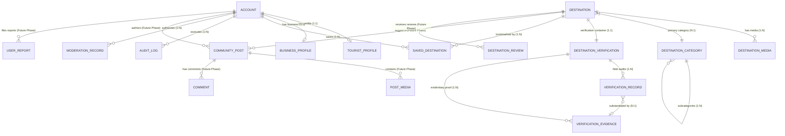

# My Travelroad — Domain Architecture & Data Models

## Executive Architecture Summary

**My Travelroad** is a tourism discovery and trip-planning platform engineered to scale from its initial regional launch in **Malappuram, Kerala** across all 14 districts of Kerala, all states of India, and internationally. 

The domain architecture addresses several key tourism requirements:
1. **Split-Identity**: Complete isolation between authentication credentials and user-facing profiles (`TouristProfile` and future `BusinessProfile`).
2. **Fact-Level Verification**: A destination's overall publication status is strictly decoupled from the verification status of its underlying factual claims (e.g. coordinates, monsoon timings, admission fees, accessibility, safety hazards).
3. **Geospatial Readiness**: Native compatibility with future PostGIS spatial indexing (`POINT(longitude latitude)` with SRID 4326), with coordinate sensitivity controls to protect fragile ecological zones, tribal settlements, and defense perimeters.
4. **Phased Lifecycle Boundaries**: Clear architectural division between **Stage A** core platform foundations (accounts, profiles, destinations, categories, verification, bookmarks, audit logs) and **Future-Phase** social interactions (community posts, reviews, likes, follows, user reports).

---

## 1. Domain Entities & Field Specifications

### 1.1 Identity & Accounts

```
+-------------------------------------------------------------+
| Account (Authentication Identity)                           |
+-------------------------------------------------------------+
  - id: AccountId (UUID, Primary Key)
  - email: string (Unique, E-mail format)
  - phone?: string | null (E.164 International phone)
  - emailVerified: boolean
  - phoneVerified: boolean
  - status: AccountStatus ('active' | 'suspended' | 'pending_verification' | 'deactivated')
  - type: AccountType ('individual' | 'business' | 'system')
  - role: UserRole ('traveler' | 'contributor' | 'curator' | 'moderator' | 'super_admin')
  - lastLoginAt?: IsoDateTimeString | null
  - createdAt: IsoDateTimeString
  - updatedAt: IsoDateTimeString
```

*Architectural Principle*: Credentials, password hashes, session tokens, and multi-factor secrets are managed strictly in the auth service layer and NEVER attached to public profiles. Privilege elevation (`curator`, `moderator`, `super_admin`) requires explicit administrative elevation recorded in the `AuditLog`.

---

### 1.2 Profiles

```
+-------------------------------------------------------------+
| TouristProfile (Public Traveler Profile)                    |
+-------------------------------------------------------------+
  - id: ProfileId (UUID, Primary Key)
  - accountId: AccountId (Foreign Key, Unique, 1:1 with Account)
  - displayName: string (e.g., 'Amina Rahman')
  - handle: string (Unique public slug, e.g., 'amina_explorer')
  - avatarUrl?: string | null
  - bio?: string | null
  - homeRegion?: string | null (e.g., 'Malappuram, Kerala')
  - preferredLanguage: string (e.g., 'en', 'ml')
  - travelPreferences: TravelPreference[]
  - isPublic: boolean
  - createdAt: IsoDateTimeString
  - updatedAt: IsoDateTimeString

+-------------------------------------------------------------+
| BusinessProfile (Future Phase: Commercial Operators)        |
+-------------------------------------------------------------+
  - id: BusinessProfileId (UUID, Primary Key)
  - accountId: AccountId (Foreign Key, Unique, 1:1 with Account)
  - businessName: string
  - registrationNumber?: string | null (e.g., DTPC or Kerala Tourism registration)
  - category: 'hospitality_homestay' | 'licensed_tour_guide' | 'water_sports_boating' | ...
  - contactEmail: string
  - contactPhone: string
  - websiteUrl?: string | null
  - physicalAddress?: string | null
  - verificationStatus: 'unverified' | 'pending' | 'verified' | 'rejected'
  - createdAt: IsoDateTimeString
  - updatedAt: IsoDateTimeString
```

---

### 1.3 Taxonomy & Categorization

```
+-------------------------------------------------------------+
| DestinationCategory (Hierarchical Taxonomy)                |
+-------------------------------------------------------------+
  - id: CategoryId (UUID, Primary Key)
  - slug: string (Unique, URL slug, e.g., 'nature-forests')
  - name: string (e.g., 'Nature & Forests')
  - shortLabel: string (e.g., 'Forests')
  - description: string
  - iconKey: string (Lucide icon identifier)
  - parentId?: CategoryId | null (Self-referencing tree foreign key)
  - displayOrder: number
  - status: CategoryStatus ('active' | 'inactive' | 'archived')
  - createdAt: IsoDateTimeString
  - updatedAt: IsoDateTimeString
```

*Hierarchy Support*: `parentId` allows subcategorization (e.g., Root: `Nature & Forests` → Subcategory: `Teak & Plantations` → Subcategory: `Eco-Walks`).

---

### 1.4 Destination Discovery

```
+-------------------------------------------------------------+
| Destination                                                 |
+-------------------------------------------------------------+
  - id: DestinationId (UUID, Primary Key)
  - slug: string (Unique, URL slug, e.g., 'nilambur-teak-reserve')
  - title: string (Primary title)
  - shortDescription: string (Card snippet / meta description)
  - fullDescription: string (Rich narrative storytelling)
  - primaryCategoryId: CategoryId (Foreign Key, Exactly 1)
  - secondaryCategoryIds: CategoryId[] (Many-to-many associations)
  - location: DestinationLocation (Embedded value object)
      * coordinates: GeoPoint (latitude, longitude, altitude, postGisPoint [lng, lat])
      * sensitivity: CoordinateSensitivity (isRestricted, publicApproximateCentroid)
      * formattedAddress: string
      * locality?: string | null (Town / village / panchayat)
      * talukOrSubdivision: string (e.g., 'Nilambur', 'Tirur', 'Eranad')
      * district: string (e.g., 'Malappuram')
      * stateOrProvince: string (e.g., 'Kerala')
      * countryCode: CountryCode (ISO 3166-1 alpha-2, 'IN')
      * postalCode?: string | null
      * nearestTransitHub?: TransitHubInfo | null
  - openingHours?: DestinationOpeningHours | null
      * type: 'always_open' | 'seasonal' | 'scheduled' | 'temporarily_closed'
      * weeklySchedule?: DaySchedule[] | null (Days 0-6 with open/close 24h times)
      * seasonalNotes?: string | null
      * entryFeePolicy: 'free' | 'paid' | 'partially_paid' | 'restricted_permit'
      * feeStructure?: AdmissionFeeStructure | null
      * advisoryNote?: string | null
  - contact?: DestinationContact | null
      * phone?: string | null
      * email?: string | null
      * officialWebsite?: string | null
      * governingAuthority?: string | null (e.g., 'DTPC Malappuram')
      * emergencyPhone?: string | null
  - accessibility?: DestinationAccessibility | null
      * wheelchairAccessible: 'fully' | 'partially' | 'not_accessible' | 'unknown'
      * parkingAvailable: boolean
      * restroomsAvailable: boolean
      * guideServicesAvailable: boolean
      * brailleOrTactilePaving: boolean
      * notes?: string | null
  - safety?: DestinationSafetyInformation | null
      * overallRiskLevel: 'low' | 'moderate' | 'high' | 'seasonal_hazard'
      * monsoonAdvisory?: string | null
      * wildlifeAdvisory?: string | null
      * waterBodySafety?: string | null
      * recommendedGear?: string[]
      * nearestHospital?: HospitalContact | null
      * nearestPoliceStation?: PoliceContact | null
  - publicationStatus: DestinationPublicationStatus ('draft' | 'submitted' | 'in_review' | 'published' | 'archived' | 'suspended')
  - featuredRank?: number | null
  - createdAt: IsoDateTimeString
  - updatedAt: IsoDateTimeString
  - publishedAt?: IsoDateTimeString | null
```

```
+-------------------------------------------------------------+
| DestinationMedia                                            |
+-------------------------------------------------------------+
  - id: MediaId (UUID, Primary Key)
  - destinationId: DestinationId (Foreign Key -> Destination)
  - type: DestinationMediaType ('image' | 'video' | 'panorama_360')
  - url: string (Asset storage URL)
  - thumbnailUrl?: string | null
  - altText: string (Screen reader text)
  - caption?: string | null
  - attribution?: string | null (Photographer / Source)
  - license: MediaLicense ('public_domain' | 'cc_by' | 'official_department_press' | ...)
  - isCover: boolean
  - displayOrder: number
  - status: 'pending_review' | 'approved' | 'rejected'
  - createdAt: IsoDateTimeString
```

---

### 1.5 Fact-Level Destination Verification

```
+-------------------------------------------------------------+
| DestinationVerification (Verification Container)            |
+-------------------------------------------------------------+
  - id: VerificationId (UUID, Primary Key)
  - destinationId: DestinationId (Foreign Key, Unique, 1:1)
  - overallStatus: VerificationStatus ('unverified' | 'in_review' | 'needs_update' | 'partially_verified' | 'verified' | 'flagged')
  - assignedCuratorId?: AccountId | null
  - lastAuditedAt?: IsoDateTimeString | null
  - nextAuditDueAt?: IsoDateTimeString | null
  - fieldStatuses: Record<VerificationField, 'verified' | 'disputed' | 'needs_update' | 'unverified'>
  - evidenceIds: EvidenceId[]
  - curatorQueueNotes?: string | null
  - createdAt: IsoDateTimeString
  - updatedAt: IsoDateTimeString

+-------------------------------------------------------------+
| VerificationRecord (Audit Entry per Fact)                   |
+-------------------------------------------------------------+
  - id: VerificationRecordId (UUID, Primary Key)
  - verificationId: VerificationId (Foreign Key)
  - destinationId: DestinationId (Foreign Key)
  - field: VerificationField ('location_coordinates' | 'opening_hours' | 'entry_fees' | 'safety_advisories' | ...)
  - status: 'verified' | 'disputed' | 'needs_update' | 'unverified'
  - verifiedBy: AccountId (Foreign Key -> Account)
  - evidenceId?: EvidenceId | null (Foreign Key -> VerificationEvidence)
  - verifiedValueSnapshotHash?: string | null (SHA-256 drift-detection hash)
  - confidenceLevel: VerificationConfidence ('official_authority' | 'on_site_inspection' | ...)
  - notes?: string | null
  - timestamp: IsoDateTimeString
  - validUntil?: IsoDateTimeString | null

+-------------------------------------------------------------+
| VerificationEvidence (Documentary / Sensor Proof)           |
+-------------------------------------------------------------+
  - id: EvidenceId (UUID, Primary Key)
  - verificationId: VerificationId (Foreign Key)
  - evidenceType: EvidenceType ('government_gazette' | 'department_circular' | 'on_site_gps_track' | 'photographic_proof' | ...)
  - documentUrl?: string | null
  - sourceOrganization: string (e.g., 'Kerala Forest Dept', 'DTPC')
  - officialReferenceCode?: string | null
  - submittedBy: AccountId (Foreign Key)
  - submittedAt: IsoDateTimeString
  - notes?: string | null
```

*Data Integrity Rule*: Whenever an editor modifies a verified field on `Destination` (e.g., changes `entryFee` or `coordinates`), the system compares the current field hash against `verifiedValueSnapshotHash`. A mismatch automatically downgrades that fact to `needs_update` without unpublishing the destination.

---

### 1.6 Saved Destinations

```
+-------------------------------------------------------------+
| SavedDestination (Wishlist Bookmarks)                       |
+-------------------------------------------------------------+
  - id: SavedDestinationId (UUID, Primary Key)
  - accountId: AccountId (Foreign Key -> Account)
  - destinationId: DestinationId (Foreign Key -> Destination)
  - collectionName?: string | null (Custom wishlist group)
  - personalNotes?: string | null (Private traveler note)
  - savedAt: IsoDateTimeString
```

*Integrity Rule*: Unique compound constraint on `(accountId, destinationId)`. An account cannot save the same destination multiple times.

---

### 1.7 Administration, Moderation & Audit Trails

```
+-------------------------------------------------------------+
| AuditLog (Immutable Operation Trail)                        |
+-------------------------------------------------------------+
  - id: AuditLogId (UUID, Primary Key)
  - actor: AuditActor (accountId, email, roleAtExecution, ipAddress, userAgent)
  - action: AdminAction ('destination.create' | 'destination.publish' | 'verification.field_verify' | 'account.suspend' | ...)
  - entityType: 'destination' | 'category' | 'verification' | 'account' | 'moderation_record' | ...
  - entityId: string
  - previousStateSnapshot?: Record<string, unknown> | null
  - newStateSnapshot?: Record<string, unknown> | null
  - contextNotes?: string | null
  - timestamp: IsoDateTimeString

+-------------------------------------------------------------+
| ModerationRecord (Curator Triage Interventions)             |
+-------------------------------------------------------------+
  - id: ModerationRecordId (UUID, Primary Key)
  - reportId?: ReportId | null
  - targetType: 'destination' | 'review' | 'community_post' | 'comment' | 'user_profile'
  - targetId: string
  - moderatorAccountId: AccountId
  - action: ModerationAction ('dismiss_report' | 'hide_content' | 'edit_content' | 'suspend_user' | ...)
  - justificationReason: string
  - internalNotes?: string | null
  - createdAt: IsoDateTimeString
```

---

## 2. Mermaid Entity-Relationship (ER) Diagram



---

## 3. Relationship Cardinalities and Ownership Rules

| Entity Relationship | Cardinality | Ownership & Cascade Rules |
| :--- | :--- | :--- |
| **`Account` → `TouristProfile`** | 1:1 | **Owned by Account**. Deleting an account cascades to its profile. Handle and Account email are independently unique. |
| **`Account` → `BusinessProfile`** | 1:1 (Optional) | **Owned by Account**. Enabled for commercial enterprise users in future phases. |
| **`Account` → `SavedDestination`** | 1:N | **Owned by Account**. Deleting an account deletes all its saves. Unique compound index `(accountId, destinationId)`. |
| **`Destination` → `DestinationCategory`** | N:1 (Primary) | **Referential Integrity**. A category cannot be hard-deleted if destinations reference it (must archive or reassign). |
| **`Destination` → `DestinationMedia`** | 1:N | **Owned by Destination**. Deleting a destination cascades to unpublishing its media gallery assets. |
| **`Destination` → `DestinationVerification`** | 1:1 | **Strict Separation**. Destination content lives in `Destination`; audit stamps and evidence live in `DestinationVerification`. |
| **`DestinationVerification` → `VerificationRecord`** | 1:N | **Historical Append-Only**. Records are immutable audit snapshots per fact field. |
| **`DestinationVerification` → `VerificationEvidence`** | 1:N | **Evidentiary Artifacts**. Files/gazettes linked to verification claims. |
| **`Account` → `AuditLog`** | 1:N | **Immutable Audit Log**. Deleting an account does NOT delete historic audit log entries (actor ID is preserved for security accountability). |

---

## 4. Lifecycle & Status State Machines

### 4.1 Destination Publication Lifecycle

```
       [ Draft ]
           │ (Submit for editorial review)
           ▼
     [ Submitted ]
           │ (Curator review starts)
           ▼
     [ In Review ] ──────── (Significant issues / rejections) ────────┐
           │                                                          │
           │ (Passes baseline editorial review)                       │
           ▼                                                          ▼
     [ Published ] ◄────────────── (Reactivated) ──────────── [ Suspended ]
           │
           │ (End of seasonal cycle or decommission)
           ▼
     [ Archived ]
```

### 4.2 Fact-Level Verification Lifecycle (Per Field)

```
   [ Unverified ] (Field submitted by contributor or preliminary draft)
          │
          │ (Evidence attached & field inspector assigned)
          ▼
    [ In Review ]
          │
     ┌────┴────────────────────────┐
     │ (Verified against evidence) │ (Discrepancy / contradicted)
     ▼                             ▼
[ Verified ]                 [ Disputed ]
     │                             │ (Curator requests corrected data)
     │ (Destination field edited)  ▼
     └──────────────────────► [ Needs Update ]
```

---

## 5. Stage A vs. Future Phase Separation

| Model / Feature Area | Implementation Phase | Classification & Usage Boundaries |
| :--- | :--- | :--- |
| **`Account` & `TouristProfile`** | **Stage A** | Core identity and traveler preferences. Active in Phase 1. |
| **`Destination` & `DestinationCategory`** | **Stage A** | Primary discovery engine, hierarchical taxonomy, and editorial storytelling. |
| **`DestinationVerification`** | **Stage A** | Granular fact audits, evidence containers, and drift detection. |
| **`SavedDestination`** | **Stage A** | Bookmarkwishlist storage with duplicate prevention. |
| **`AuditLog` & `ModerationRecord`** | **Stage A** | Operational security, privileged role tracking, and compliance trails. |
| **`BusinessProfile`** | **Future Phase** | Commercial claimed listings for tour operators, homestays, and transport. |
| **`CommunityPost` & `PostMedia`** | **Future Phase** | Social user-generated trip reports. Strictly untrusted UGC. |
| **`Comment`, `Like`, `Follow`** | **Future Phase** | Social graph connections. |
| **`DestinationReview`** | **Future Phase** | Visitor subjective feedback (1-5 stars). Decoupled from verified factual models. |
| **`UserReport`** | **Future Phase** | Community content flagging mechanism. |

---

## 6. PostGIS Geospatial Readiness & Privacy

### Coordinate Structure
Every `DestinationLocation` includes:
- `latitude` (IEEE 754 float, ±90.0)
- `longitude` (IEEE 754 float, ±180.0)
- `altitudeMeters` (optional elevation above sea level)
- `postGisPoint`: `[longitude, latitude]` standard tuple, mapped to:
  ```sql
  -- Future PostGIS mapping:
  ST_SetSRID(ST_MakePoint(longitude, latitude), 4326)::geography
  ```

### Privacy & Ecological Protection
Certain locations (e.g. vulnerable breeding sites at Kadalundi, sensitive forest settlements in Nilambur, sacred groves) require coordinate masking:
- `isRestricted: true` in `CoordinateSensitivity`.
- Public discovery APIs return `publicApproximateCentroid` (e.g., the nearest district road junction or ticketing counter) instead of raw coordinates.
- Full coordinates are only visible to authorized forest rangers or verified research curators.

---

## 7. Data Integrity Rules

1. **Email & Handle Uniqueness**:
   - `Account.email` is case-insensitively unique across the system.
   - `TouristProfile.handle` is strictly alphanumeric + underscore and unique.
2. **Duplicate Bookmark Prevention**:
   - Unique composite index on `(SavedDestination.accountId, SavedDestination.destinationId)`.
3. **No Self-Assigned Privileges**:
   - Users registering via public flows are assigned `role: 'traveler'`. Elevation to `contributor`, `curator`, `moderator`, or `super_admin` can only be performed by a `super_admin` and produces an `AuditLog` entry.
4. **Untrusted UGC Separation**:
   - No community post, comment, or review can write to or overwrite any field in `Destination` or `DestinationVerification`.
5. **No Booking / Payment Entities**:
   - Per architecture constraints, booking engines, payment gateways, and reservation models are strictly excluded from this task.

---

## 8. Architectural Assumptions & Future Clarifications

1. **Multi-Region Expansion**:
   - Location models use `countryCode: CountryCode` ('IN') and `stateOrProvince` ('Kerala') to support expansion outside Malappuram without schema changes.
2. **Database Engine Agnosticism**:
   - All domain types are represented as pure TypeScript interfaces and branded nominal types, allowing future persistence via PostgreSQL + PostGIS (Prisma / Drizzle) or document storage without domain refactoring.
3. **Audit Immutability**:
   - Audit logs are append-only. Storage layers must enforce `INSERT`-only permissions on audit collections.
